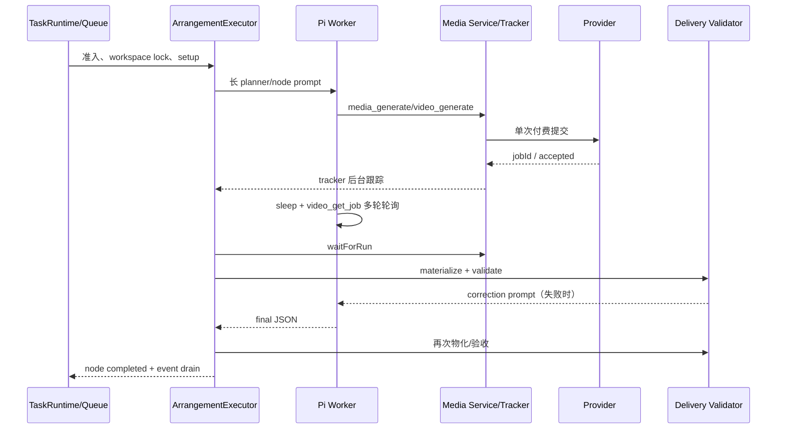
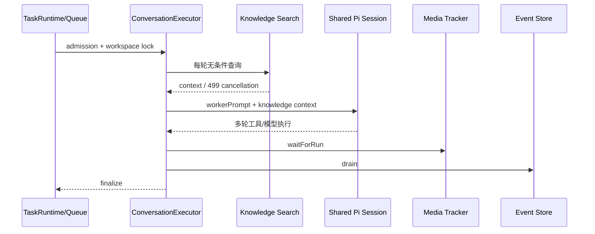

# 编排与普通会话性能优化开发文档 Implementation Plan

> **For Claude:** REQUIRED SUB-SKILL: Use superpowers:executing-plans to implement this plan task-by-task.

**Goal:** 缩短编排任务和普通会话的端到端耗时，消除媒体生成成功后的交付等待与历史任务假进行中，降低无效模型回合，并建立真实计时和可定位队列、锁、知识库、模型、工具、媒体和事件收尾耗时的完整观测链路。

**Architecture:** 保留现有 `renderer → controller → service → data/runtime → pi/sdk` 分层。媒体提交后由主进程的媒体状态机和 tracker 统一等待、保存和物化，模型只负责业务选择和摘要；普通会话增加知识库门控、上下文预算与摘要 checkpoint；两类运行统一写入阶段耗时和请求分类指标，避免把模型回合数误认为媒体生成次数。

**Tech Stack:** Electron main process、TypeScript、React renderer、Pi SDK、Zod、现有 task/media/video stores、Node test runner（`tsx --test`）及项目现有测试脚本。

---

## 1. 背景与结论

### 1.1 用户可见问题

历史任务 `bb5abb51-2725-4105-93af-21cbc7419c2a` 在 2026-10-22 16:55:48 至 17:08:30 运行约 12 分 42 秒。图片实际生成后仍继续执行检查和交付修正，视频实际只提交 1 次，但模型产生 20 次请求回合，因此界面容易显示为“视频调用了 20 次”。

### 1.2 已确认事实

- 图片节点约 2 分钟，模型请求 12 次；实际生成后继续执行 `ls`、`find`、`read`、尺寸检查、manifest 检查和交付 JSON 修正。
- 视频节点约 9 分 18 秒，`executionRounds=18`、`requestAttempts=20`、`executionRetries=2`；实际视频生成只提交 1 次，最终 `billingStatus=SETTLED`，约 28.8 CNY。
- 视频在约 17:00:33 已成功提交，模型之后自行执行多轮 `sleep 30/60/90/120/60` 和 `video_get_job`，直到约 17:08:14 才确认 `SUCCEEDED/SAVED`。
- 后台 `VideoTracker` 已经具备恢复、退避、轮询和 30 分钟预算，模型再次轮询造成双重等待。
- `onResponseSettled` 将媒体等待、交付物化、文件校验和 JSON 修正绑定到模型回合，导致生成完成后仍可能触发新模型请求。
- 编排 planner prompt 约 32,479 字符，包含员工目录、规则、完整示例、媒体规范、前置成果和交付合同，存在重复注入。
- 普通会话每轮无条件执行知识库查询；共享 Pi session 历史不断增长；恢复时会拼接全部历史。
- 每次模型请求前同步持久化请求计数；队列、workspace lock、事件 drain 缺少阶段耗时指标。

### 1.3 核心判断

“图片调用模型 12 次、视频调用模型 20 次”是模型执行回合/重试/恢复/工具后继续执行的统计，不等于 12 次图片生成或 20 次视频生成，也不等于 20 次账务扣费。优化必须同时治理实际重复工作和统计口径，不能只把计数器改小。

### 1.4 新增高优先级问题：视频长期生成中、页面停在 50%

- 补充日期：2026-10-23。历史复现任务：`b69b02ac-c7f5-4e3c-8413-1026fe9eae70`，标题“米白色陶瓷马克杯商品主图与展示短片制作”。
- 视频 job：`video_9e851634-c813-49a8-ac80-6128b8e47b2f`，本地创建时间为 2026-10-22 18:25:23，约 18:25:28 返回提交结果；实际只提交 1 次。
- 2026-10-22 18:37:39 的工具查询仍返回 `generationStatus=RUNNING`、`saveStatus=PENDING`、空输出，账务已为 `SETTLED`；当时视频节点累计约 17 次模型请求。
- 2026-10-23 再次核对本地记录：该任务最终于当天 03:30:01 完成，视频节点从 2026-10-22 18:25:07 至 2026-10-23 03:30:01 约 9 小时 5 分钟；`executionRounds=138`、`requestAttempts=147`、`executionRetries=9`，视频交付文件约 1.34 MB。完成时间不等于供应商生成完成时间，仍需按 P0.0 分解真实等待与客户端发现/交付延迟。
- 截图中的 50% 表示两个节点只完成图片节点，不是供应商视频生成进度。上述为当时日志快照，不代表 2026-10-23 的实时状态。
- 本地状态只能证明客户端当时仍看到“生成中”。必须核对原请求的服务端状态，区分供应商排队/生成慢、查询返回过期状态、客户端跟踪停滞、下载保存失败和交付收尾失败；`SETTLED` 不能作为生成成功证据。

该问题列为 **P0.0（最高优先级）**。先取得可验证的状态和时间链，再修统一跟踪、完成后自动交付及超时恢复；仅缩短超时不会缩短供应商实际生成时间。

### 1.5 新增高优先级问题：历史任务一直显示执行中、执行计时失真

**审计快照：2026-10-23 09:53（Asia/Shanghai）**。当前成员本地快照共 57 个任务：已完成 22、已中断 3、已暂停 14、待开始 15、已失败 3。此前 09:15 检查时有一个新建任务正在执行；本节仅记录上述快照，不把之后的状态变化视为异常。

15 个旧任务创建于 2026-10-15 至 2026-10-16，均为 `pending`，且 `activeRunId=null`、`startedAt=null`，无执行记录、无事件文件、无产出文件。其中红色陶瓷杯图片 9 个、苹果17电商 UI 4 个、18 手机电商 UI 2 个。复现样例为 `622efc05-8786-4ff3-a20b-96be343986af`；同类任务 `3c642093-c7b5-4ee6-879e-5713e934c54e` 已由用户手动终止，必须保留终止事实。

这些记录只能证明没有本地执行证据，无法证明历史上的具体启动错误。缺失日志时不能推断为生成失败、重复扣费或已完成。相同标题的多个任务也不能自动合并，它们可能是用户分别创建的请求。

**代码确认的原因与缺口：**

| 位置 | 当前行为 | 用户影响及优化方向 |
|---|---|---|
| `electron/runtime/task-manager.ts` 的 `createTask/admitTask` | 新建任务和已准入任务都为 `pending`，仅后者绑定 `activeRunId` | `pending` 不能单独证明已入队；增加安全的执行状态投影 |
| `electron/service/arrangement-service.ts` 的 `confirmDraft/confirmAndStart` | 先保存任务、计划和草稿绑定，再调用 `executeTask`；后续调用抛错时没有专门的启动失败记录 | 存在留下未准入 pending 的路径；这是代码风险，尚不能据此断定每个旧任务的历史原因 |
| `electron/service/task-creation-gate.ts` | 仅协调查询，不是启动互斥锁，失败集合保存在内存 | 重启后不能依赖该集合判断启动失败；重复启动需复用已有准入保护和持久化绑定 |
| `electron/runtime/task-manager.ts` 的 `setCurrentUser` | 对 running、waiting approval 和带 activeRunId 的 pending 做启动恢复；没有执行绑定的 pending 保留 | 合法未开始任务应保留，但不能继续显示正在处理；历史 run 终态也需要核对 |
| `electron/runtime/conversation-executor.ts` 的 `finalize`、`electron/runtime/task-runtime.ts` 的 `startArrangementRun` | run 结束保存、任务收尾、事件和资源释放跨多个 await；部分保存错误被忽略 | 需记录收尾失败并支持幂等修复；已有保护保留，不把所有旧问题归因于它 |
| `src/features/enterprise/work-mapping.ts` 的 `toWorkStatus` | 所有 pending 映射为 arranging | 未开始任务被误报为准备执行 |
| `src/features/enterprise/work-record-filters.ts`、`useEnterpriseWorkspace.ts` | arranging 计入进行中筛选和首页数量 | 没有执行者的旧任务长期占据进行中 |
| `src/components/enterprise/WorkTalkDrawer.tsx`、`work-process.ts` | arranging 显示正在处理/准备工作 | 用户误以为模型还在运行 |
| `src/pages/enterprise/WorkDetailPage.tsx`、`work-mapping.ts` | 起点为 createdAt，未结束时累计到现在；updatedAt 回退到 startedAt/createdAt | 截图里的 167 小时实为创建后的等待，暂停任务的耗时也可能失真 |

新增 **Task P0.6（P0 高优先级，执行顺序仅次于 P0.0）**，编号沿用现有媒体任务，避免已有任务引用失效。该任务治理普通会话和编排共用的生命周期，不以供应商生成结果作为修复前提。

## 2. 范围、非目标与成功指标

### 2.1 范围

- 编排媒体节点：图片生成、文生视频、图生视频、媒体状态等待、结果保存、交付物化和节点完成。
- 编排 planner/node prompt：固定合同压缩、增量上下文、媒体结果结构化传递。
- 普通会话：知识库查询门控和缓存、共享 session 上下文预算、恢复摘要、媒体等待和事件收尾。
- 任务运行公共链路：排队、准入、workspace lock、setup、provider、tool、media、delivery、event drain 的耗时指标。
- 请求次数分类：执行、工具后继续、交付修正、网关重试、上下文恢复、压缩，不再把这些直接展示为媒体生成次数。
- 任务生命周期：创建与准入分离、启动失败记录、当前运行与历史终态核对、用户终止保护、进行中列表和真实计时。

### 2.2 非目标

- 不更换图片/视频供应商或服务端生成协议。
- 不复制供应商账务、receipt 或计费权威记录。
- 不改变现有 `@earendil-works/pi-coding-agent`、`@earendil-works/pi-ai` 版本。
- 不把绝对路径、供应商 URL、refresh token、完整 prompt 或原始错误传给 renderer。
- 不删除用户已有媒体闭环、预览、授权和交付改动。

### 2.3 成功指标

以发布前基线任务和普通会话回归集为样本，至少满足：

| 指标 | 目标 |
|---|---|
| 生成完成到主进程确认完成 | P95 ≤ 5 秒；不再依赖模型 `sleep` 轮询 |
| 单个媒体 job 的实际提交数 | 同一幂等键最多 1 次；恢复不重复提交 |
| 视频长等待可解释性 | 显示排队、生成、下载/保存、交付阶段、最后成功查询时间和超时提示；未确认的服务端进度不得推测 |
| 原视频任务恢复 | 超时、重启和连续点击“继续查询原任务”均复用原请求，新增生成提交数为 0 |
| 未开始任务展示 | 上述 15 个无执行证据的 pending 显示“未开始/尚未启动”，不显示正在处理，不计入进行中 |
| 执行计时准确性 | 无 startedAt 时执行时长为未知或未开始；创建等待、排队、运行和暂停分别计算，不再显示虚假的 167 小时 |
| 启动失败及孤儿运行收敛 | 新任务注入启动异常后保留原因且可重试；确认失去执行者的任务在一个核对周期内退出运行展示；正常排队/建仓不误判 |
| 用户终止和历史恢复 | 已终止任务不被迟到事件或旧 run 重新激活；状态修复产生的模型、工具和媒体提交数均为 0 |
| 编排媒体节点模型轮数 | 相同输入下比基线减少大多数轮询/校验回合；交付校验不超过必要修正次数 |
| 普通会话无关知识库等待 | 无检索意图时 0 次查询；有检索意图时查询可并行或受预算约束 |
| 普通会话上下文 | 输入 token/消息数始终受配置预算控制；恢复不拼接全部历史 |
| 阶段观测完整度 | 任务 100% 记录 queued、admission、lock、setup、provider、tool、media、delivery、drain 时间 |
| 请求统计可解释性 | UI/API 明确区分 model request、media submission、media polling、billing event |

## 3. 当前链路与耗时位置

### 3.1 编排链路



问题在于 `P` 和 `M` 同时负责等待媒体；`D` 又绑定模型响应结束，生成成功后的等待和交付检查被串到模型回合里。

### 3.2 普通会话链路



普通会话还受到共享 session 历史膨胀影响；session 损坏恢复时会将全部用户/助手消息重新拼进 prompt。

## 4. 总体设计

### 4.1 媒体主进程状态机

增加任务内媒体阶段状态，至少包含：

```ts
type MediaRunPhase =
  | 'idle'
  | 'submitting'
  | 'submitted'
  | 'tracking'
  | 'succeeded'
  | 'materializing'
  | 'delivered'
  | 'failed'
  | 'cancelled'
```

流程：

1. 生成工具只负责授权、报价、审批和幂等提交，返回 `jobId`。
2. 主进程记录 `taskId + nodeRunId + mediaOperation + idempotencyKey + jobId`。
3. tracker 统一负责退避轮询、恢复和最终保存。
4. tracker 达到 `SUCCEEDED/SAVED` 后，主进程自动生成安全的 `MediaArtifactSummary`。
5. 编排执行器进入 `waiting-media`，不让模型调用 `sleep` 或 `video_get_job`。
6. 交付物化由主进程根据计划中的 `deliverableId` 进行，模型只提交资产选择或摘要。
7. 只有主进程无法完成业务选择时，才恢复模型一次；恢复提示只包含失败字段和结构化错误。

### 4.2 主进程 delivery envelope

将自由文本交付 JSON 收敛为结构化提交：

```ts
type ArrangementDeliveryEnvelope = {
  version: 1
  nodeId: string
  nodeRunId: string
  summary?: string
  selections: Array<{
    deliverableId: string
    artifactId?: string
    sourcePath?: string
  }>
  generatedAt: string
}
```

`deliverableId`、目标相对路径、媒体类型、哈希、文件大小和保存状态由主进程校验或生成。模型不能提交绝对路径、供应商 URL 或猜测的 artifact ID。旧计划仍支持工作区文件交付。

### 4.3 普通会话 context budget

新增会话上下文预算配置：

```ts
type ConversationContextBudget = {
  maxInputTokens: number
  maxMessages: number
  recentMessageWindow: number
  summaryTriggerRatio: number
  maxKnowledgeChars: number
}
```

达到阈值时生成摘要 checkpoint，后续请求只注入：`conversation summary + 最近消息窗口 + 当前用户消息 + 必需工具状态`。恢复只读取摘要和最近窗口；不再拼接全部历史。

### 4.4 Knowledge gate/cache

知识库查询前增加轻量意图判断：用户明确询问公司资料、项目知识、历史文档或要求检索时才查询。相同任务、相同规范化 query、相同知识库版本在短时间内复用缓存。查询失败或取消时保留模型首轮执行，不阻塞无关会话。

### 4.5 公共 telemetry

每个 run 记录统一阶段字段：

```ts
type RunTiming = {
  queuedAt: number
  admittedAt?: number
  workspaceWaitMs?: number
  setupMs?: number
  knowledgeMs?: number
  providerMs?: number
  toolMs?: number
  mediaWaitMs?: number
  deliveryValidationMs?: number
  eventDrainMs?: number
  totalMs?: number
}
```

请求统计另外记录：`modelRequestCount`、`executionRounds`、`executionRetries`、`recoveryCount`、`compactionCount`、`mediaSubmissionCount`、`mediaPollCount`、`billingEventCount`。UI 默认展示分类后的摘要，不把 `modelRequestCount` 命名为“图片/视频调用次数”。

### 4.6 生命周期事实投影、状态核对和计时

**复用现有 TaskStatus，不立即新增一组持久化任务状态。** 先在主进程提供可选的 renderer-safe `executionState` 投影，区分 `not-started`、`queued`、`starting`、`running`、`waiting-approval`、`waiting-media`、`finalizing`、`inactive`、`unknown`。另加 `health`：`normal`、`start-failed`、`needs-reconciliation`。这是执行事实投影，与已有 `workType` 的任务类型投影分开，不能把执行状态缓存为不可变类型。

最小持久化字段建议为 `stateRevision`、`updatedAt`、`lastStartAttemptAt`、`startFailureCode`、`lastRunId`、`stoppedAt/stopReason`；准入后保存 `queuedAt`。新增字段使用 Zod/现有解析边界，`TaskStore.parseTask` 必须显式读取并在重启后保留，缺失字段保持未知。

证据按职责使用：TaskManager 保存用户意图和当前绑定；RunQueue、启动登记、WorkerRegistry、activeArrangements 以及 P0.0 媒体等待登记证明当前进程的执行归属；TaskRunStore 保存已执行回合；编排最终完成还需对应 checkpoint 和交付验收。平台 monitor 的 snapshot/heartbeat 是镜像，不是本地执行者证据。

核对由 runtime 发起，service 使用注入端口，data 只读写文件。任务列表读取只投影，不启动、修复或重放任务。启动恢复和有界的运行巡检才执行状态修复：先取 scope generation、taskId、activeRunId、revision，再在写入前重新验证；过时观察直接丢弃。队列取出到 worker 注册之间增加明确的 starting 登记，整个 finally 收尾期间保持 finalizing 登记，防止正常过渡被误判成失联。

**判定不能只看时间：** 没有文本事件不代表 worker 死亡，审批、长工具和 waiting-media 均为合法等待。巡检记录最后活动和阶段预算；超过阈值先标记疑似异常并诊断，只有确认运行归属消失或阶段超时控制已完成中断，才能写终态。周期和宽限阈值可配置，使用测试时钟验收。

**计时口径：** createdAt 是创建时间；queuedAt 至 startedAt 是排队/启动等待；startedAt 至该 run 的 endedAt 是本轮运行耗时，包含可分解的审批/媒体等待；暂停和重试间隔不计为运行。多轮任务累计只汇总顶层 run 的运行区间，编排并行节点不累加到父任务耗时；区间重叠时求并集。旧记录没有可信时间时展示未知，不以创建时间或重启时刻伪造实际运行结束时间。

## 5. 分阶段开发任务

以下任务按 P0/P1/P2 排序，**P0.0 为最高优先级，P0.6 为生命周期第二优先级，均先于 P1/P2**。P0.6 可以在 P0.0 调查原媒体状态期间独立实施，不等待全部媒体优化；为保留已有引用，不重排任务编号。每个任务都应先写失败测试，再实现最小改动，再运行针对性测试；不要在同一提交混入无关重构。

### P0：媒体等待、自动交付和任务生命周期

#### Task P0.0：视频长等待诊断、统一跟踪与超时恢复（最高优先级）

**目标：** 用户能知道视频等在哪一步；供应商完成后客户端及时查询、保存和交付；长等待与恢复不会触发重复生成或再次付费。

**Files:**
- Modify: `electron/service/video-service.ts`（原请求查询、补存和恢复）
- Modify: `electron/service/video-tracker.ts`（跟踪去重、退避、预算结束原因）
- Modify: `electron/service/video-run-service.ts`（run 等待和恢复结果）
- Modify: `electron/domain/video-media.ts`、`electron/data/video-store.ts`（必要的持久化诊断字段）
- Modify: `electron/runtime/arrangement-executor.ts`、`electron/service/arrangement-media-service.ts`（复用 P0.2/P0.3/P0.4）
- Modify: `electron/runtime/conversation-executor.ts`（普通会话使用同一跟踪和超时语义）
- Modify: `electron/controller/routes/video.ts`、`src/shared/types.ts`（复用原任务恢复接口、安全状态投影）
- Modify: `src/components/workspace/ArrangementMediaPanel.tsx`、`src/pages/enterprise/WorkDetailPage.tsx`（阶段与恢复入口）
- Test: `electron/service/video-tracker.test.ts`、`electron/service/video-service.test.ts`、`electron/service/video-run-service.test.ts`
- Test: `electron/runtime/arrangement-media-e2e.test.ts`、`src/pages/enterprise/WorkDetailPage.test.tsx`

**Steps:**

1. 用现有 scope-aware 查询/恢复入口核对上述原 job，关联本地 jobId 和服务端请求身份，记录提交、各次查询、服务端状态变化、结果下载、保存和交付时间。诊断只查询原请求，禁止重新报价、重新提交或通过重新生成验证问题；如果权限或服务端信息不足，记录“未确认”，不得直接定性为供应商故障。
2. 为 tracker 记录 `lastQueryStartedAt`、`lastQuerySucceededAt`、`lastRemoteStatusChangedAt`、`nextPollAt`、查询失败次数和本轮结束原因；区分“查询成功但状态没变”和“查询没有成功”。服务端提供的时间字段才可用于计算真实排队/生成时长，缺失时只记录客户端观测区间。
3. 将同一原请求的自动跟踪合并，复用现有退避、服务端 `pollAfterMs` 和 30 分钟跟踪预算。`video_get_job` 的本地快照读取不视为一次成功远端查询；模型不再通过 `bash sleep` 承担媒体等待。保留首次能力/资产查询以及其他必要工具用途。
4. 分别配置单次查询超时、长等待提示阈值和一轮跟踪预算；参数通过现有配置机制管理。长等待时显示“视频生成耗时较长”；查询连续失败时显示查询异常；预算耗尽时持久化可恢复的暂停原因并结束本轮等待，不能把本地超时写成供应商生成失败，也不能用新一轮 `track()` 无限重置同一次等待的预算。
5. 主进程查询到成功后按 `download → SAVED → materialize → validate → node completed` 自动推进，复用 P0.2/P0.3。供应商成功但下载失败进入补存恢复；保存成功但交付失败进入交付恢复，两者都复用原资产和请求。
6. 界面保留整体节点进度，同时显示视频的排队、生成、下载/保存或交付阶段，以及最后成功查询时间。超时后提供“继续查询原任务”；通过现有 `resume(taskId, jobId)` 路径开启受预算约束的新跟踪轮次，连续点击合并。页面只读刷新不触发恢复。
7. 将 waiting-media、暂停原因、原 job 绑定与所需时间信息持久化，普通会话和编排共用服务语义。重启后恢复原查询/补存/交付；停止本地等待不意味着取消供应商任务，也不推断退款。

**验收场景：**

- **服务端仍在排队/生成：** 界面准确展示等待阶段与查询时间；超过提示阈值可见长等待原因，预算耗尽后可恢复；实际生成提交保持 1 次。
- **服务端已成功、本地仍是生成中：** 下一次按服务端允许间隔进行的查询发现成功后，自动保存和交付，不等待模型下一轮 `sleep`。分别记录查询发现延迟、下载耗时和交付耗时，不能把大视频下载时间算作模型额外等待。
- **下载或交付失败：** 只补存或重新物化，复用源 asset/job；错误和可恢复步骤可见。
- **查询失败/超时/重启：** 继续查询原 job，新增生成提交数为 0；重复恢复不会并行启动多个同请求 tracker。
- **账务已结算但未生成：** 显示“生成中”和已结算的账务状态，不宣称视频成功，不触发重复生成。
- **普通会话生成视频：** 与编排使用相同查询、长等待提示和恢复规则，避免只修编排详情。

**Run（模拟服务端，禁止在回归测试中真实付费生成）：**

```bash
npx --no-install tsx --test electron/service/video-tracker.test.ts electron/service/video-service.test.ts electron/service/video-run-service.test.ts electron/runtime/arrangement-media-e2e.test.ts
npx --no-install tsx --test src/pages/enterprise/WorkDetailPage.test.tsx
npm run test:invariants
npm run typecheck
npm run check:boundaries
```

**Expected:** 长时间 `QUEUED/RUNNING`、状态查询失败、成功补存、超时恢复和重启路径均通过；每个原请求只提交 1 次，恢复不新增付费提交。实施记录包含上述复现任务的状态核对结论及各阶段时间；无法取得服务端证据时明确保留未确认项。

**依赖与实施顺序：** P0.0 是首要交付项；完成原任务核对和必要的查询计时后，依次实施 P0.1 → P0.2 → P0.3/P0.4，再验收本任务的界面提示与恢复闭环。不另造第二套 tracker，不等待全部 P1 telemetry 或 P2 请求分类完成。

#### Task P0.1：定义媒体运行状态和幂等键

**Files:**
- Modify: `electron/domain/arrangement-media.ts`
- Modify: `electron/domain/video-tools.ts`
- Modify: `electron/domain/media.ts`（仅在现有类型需要共享字段时）
- Test: `electron/domain/arrangement-media.test.ts`（若不存在则创建）

**Steps:**

1. 增加 `MediaRunPhase`、`MediaArtifactSummary`、`MediaRunIdentity`，保留旧状态解析兼容。
2. 定义 `owner + taskId + nodeRunId + operation + inputHash` 的稳定幂等键生成函数。
3. 明确 `mediaSubmissionCount` 与 `modelRequestCount` 为不同字段。
4. 测试同一输入生成同一幂等键，重试输入变化时键变化；未知旧状态解析为可恢复状态而不是重新提交。

**Run:** `npm run test:tasks -- arrangement-media`

**Expected:** 新类型和幂等键测试通过，旧媒体任务 fixture 仍能解析。

#### Task P0.2：让 tracker 成为唯一媒体等待方

**Files:**
- Modify: `electron/service/video-run-service.ts:150-169`
- Modify: `electron/service/media-service.ts`（复用现有图片 tracker 的等待入口）
- Modify: `electron/runtime/arrangement-executor.ts:450-493,577-580`
- Test: `electron/service/video-run-service.test.ts`
- Test: `electron/runtime/arrangement-media-e2e.test.ts`

**Steps:**

1. 为媒体 run 增加 `submitted/tracking/succeeded/failed` 事件或可查询快照。
2. `waitForRun` 只等待已注册 job；重复调用返回同一结果，不重复报价、提交或账务操作。
3. 编排执行器在提交成功后写入 `waiting-media` checkpoint，暂停模型驱动的轮询。
4. 屏蔽或拒绝编排模式下的 `sleep`、`video_get_job` 轮询建议；保留普通会话已有工具兼容，但由主进程结果驱动结束。
5. 增加测试：提交 1 次、tracker 轮询若干次、`waitForRun` 调用多次仍只有 1 个 submission；完成后直接返回 `SUCCEEDED/SAVED`。

**Run:** `npm run test:tasks -- video-run-service arrangement-media-e2e`

**Expected:** 相同 job 多次等待幂等，视频成功后无需新模型轮次即可进入交付。

#### Task P0.3：主进程自动物化媒体交付

**Files:**
- Modify: `electron/runtime/arrangement-executor.ts:491-530`
- Modify: `electron/service/arrangement-media-service.ts`
- Modify: `electron/data/arrangement-media-files.ts`
- Modify: `electron/data/arrangement-delivery-files.ts`
- Test: `electron/data/arrangement-media-files.test.ts`
- Test: `electron/data/arrangement-delivery-files.test.ts`
- Test: `electron/runtime/arrangement-media-e2e.test.ts`

**Steps:**

1. 将模型响应解析为 `ArrangementDeliveryEnvelope`；只允许计划中已存在的 `deliverableId`。
2. 主进程根据计划交付物类型、资产 ID 和工作区相对路径完成物化、流式哈希和原子 rename。
3. 同源同哈希重复物化直接复用；目标文件不同则返回明确冲突；失败不重新提交媒体 job。
4. 成功后一次性保存 `finalFiles`、源资产 ID、哈希和验收状态。
5. 只有 envelope 缺失必要业务选择时才构造一次短 correction prompt；禁止把文件检查细节和完整计划再次注入。

**Run:** `npm run test:tasks -- arrangement-media-files arrangement-delivery-files arrangement-media-e2e`

**Expected:** 图片/视频保存成功后在秒级完成交付；重复恢复不会产生新媒体提交；越界路径和错误媒体类型仍被拒绝。

#### Task P0.4：增加 waiting-media checkpoint 和恢复语义

**Files:**
- Modify: `electron/domain/arrangement-execution.ts`
- Modify: `electron/runtime/arrangement-executor.ts`
- Modify: `electron/service/arrangement-service.ts`
- Test: `electron/runtime/arrangement-executor.test.ts`（或现有 arrangement runtime 测试）

**Steps:**

1. 增加 `waiting-media` 节点/编排状态和 `mediaWaitStartedAt`、`jobIds`、`deliveryEnvelope`。
2. 应用退出或暂停时保存状态；恢复时优先 `track existing job → materialize → validate`。
3. 仅在原 job 不存在且明确允许重试时重新提交；默认恢复不重做、不重复扣费。
4. 为取消、超时、账务 pending、部分成功和 tracker 失败分别定义终态映射。

**Run:** `npm run test:invariants && npm run test:tasks -- arrangement-executor`

**Expected:** 中断/恢复、重复恢复、取消和失败路径状态稳定且不重复提交。

#### Task P0.6：历史任务假进行中、启动失败收尾和执行计时（P0 高优先级）

**执行位置：** 紧随 P0.0，先于 P1/P2。保留 P0.1 至 P0.4 媒体任务编号；本任务的 UI 修正及启动失败记录不依赖完整媒体状态机，waiting-media 归属检测与 P0.0/P0.4 联动。

**交付结果：** 历史未开始任务不再冒充正在执行；启动异常有记录，执行失联有可恢复状态；已完成但快照未更新的任务可以根据匹配证据修复；用户终止保留；等待时间与执行时间分开。

**Files：**

- Modify: `src/shared/types.ts`、`electron/data/task-store.ts`、`electron/data/task-run-store.ts`（可选生命周期、revision、时间与原运行绑定字段，旧数据兼容解析）。
- Create: `electron/domain/task-lifecycle.ts`、`electron/domain/task-lifecycle.test.ts`（纯状态分类与修复决策，不能依赖 runtime/store）。
- Modify: `electron/runtime/task-manager.ts`、`electron/runtime/task-runtime.ts`、`electron/runtime/conversation-executor.ts`、`electron/runtime/run-types.ts`、`electron/runtime/run-queue.ts`、`electron/runtime/run-workers.ts`（启动登记、收尾、状态核对）。
- Modify: `electron/service/arrangement-service.ts`、`electron/service/task-service.ts`、`electron/service/task-creation-gate.ts`（开始请求、失败记录和只读投影；creation gate 保持查询协调职责）。
- Modify: `electron/controller/routes/task.ts`、`electron/controller/routes/conversation.ts`、`electron/controller/ipc-contract.test.ts`（新增字段在边界校验；优先复用查询/重试入口）。
- Modify: `src/features/enterprise/types.ts`、`src/features/enterprise/work-mapping.ts`、`src/features/enterprise/work-record-filters.ts`、`src/features/enterprise/work-process.ts`、`src/features/enterprise/vocabulary.ts`、`src/features/enterprise/useEnterpriseWorkspace.ts`、`src/features/enterprise/task-read-cache.ts`（生命周期映射、操作条件和版本比较）。
- Modify: `src/pages/enterprise/WorkDetailPage.tsx`、`src/components/enterprise/WorkTalkDrawer.tsx`、`src/components/workspace/TaskCenterHomePage.tsx`（真实阶段、计时、首页及会话等待状态）。
- Test: `electron/data/task-store.test.ts`、`electron/data/task-run-store.test.ts`、`electron/runtime/task-runtime.test.ts`、`electron/runtime/defect-regressions.test.ts`、`electron/runtime/concurrency-invariants.test.ts`、`electron/runtime/arrangement-resume.test.ts`。
- Test: `electron/service/arrangement-service.test.ts`、`electron/service/task-service.test.ts`、`electron/service/task-creation-gate.test.ts`、`electron/service/client-monitor-history-service.test.ts`。
- Test: `src/features/enterprise/work-mapping.test.ts`、`src/features/enterprise/work-record-filters.test.ts`、`src/features/enterprise/work-process.test.ts`、`src/features/enterprise/task-read-cache.test.ts`、`src/pages/enterprise/WorkDetailPage.test.tsx`。

**步骤 A：先定义分类与修复规则，复现 15 个旧 pending。**

1. 把 1.5 节中的无运行证据任务做成脱敏 fixture；读取现有纯分类输入，新增 `executionState`/`health` 断言。原始失败原因缺失时展示“尚未启动，未记录原因”，不标为已失败或已完成。
2. 为正常新建任务、真实排队、starting、running、审批、waiting-media、finalizing、用户暂停和未知投影分别写测试；生命周期和 workType 独立。
3. 执行 `npx --no-install tsx --test electron/domain/task-lifecycle.test.ts`，先验证新增断言失败，再实现不访问 IO 的分类/修复策略使其通过。

**步骤 B：记录开始意图，处理创建成功但启动失败。**

1. 在 `confirmAndStart`、`TaskService.execute` 和普通会话继续执行路径进入准入前，保存本次 start attempt 身份、时间和 scope generation；`confirmDraft` 单独调用合法保留未开始状态。
2. 授权、runtime 动态加载或准入失败且本次请求没有成为当前运行时，保存 `startFailureCode`、脱敏原因、失败时间并通知 renderer；复用原任务和已确认计划。可保留 `pending + health=start-failed`，不扩大 TaskStatus 枚举，仅由显式重新开始流程清除该错误。
3. 同一已确认草稿的重复点击复用绑定的 task；对同一 task 的启动请求用现有准入锁/CAS，冲突请求不得把已获准入的另一运行标记失败。不同草稿不按标题或 prompt 自动合并。
4. 测试依次注入授权失败、runtime 加载失败、准入持久化失败及两个并发开始请求；验证原 task/plan 保留、原因可见、重复点击最多一条准入。记录失败本身落盘失败时返回持久化异常，不能假报记录已成功。

**步骤 C：完善准入、执行收尾与受控核对。**

1. 在 `admitTask` 至 `RunQueue.push` 及 `queue.take` 至 worker 注册间明确登记 pending-start/starting，并与 activeRunId 匹配。不得新增依靠重新执行来修复的第二个队列。
2. 为 worker 建仓、run 写入、事件 drain、run.finish、task.settle 等收尾边界写故障注入；run 终态、任务状态、资源释放分别尝试，单个写入/finishRun/dispose 失败不能阻止完成信号、workspace lock 释放和下一项调度。失败项留下可追踪修复需求及错误，禁止用空 catch 吞掉状态失败。
3. 扩展现有启动恢复：改变旧 activeRunId 前保留 expected run 绑定；先核对匹配的顶层 run 终态与编排 checkpoint，再处理没有终态的旧运行。普通会话父 run completed 可以证明本轮结束；编排只见子节点 completed 不够，需父运行完成及最终交付/确认条件成立。
4. runtime 增加有界巡检，批量检查本 scope 活跃条目及待修复条目；无事件只是告警，只有确认不在 queue/starting/worker/arrangement/media/finalizing 且超过过渡宽限才标记失联。正常锁等待、用户审批及媒体等待不能被统一空闲超时判失败。
5. 核对使用 `generation + taskId + expectedRunId + stateRevision` 做原子写前复查；最终结果与清除 activeRunId 一起提交。修复前若用户终止、任务删除/归档、scope 切换或新 run 启动，立即放弃旧修复。多次扫描无额外修改/日志，也不调用 worker/tool/媒体生成。
6. 测试收尾失败后重启、重复扫描、暂停与扫描交错、扫描时新 run 进入、启动间隙、scope 切换、父子编排终态不一致，确保既可收敛又不误判。

**历史与实时决策表：**

| 证据组合 | 展示/修复结果 | 禁止动作 |
|---|---|---|
| pending，无 activeRunId/run/事件/文件 | 投影未开始，保留合法 pending；有本次失败记录则显示启动失败 | 不因年代久远强改失败；不计入进行中；不自动启动 |
| 有 activeRunId，run 尚未写入，但 queue/starting 登记匹配 | 排队/启动中，展示等待原因和时间 | 不因没有 run 文件清空正常准入 |
| 当前 run 与归属均存在，等待审批/媒体/工具 | 展示对应阶段，超期先诊断 | 不以缺少 token/工具事件认定死亡 |
| 当前或恢复前 run 身份匹配，顶层 run 已结束，任务仍为活动状态 | 按可验证最终结果修复；编排再查 checkpoint/交付，stopped 对应 waiting-user 时保留用户确认入口 | 不用任意历史 completed 或子节点成功覆盖新 run |
| 活动绑定失去执行者，经宽限及重新核对确认 | 中断并记录失联原因，清理对应准入；允许显式恢复 | 不重放工具或重新提交媒体 |
| 用户已暂停/终止，或任务删除/归档 | 保留用户控制事实、现有产物；只修复对应旧 run 清理 | 不被迟到 completed/旧 heartbeat 恢复执行或复活记录 |
| 状态/时间文件损坏或证据不匹配 | 状态待核对、原因未知，保留诊断 | 不根据有文件/账务已结算/时间久来宣告完成 |

**步骤 D：修正列表、会话提示与操作入口。**

1. 从主进程 projection 映射 WorkItem，新增必要的未开始、启动失败和状态待核对展示；`arranging` 只表达真实队列/启动准备，不能再靠 `pending` 单字段决定活动状态。更新 vocabulary 的类型映射及所有状态分支。
2. 工作记录、首页 active 数、员工工作中标识采用统一判断：真实排队/starting/running/finalizing 算活动；审批/用户确认保留现有“待我处理”入口；未开始、启动失败和已停止不算正在执行。媒体等待与 P0.0 一致。
3. 未开始显示“尚未启动”；启动失败显示脱敏原因和“重新开始”，该命令复用任务并重新授权；未知状态显示查询失败及只读刷新入口。用户主动恢复才调用现有执行/重试，不在 UI 渲染或列表刷新中自动开始。
4. 按 scope + stateRevision + runId 合并快照，迟到列表/查询不能覆盖已经收到的终态或新 run；同 run 的暂停后迟到消息可以保留内容，但不能改为正在回复。旧 snapshot 无 revision 时采用保守兼容规则并安排只读查询，不用任务类型不可变缓存存 executionState。

**步骤 E：修正本轮和累计耗时。**

1. WorkItem 保留 startedAt、queuedAt、当前/最后顶层 run、真实结束时间和可选累计运行区间；`updatedAt` 表示更新时间，不能再作为万能结束时间。任务暂停/停止也需要 stoppedAt 或对应 run endedAt。
2. 无 startedAt 显示“尚未开始/执行时长未知”；排队可显示等待时长；有真实当前运行才启动执行计时，进入停止/完成/失联状态后停止增长。有限定媒体等待阶段仍可计入该 run 并单独解释。
3. 已结束本轮按 endedAt - startedAt；累计汇总顶层运行区间，不计重试间隔、暂停和进程退出后的无执行区间。编排并行子 run 不重复相加。崩溃时间无证据时只能标记时长未知/下界，不能使用重启时刻补成“运行了七天”。
4. 固定时钟测试：无启动时间且创建七天的任务不含“已运行 167 小时”；运行两分钟、暂停一天、恢复一分钟的累计为三分钟；旧终态、时区、非法负间隔、并行节点重复计时和暂停无 endedAt 均覆盖。

**步骤 F：诊断与灰度验收。**

1. 开发环境用 fixture 与故障注入测试，不更改正在执行的真实任务；首次启用只读审计。历史 15 个 pending 首先只改变准确展示，无充分失败证据则保留原始状态。
2. 输出每个修复的 taskId、expectedRunId、旧/新状态、证据类型、规则版本、原因码和审计时间；脱敏，不打印完整 prompt、凭据和媒体 URL。未执行任何任务/工具/媒体生成是专项验收指标。
3. 灰度开启条件明确的状态收敛；确保手动终止记录、归档删除标记及恢复入口不被覆盖。monitor 同步仅反映已持久化事实，409/旧 heartbeat 不能反向改变本地执行状态；本任务不扩展为平台协议重做。

**Run（下列是实施后的验收命令，本次仅写文档，不代表已执行）：**

```bash
npx --no-install tsx --test electron/domain/task-lifecycle.test.ts electron/domain/task-state-machine.test.ts electron/data/task-store.test.ts electron/data/task-run-store.test.ts electron/service/arrangement-service.test.ts electron/service/task-service.test.ts electron/service/task-creation-gate.test.ts
npx --no-install tsx --test src/features/enterprise/work-mapping.test.ts src/features/enterprise/work-record-filters.test.ts src/features/enterprise/work-process.test.ts src/features/enterprise/task-read-cache.test.ts src/pages/enterprise/WorkDetailPage.test.tsx
npm run test:invariants
npm run typecheck
npm run check:boundaries
```

修改启动恢复逻辑或运行加载边界时，补跑 `npm run poc:01` 至 `npm run poc:04` 和 `npm run build`。上述单测使用现有 `tsx --test`/Node 测试框架；不是给 `npm run test:tasks -- 名称` 传伪过滤参数。新增生命周期测试在落地后再执行。

**Expected:** 15 个历史未开始 fixture 无活动动画、无虚假执行计时；真实排队/运行/审批/媒体等待正常；启动失败和终态写入失败可追踪、可幂等收敛；手动停止、scope 切换、新运行和归档不被过时核对覆盖；修复产生 0 次模型、工具和媒体提交。若原始失败证据不足，验收记录保留未知原因。

### P1：普通会话和公共运行时性能

#### Task P1.1：增加统一阶段计时和请求分类

**Files:**
- Modify: `electron/runtime/task-runtime.ts:576-630`
- Modify: `electron/runtime/run-queue.ts`
- Modify: `electron/runtime/workspace-lock-manager.ts`
- Modify: `electron/runtime/run-events.ts`
- Modify: `electron/runtime/conversation-executor.ts`
- Modify: `electron/runtime/arrangement-executor.ts`
- Modify: `electron/pi/sdk/model-request-tracker.ts`
- Modify: `electron/pi/sdk/pi-coding-agent-adapter.ts:854`
- Test: `electron/runtime/task-runtime.test.ts`
- Test: `electron/runtime/run-events.test.ts`

**Steps:**

1. 在入队、准入、锁获取、setup、provider、tool、media wait、delivery、event drain 入口采集单调时钟。
2. 将计时写入安全的 task/run 摘要；日志使用 `runId/taskId/nodeRunId/stage/durationMs`，禁止完整 prompt 和 secret。
3. 将 `modelRequestCount`、`executionRounds`、`executionRetries`、`recoveryCount`、`compactionCount` 与媒体提交/轮询/账务事件分开。
4. 测试正常、排队、锁等待、取消和异常路径都能结束计时，不产生负数或重复结束。

**Run:** `npm run test:invariants && npm run test:tasks -- task-runtime run-events`

**Expected:** 每条运行记录都能解释总耗时，事件 drain 和锁等待不再隐藏。

#### Task P1.2：知识库查询门控、缓存和取消降级

**Files:**
- Modify: `electron/runtime/conversation-executor.ts:205-214`
- Modify: `electron/domain/conversation-context.ts`
- Create/Modify: `electron/runtime/knowledge-query-gate.ts`
- Test: `electron/runtime/conversation-executor.test.ts`
- Test: `electron/runtime/knowledge-query-gate.test.ts`

**Steps:**

1. 实现无网络的轻量 gate：根据用户请求中检索/引用知识库/公司资料/历史文档等意图及显式工具选择判断是否查询。
2. 对规范化 query、scope、knowledge version 设置短 TTL 缓存和并发去重。
3. 查询取消、499 或服务异常时记录 `knowledgeMs` 和降级原因，继续首轮模型执行；仅在明确要求强制检索时失败。
4. 限制注入模型的知识内容字符数，保留来源 ID/标题等可追溯摘要。
5. 测试无检索意图 0 次查询、同 query 复用、取消不阻塞、强制检索错误可见。

**Run:** `npm run test:tasks -- conversation-executor knowledge-query-gate`

**Expected:** 普通聊天不再每轮等待无关知识库；需要检索时保持可解释和可追溯。

#### Task P1.3：共享会话上下文预算和摘要 checkpoint

**Files:**
- Modify: `electron/runtime/conversation-executor.ts:447-486`
- Modify: `electron/pi/sdk/pi-shared-session.ts`
- Modify: `electron/domain/conversation-context.ts`
- Modify: conversation persistence store（按现有实现定位）
- Test: `electron/runtime/conversation-executor.test.ts`
- Test: `electron/pi/sdk/pi-shared-session.test.ts`

**Steps:**

1. 统计消息数、估算输入 token、session 文件大小和恢复次数。
2. 在达到 `maxInputTokens`、`maxMessages` 或文件大小阈值前生成摘要 checkpoint；摘要生成失败时保留最近窗口并记录降级。
3. worker prompt 使用摘要 + 最近消息窗口 + 当前请求；移除无界 `listMessages()` 全量拼接。
4. session 损坏恢复只使用摘要和最近窗口，不重放工具操作。
5. 测试长会话压缩、恢复、摘要缺失、用户取消和多轮并发隔离。

**Run:** `npm run test:tasks -- conversation-executor pi-shared-session && npm run test:invariants`

**Expected:** 长会话输入长度稳定在预算内，恢复耗时不随历史消息线性增长。

#### Task P1.4：请求计数异步批量持久化

**Files:**
- Modify: `electron/pi/sdk/model-request-tracker.ts:51-73`
- Modify: `electron/pi/sdk/pi-coding-agent-adapter.ts:854`
- Modify: `electron/runtime/arrangement-executor.ts:490`
- Test: `electron/pi/sdk/model-request-tracker.test.ts`

**Steps:**

1. 将普通诊断计数聚合在内存，按请求回合结束或短时间窗口异步落盘。
2. 仅将崩溃恢复必需的关键状态同步保存；持久化失败要产生可观测错误，但不在 provider 请求前串行阻塞非关键字段。
3. 记录 `requestPersistMs`，保证进程退出前 flush，取消时不丢失已确认的关键状态。
4. 测试高频请求下 provider 不等待每次同步写入，flush 顺序稳定，失败可恢复。

**Run:** `npm run test:tasks -- model-request-tracker`

**Expected:** 请求计数落盘不再成为每轮 provider 请求前的固定阻塞点。

### P2：减少 planner 和 UI 误解

#### Task P2.1：压缩 planner/node prompt 并采用增量上下文

**Files:**
- Modify: `electron/domain/arrangement-planner.ts`
- Modify: `electron/runtime/arrangement-executor.ts:76-115`
- Modify: `electron/domain/arrangement-plan.ts`
- Test: `electron/domain/arrangement-planner.test.ts`
- Test: `electron/runtime/arrangement-executor.test.ts`

**Steps:**

1. 将固定交付合同、媒体 schema 和安全规则放到短固定系统提示或结构化 schema；节点 prompt 仅保留当前节点需要的字段。
2. planner 后续轮只传 unresolved steps、校验错误和新增资料，不重复员工目录、完整规则和已完成成果。
3. 前置文件使用摘要/哈希/安全读取快照，避免重复注入完整正文；工具结果与过程文本分离。
4. 对 planner prompt 长度、重复字段和超预算行为增加断言。

**Run:** `npm run test:tasks -- arrangement-planner arrangement-executor && npm run typecheck`

**Expected:** planner/node 输入 token 显著下降，计划语义和旧计划兼容性不变。

#### Task P2.2：请求次数和媒体次数分层展示

**Files:**
- Modify: `src/shared/types.ts`
- Modify: relevant controller route/channel definitions under `electron/controller/`
- Modify: `src/pages/enterprise/WorkDetailPage.tsx`
- Modify: `src/components/workspace/ArrangementMediaPanel.tsx`
- Test: `src/pages/enterprise/WorkDetailPage.test.tsx`

**Steps:**

1. API 返回 `modelRequests`、`mediaSubmissions`、`mediaPolls`、`billingEvents` 四类摘要。
2. UI 文案明确“模型执行回合”“媒体提交次数”“媒体状态查询次数”“账务事件”，不把 20 次 model request 显示为 20 次视频生成。
3. 展示媒体 jobId、状态、保存时间和交付状态；隐藏供应商内部 URL、token、完整 prompt。
4. 为历史任务兼容缺失字段，显示“未知/历史数据”而不是推断为 0。

**Run:** `npm run test:renderer && npm run typecheck`

**Expected:** 用户可区分模型回合、真实媒体提交和账务扣费，历史数据不误报。

## 6. 数据结构和状态迁移

### 6.1 兼容原则

- 所有新增字段可选并带 `version`；旧 checkpoint、旧计划和旧任务按旧路径读取。
- 旧任务没有 `idempotencyKey` 时从现有 `jobId`、nodeRunId 和请求摘要补建只读键，禁止根据缺失键盲目重新提交。
- 旧任务仍可能存在模型轮询文本；恢复时识别已有 job 后转入主进程 tracker。
- 旧计数只能标记为“历史模型请求回合”，无法反推出媒体提交次数，不得回填为媒体生成次数。

### 6.2 推荐迁移字段

```ts
type PerformanceRunSnapshot = {
  schemaVersion: 1
  timing?: RunTiming
  requestStats?: {
    modelRequestCount: number
    executionRounds: number
    executionRetries: number
    recoveryCount: number
    compactionCount: number
    mediaSubmissionCount: number
    mediaPollCount: number
    billingEventCount: number
  }
}
```

### 6.3 状态迁移规则

| 旧状态/情况 | 新状态 | 行为 |
|---|---|---|
| 已提交且 jobId 存在 | `tracking` | 仅跟踪原 job，不重新提交 |
| `SUCCEEDED` 但未物化 | `materializing` | 直接写工作区并验收 |
| 已物化且哈希相同 | `delivered` | 幂等完成 |
| billing pending | `tracking` | 等待账务终态，禁止新提交 |
| 取消/用户停止 | `cancelled` | 停止 tracker，保留可恢复 job 信息 |
| job 缺失且无安全恢复证据 | `failed` | 要求用户明确重新生成 |

### 6.4 生命周期兼容与历史修复

- `executionState`/`health` 为查询投影，原始 `pending` 保持兼容；不能把一组新 phase 直接写入现有 TaskStatus。必要的 WorkStatus 新文案需同步 vocabulary、筛选及操作条件。
- 无 run 的旧 pending 投影为未开始；没有 start attempt 时失败原因为未知。正常仅确认计划尚未开始的任务也保留，不能凭创建时间批量失败或启动。
- 终态修复只能使用当前/恢复前绑定的顶层 run 与匹配 checkpoint；任意旧 run 已完成或媒体文件已存在不是当前任务完成证据。修复前后保存安全审计和 revision，重复核对不改变结果。
- 手动终止、停止原因、已归档/删除和 scope 归属优先保护。运行登记与持久化意图发生冲突时进入待核对状态，先停止错误展示，再由 runtime 控制收敛，不能由 renderer 写底层存储。
- 旧记录缺 endedAt/queuedAt 时保持未知。启动清理时写入的“发现中断时间”单独保存，不能伪造实际停止时间或把离线时长计入已运行。

## 7. 失败、取消、恢复和幂等

- **模型请求失败：** 只恢复当前模型回合；已提交媒体 job 继续由 tracker 跟踪。
- **媒体 tracker 失败：** 记录供应商/网络/账务错误码，节点进入可恢复失败；不得自动重新付费提交。
- **本地跟踪预算耗尽：** 保存原请求身份和可恢复暂停原因；不覆盖服务端生成状态。用户继续查询可开启新跟踪轮次，禁止自动重新提交或在同一次等待中无限重置预算。
- **物化失败：** 允许重新物化同一 asset；校验源哈希和目标冲突，不重新生成。
- **交付校验失败：** correction prompt 只包含结构化 issue 和缺失选择；达到上限后终止节点，保留资产和诊断信息。
- **用户取消：** abort worker、tracker 和待处理事件；checkpoint 标记 cancelled，恢复时由用户选择继续跟踪或结束。
- **应用退出：** 先持久化 phase/jobId/envelope，再恢复 tracker；不要依赖内存 promise。
- **并发运行：** 继续使用 workspace lock；相同幂等键只能有一个 active submission，其余调用等待或复用结果。
- **创建成功但启动失败：** 原 task/plan 保留，记录 start attempt 和安全失败原因；未获当前准入的失败请求不能清除另一运行。用户显式重新开始才重新授权并执行。
- **状态收尾失败：** 最终 run、task、资源清理分别尝试；清理失去执行者后留下待修复证据，由有界巡检/启动恢复核对，不能静默清空 activeRunId 留下永久 running。
- **迟到结果与手动终止：** 匹配 run 的迟到内容可保留，但状态更新必须验证 revision 和用户控制意图，不能复活已终止/删除/归档任务。
- **敏感数据：** 日志只写安全 ID、阶段、状态、耗时和错误码；prompt、token、内部路径和 receipt 必须经过现有 redaction。

## 8. 观测、日志和告警

### 8.1 结构化日志字段

统一字段：`taskId`、`runId`、`nodeRunId`、`arrangementRunId`、`stage`、`phase`、`durationMs`、`status`、`attempt`、`modelRequestCount`、`mediaSubmissionCount`、`mediaPollCount`、`billingStatus`、`errorCode`。

### 8.2 关键指标

- `run_total_ms`、`queue_wait_ms`、`workspace_lock_wait_ms`。
- `knowledge_query_ms`、`knowledge_cache_hit`、`knowledge_degraded`。
- `provider_request_ms`、`tool_execution_ms`、`request_persist_ms`。
- `media_submit_ms`、`media_tracking_ms`、`media_completion_to_delivery_ms`。
- `delivery_validation_ms`、`event_drain_ms`。
- `model_request_count`、`media_submission_count`、`media_poll_count`、`billing_event_count`。
- `not_started_task_count`、`start_failure_count`、`orphaned_run_count`、`finalization_failure_count`、`lifecycle_reconciliation_ms`、`stale_update_dropped_count`；按规则版本统计误判及修复结果。

### 8.3 告警建议

- `media_completion_to_delivery_ms` P95 超阈值。
- 同一幂等键出现超过 1 次 submission。
- `model_request_count` 高但 `media_submission_count=1` 的任务比例异常升高。
- 普通会话无检索意图却发生 knowledge query。
- 上下文压缩/恢复比例持续升高。
- event drain 或 workspace lock 等待超过阈值。
- 视频长期排队/生成、远端查询持续失败、下一次查询过期未执行或服务端成功后下载/交付长期未完成；分别告警，避免把所有情况归为“生成慢”。
- 活动任务没有 queue/starting/worker/media/finalizing 归属、任务与匹配 run 终态冲突、或收尾失败未收敛。无 token 输出仅作为疑似异常，不能直接等价为执行者消失。

## 9. 测试矩阵与验收标准

### 9.1 单元测试

- 媒体 phase、幂等键、旧状态兼容。
- tracker 重复等待不重复提交。
- delivery envelope、路径越界、类型不匹配、哈希冲突。
- knowledge gate、缓存、取消降级、字符上限。
- context budget、摘要 checkpoint、恢复窗口。
- request counter 分类和异步 flush。
- timing start/stop 一致性。
- 生命周期投影、revision/CAS、合法未开始与真实排队区分、手动终止保护、缺失历史时间及顶层 run 区间去重。

### 9.2 集成/回归测试

- 图片生成 → 保存 → 自动物化 → 节点完成。
- 视频提交 1 次 → tracker 完成 → 自动交付，不调用模型 `sleep`/`video_get_job` 轮询。
- 图片输出 → 图生视频输入，恢复时不重复生成。
- 媒体成功后交付 JSON 缺字段，仅触发一次短 correction。
- 普通会话无知识库意图、有知识库意图、知识库 499、长上下文和 session 恢复。
- 两个任务竞争同一 workspace lock；队列等待耗时可见。
- 取消、应用退出、网络中断、billing pending、部分成功和重复恢复。
- P0.0 专项：持续 `QUEUED/RUNNING`、`SETTLED` 但无成品、原请求查询超时、跟踪预算耗尽后继续查询、供应商已成功但本地状态滞后、下载补存和交付重试；普通会话与编排均覆盖，实际生成提交始终为 1 次。
- P0.6 专项：15 个历史 pending fixture、仅确认未开始、创建后授权/加载失败、准入到入队及 queue 到 worker 的过渡、收尾持久化故障、同 task 重复点击、重启与用户终止交错、scope 切换、迟到列表/终态更新及任务归档；真实运行和 waiting-media 不误判，状态修复触发 0 次执行。

### 9.3 必跑命令

```bash
npm run typecheck
npm run lint
npm run test:tasks
npm run test:invariants
npm run test:renderer
npm run check:boundaries
npm run build
```

如改动 `electron/main.ts`、`electron/pi/` 或启动/动态加载边界，还必须运行：

```bash
npm run poc:01
npm run poc:02
npm run poc:03
npm run poc:04
```

### 9.4 端到端验收

使用历史任务同等复杂度的固定 fixture，记录优化前后：总耗时、媒体提交数、模型回合数、媒体轮询数、生成完成到交付时间、provider/tool/knowledge/event drain 时间。验收报告必须能回答“时间消耗在哪里”和“20 次请求是否真的产生 20 次媒体提交”。

生命周期专项验收需证明：无 run/startedAt 的七天旧任务不再显示运行 167 小时；15 个待开始 fixture 不计入进行中；真实排队、运行、审批和媒体等待仍可见；暂停一天不增加运行时长；匹配终态修复与显式停止不冲突。真实旧数据只做读取/投影验证，自动状态写入先通过 fixture 和灰度。

## 10. 发布顺序、灰度与回滚

### 10.1 发布顺序

1. **最高优先级 P0.0：** 核对原视频请求状态，先落地必要的查询计时与长等待诊断；无需等待完整 telemetry 和请求分类。
2. **第二优先级 P0.6：** 先发布未开始/真实运行投影、计时修正和启动失败记录，再以只读审计验证状态核对规则，最后灰度开启条件明确的自动收敛；不自动启动或强改无执行证据的历史 pending。
3. 发布 P0.1/P0.2 tracker 单一等待方，开启任务级 feature flag，并保证同一次等待预算不被重复启动重置。
4. 发布 P0.3/P0.4 自动物化和 waiting-media 恢复，完成 P0.0 阶段展示、超时提示和“继续查询原任务”闭环；用原请求验证恢复不重复提交。
5. 发布 P1 完整阶段 telemetry、普通会话 gate、上下文预算和异步计数。
6. 发布 P2 prompt 压缩和 UI 文案/分类。

### 10.2 Feature flag

建议至少支持：

- `arrangement_media_state_machine_v2`
- `arrangement_auto_delivery_v2`
- `conversation_knowledge_gate_v1`
- `conversation_context_budget_v1`
- `run_timing_telemetry_v1`
- `task_lifecycle_projection_v1`（状态/计时展示与启动失败记录）
- `task_lifecycle_reconciliation_v1`（条件明确的历史/孤儿状态收敛，独立于只读展示开关）

默认关闭新行为时仍保留计时和兼容读取；按企业/任务类型灰度，先覆盖内部测试任务。

### 10.3 回滚

- 关闭对应 feature flag 后，新任务回到旧执行路径；已进入 `waiting-media` 的任务继续由兼容恢复器处理。
- 不删除已保存 job、asset、delivery snapshot 或 timing 数据。
- 如果发现重复提交风险，立即关闭自动重试/自动重新提交开关，只允许跟踪已有 job。
- 回滚后保留 telemetry，比较新旧路径的媒体 submission 幂等性和交付延迟。
- 生命周期收敛异常时先关闭自动修复开关，保留准确展示和只读审计；禁止把已完成/终止任务回滚成 running，也不删除原 run、用户停止原因和修复审计。

## 11. 风险与未决问题

- 媒体 tracker 的现有退避/预算与供应商异步状态需要先确认是否能提供事件通知；没有事件时保留主进程轮询，但轮询不再由模型承担。
- 自动物化大型视频会增加磁盘 IO；必须采用流式复制、临时文件和原子 rename，并记录 `materializeMs`。
- 摘要模型自身可能增加一次模型请求；需要以输入 token 节省和恢复耗时收益为准设置触发阈值，并允许简单短会话不压缩。
- knowledge gate 的规则可能漏掉隐式检索需求；保留显式“强制检索”入口和可观测降级原因。
- 历史任务缺少媒体提交计数时只能显示未知，不能从模型回合数推断。
- P0 自动交付与现有媒体闭环改动存在交叉文件；实施时逐段合并并保留用户已有修改，先补测试再改行为。
- P0.6 的历史 15 个任务缺少原始启动失败日志；修复能恢复准确展示，但不能承诺还原每一次失败原因。新任务才强制记录开始/失败证据。
- 状态核对易误伤正常队列、starting、finalizing 和媒体长等待；必须用归属、宽限、generation/revision 与用户控制意图综合判定，先只读灰度。
- 多存储之间没有跨文件事务；采用原子单文件写入、稳定 run 身份与幂等修复，不能假称 task/run/monitor 全部一次性原子提交。损坏或冲突证据保留未知，禁止盲目修成已完成。

## 12. 参考文件

- [生图、生视频编排闭环开发调研与方案](../research/2026-10-22-生图生视频编排闭环开发调研与方案.md)
- [编排生图、生视频闭环详细开发方案](./2026-10-22-编排生图生视频闭环详细开发方案.md)
- [编排媒体预览授权与交付冲突修复方案](./2026-10-22-编排媒体预览授权与交付冲突修复方案.md)
- [conversation regression verification](../testing/conversation-regression-verification.md)
- [arrangement planning diagnostics](../testing/arrangement-planning-diagnostics.md)
- `electron/runtime/arrangement-executor.ts`
- `electron/runtime/conversation-executor.ts`
- `electron/service/video-run-service.ts`
- `electron/pi/sdk/model-request-tracker.ts`
- `electron/runtime/task-runtime.ts`
- `electron/runtime/task-manager.ts`、`electron/runtime/run-queue.ts`、`electron/runtime/run-workers.ts`
- `electron/service/arrangement-service.ts`、`electron/service/task-service.ts`、`electron/service/task-creation-gate.ts`
- `electron/data/task-run-store.ts`、`electron/data/task-store.ts`
- `src/features/enterprise/work-mapping.ts`、`src/features/enterprise/work-record-filters.ts`、`src/features/enterprise/work-process.ts`、`src/features/enterprise/task-read-cache.ts`
- `src/pages/enterprise/WorkDetailPage.tsx`、`src/components/enterprise/WorkTalkDrawer.tsx`
