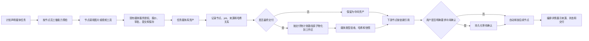

# 编排生图、生视频闭环详细开发方案

- 日期：2026-10-22
- 状态：三个主要连接与显式确认已接入，后端 mock E2E 已通过；完整界面、真实网关与真实账务验收仍待完成。本文现状分析保留实施前基线，实施结果及验证记录见[编排媒体闭环开发进度](./2026-10-22-编排媒体闭环开发进度.md)。后端分层和运行状态语义以 docs/architecture 下的基线及当前代码为准。
- 依据：[生图生视频编排闭环开发调研与方案](../research/2026-10-22-生图生视频编排闭环开发调研与方案.md)、[生图生视频使用逻辑与编排接入调研](../research/2026-10-21-生图生视频使用逻辑与编排接入调研.md)。
- 协同依赖：[客户端视频提交错误与账务展示修复方案](./2026-10-22-客户端视频提交错误与账务展示修复方案.md)；编排运行时沿用该方案定义的视频明确拒绝、提交未知和账务状态语义。
- 范围：客户端编排对图片生成、文生视频、图生视频的资产流转、最终交付、用户确认、界面和恢复闭环。不改 SEP 服务端生成协议，不替代已有媒体服务和账务记录。

## 1. 已确认的产品决策

以下决策是本方案的产品基线，避免实现期间反复讨论：

1. **生成完成后默认自动继续。** 图片或视频任务保存成功后，编排按 DAG 依赖自动进入下一个节点。只有用户明确要求检查中间结果时，计划才设置 requiresUserConfirmation: true，执行器暂停并等待用户确认。
2. **不增加独立的媒体权限开关。** 继续使用当前编排工具权限、权限上限和审批规则。媒体请求仍须经过员工授权、工具策略、报价、预算、审批和服务端校验；自动继续不代表自动绕过媒体审批。
3. **最终媒体交付物自动保存到编排共享工作区。** 中间图片和视频留在任务媒体库，供后续节点引用和用户查看。最终交付的工作区副本与媒体库源资产同时保留，二者通过资产 ID、节点、交付物 ID 和哈希建立关系。
4. **恢复不等于重做。** 恢复跟踪、补存文件和重试物化都复用原媒体任务。只有用户明确选择重新生成时才发起新请求，并继续执行原审批和计费流程。

这套取舍让常规任务少停顿，同时保留用户需要审核、处理异常和确认付费动作的入口。

## 2. 目标与范围

### 2.1 完成后的用户流程

- 自动编排能识别“生成图片”“文生视频”“把前序图片做成视频”等任务，并把媒体要求交给负责的节点。
- 生图或生视频通过现有工具和服务提交，媒体服务继续负责授权、报价、审批、跟踪、下载和保存。
- 保存成功的媒体资产在任务内可追溯到编排节点、节点运行、媒体 job 和来源资产。
- 下游节点可以直接使用明确选定的前置图片，不要求用户先手动导出图片、再重新导入。
- 计划声明为最终交付的图片或视频会自动写到共享工作区计划路径，经媒体类型检查后成为正式交付文件。
- 编排详情可以查看媒体任务进度、结果、来源和等待处理的操作。
- 应用暂停、退出或网络中断后，能够恢复原任务状态；不能因为恢复而重复提交付费请求。

### 2.2 不在本次设计范围

- 不更换图片或视频网关，不在客户端复制供应商账务或 receipt 作为新权威记录。
- 不把供应商 profile ID、内部绝对路径、临时下载地址或凭据写入编排计划和 renderer。
- 不自动把所有中间产物写入共享工作区，也不在编排结束时立即清理媒体库。
- 不新增媒体专属权限开关，不以自动确认替代媒体授权、预算、报价或审批。
- 不把某个网关当前可用的分辨率、时长、比例、参考图数量或文件大小作为永久产品范围。

## 3. 当前实现与差距

| 能力 | 当前实现 | 需要补齐 |
|------|----------|----------|
| 编排节点调用媒体工具 | ArrangementExecutor 为节点准备图片和视频工具，并在结构化节点提交前等待当前 run 媒体任务结束 | 需要将保存后的资产与节点交付、前后节点依赖建立显式关系 |
| 图片生成 | MediaService 保存 source: output 的本地图片资产，记录任务、job、output、哈希和状态 | 图生视频适配器只把 source: reference 暴露为参考图，图片输出不能直接被下游视频节点使用 |
| 视频生成 | 视频服务保存任务、job、output 和账务/恢复状态；视频输出由 jobId + outputId 定位 | 缺少编排侧统一资产索引和指定交付物自动写盘路径 |
| 最终交付 | ArrangementDeliverable 有相对路径；arrangement-delivery-files.ts 检查工作区文件、格式、哈希并保存交付快照 | 验收流程不接收媒体 asset ID，也没有图片/视频专用检查器；视频大文件不能沿用固定小文件内存读取流程 |
| 跨节点依赖 | 下游节点收到前置节点已验收文件的快照路径 | 无法将媒体库内的中间资产以安全引用方式交给下游 |
| 中间确认 | 计划有 requiresUserConfirmation 字段 | 执行器未读取该字段；现有 confirmStep 通过通用 continueTask 发自然语言消息，不能可靠地表示“确认这个编排节点并释放其下游” |
| 编排详情 | getExecution() 主要返回节点状态和最终文件；详情页只给会话任务挂载 MediaArtifactsPanel | 编排详情缺少媒体任务、资产来源、预览、导出和恢复信息 |
| 规划和预检 | 规划器提供员工、模型、节点和交付约定；预检检查订阅、模型、计划结构和权限策略 | 计划不声明媒体输入/输出需求，预检无法按节点员工的实时媒体能力核对 |

涉及实现的现有入口主要是：

- 编排状态与节点调度：electron/domain/arrangement-execution.ts、electron/runtime/arrangement-executor.ts
- 计划、规划与预检：electron/domain/arrangement-plan.ts、electron/domain/arrangement-planner.ts、electron/service/arrangement-service.ts
- 图片资产：electron/domain/media.ts、electron/service/media-service.ts、electron/data/media-store.ts
- 视频适配和资产：electron/domain/video-media.ts、electron/service/video-run-service.ts、electron/data/video-store.ts、electron/data/video-scope-adapter.ts
- 工作区交付：electron/domain/arrangement-delivery.ts、electron/data/arrangement-delivery-files.ts
- IPC 与页面：electron/controller/routes/arrangement.ts、electron/controller/channels.ts、src/features/enterprise/useEnterpriseWorkspace.ts、src/pages/enterprise/WorkDetailPage.tsx

## 4. 目标运行流程



“节点依赖”与“媒体输入关系”需要分别表达：前者决定 DAG 调度，后者决定下游可以选用哪些具体资产。一个下游节点仍可依赖多个前置节点，也可以明确只使用其中一个交付物或输出资产。

## 5. 架构与数据职责

遵守仓库既有边界：

```text
renderer -> controller -> service -> data/runtime -> pi/sdk
```

### 5.1 Runtime

ArrangementExecutor 负责：

- 提供当前 taskId、arrangementRunId、nodeId、nodeRunId、节点 attempt 和依赖资产给运行时端口。
- 等待节点产生的媒体任务保存完成，再读取该 run 的安全摘要。
- 对模型提交的资产 ID 做业务绑定校验；不接受模型自行指定目标绝对路径。
- 节点交付成功后按 requiresUserConfirmation 决定释放下游或持久化等待确认。
- 在恢复时区分“恢复原媒体 job”“补做文件物化”和“重新生成”，避免重复付费提交。

执行器不直接读取媒体目录、不拼接持久化路径、不调用网关，也不解析供应商 receipt。

### 5.2 Service

建议增加编排媒体用例服务/端口，例如 ArrangementMediaService 与 ArrangementMediaPort。最终命名可随本地代码风格调整，职责需要保持：

- 使用当前 owner scope 验证任务、编排、节点运行、订阅和资产归属。
- 聚合现有图片与视频 job/output 状态，生成供编排和 renderer 使用的业务摘要。
- 创建图片 output 到 reference 的受控派生关系。
- 根据已确认计划的 deliverable ID 物化媒体文件并返回验收元数据。
- 协调图片、视频资产和工作区交付文件存储。
- 提供幂等的恢复、补存、读取摘要能力。

Service 只编排用例，不负责拼接媒体目录或工作区内部路径；实际文件路径由对应 data adapter 管理。

### 5.3 Data

- MediaStore 仍是图片二进制、manifest、哈希和图片 job 的权威来源。
- VideoStore 仍是视频输出和视频 job 的权威来源。
- 新增的编排媒体索引只保存媒体 job/asset 与节点、交付物、来源之间的关系，不重复保存报价、账务或供应商 receipt。
- 工作区物化通过 data 层实现：安全解析计划中的相对路径、校验符号链接和目标目录、临时文件写入、哈希复核、原子发布。
- 视频和较大图片使用流式读取、写入与哈希。不得把完整长视频一次性读入内存。

### 5.4 Controller / Renderer

- Controller 对所有新增输入使用 Zod 严格校验，并通过 scope-aware service 处理，不暴露内部绝对路径。
- Renderer 只使用投影后的 ArrangementMediaSummary，不读取磁盘、不持有媒体存储实现。
- 事件只传阶段、节点、job/asset 的安全 ID、可恢复状态和用户可理解的错误码；不传 token、供应商 URL、完整 prompt 或原始错误对象。

## 6. 计划与媒体资产协议

以下是便于实现拆分的建议契约，不要求一次性引入所有字段。字段应可选、可版本化，旧的无媒体计划仍按现有工作区交付运行。

### 6.1 节点媒体意图

在 ArrangementNode 增加可选媒体要求，例如：

```ts
type ArrangementMediaRequirement = {
  id: string
  kind: 'image' | 'video'
  operation: 'generate' | 'edit' | 'image-to-video' | 'text-to-video'
  required?: boolean
  inputFrom?: {
    nodeId: string
    deliverableId?: string
    artifactId?: string
  }
  inputSelection?: 'single' | 'any' | 'all' | 'model' | 'user'
  preferred?: {
    aspectRatio?: string
    resolution?: string
    durationSeconds?: number
    frameRate?: number
    audio?: boolean
    outputFormat?: string
    count?: number
  }
}
```

要求只表达业务意图。配置是否受支持、可用范围、默认值、profile 和实际员工能力由预检及运行时的实时 manifest 决定。新字段不得要求固定的供应商模型名称。

规划阶段优先用 nodeId + deliverableId + inputSelection 指定来源。artifactId 只用于用户已选定且已存在的任务内资产；尚未生成的输出 ID 由运行时在前置节点保存后解析，不得让 planner 猜测。

### 6.2 最终交付物类型

在现有 ArrangementDeliverable 上增加可选的 artifact 描述：

```ts
type DeliverableArtifact = {
  kind: 'document' | 'image' | 'video' | 'data' | 'other'
  source?: 'workspace' | 'media-output' | 'either'
  operation?: 'generate' | 'edit' | 'image-to-video' | 'text-to-video'
}
```

现有 format 和 path 继续规定最终交付格式和工作区相对路径。对于旧计划，缺少 artifact 时沿用当前文件验证逻辑。图片和视频交付必须声明或由运行时安全识别其类型；不得仅根据模型返回的文件扩展名跳过媒体检查。

### 6.3 模型结束提交与资产选择

保留现有 finalDeliverables: [{ id, path }] 格式，以兼容旧提示和现有交付校验；新增可选的资产映射字段，例如：

```ts
mediaDeliverables?: Array<{
  deliverableId: string
  artifactId: string
}>
```

要求：

- 模型提交 deliverableId 和不透明 artifactId，不提交绝对路径、内部存储路径或目标路径。
- 目标路径只能由后端从已确认的 WorkPlan 读取。
- 后端确认 asset 属于当前 owner、task、nodeRun，并且状态为已保存；核对哈希与实际字节一致。
- 计划中的图片/视频交付必须恰好映射到有效资产；多输出只允许显式选择资产，不按“第一张”或文件名猜测。
- 文档类旧交付仍可只提交 finalDeliverables，无需媒体字段。
- 字段名和结果 ID 格式最终由共享契约评审确定；不应让模型构造可直接读写本地文件的参数。

### 6.4 编排媒体关联索引

建议增加 task-scoped、owner-scoped 的 ArrangementMediaLink 索引，示意字段如下：

```ts
type ArrangementMediaLink = {
  version: number
  owner: TaskOwnerScope
  taskId: string
  arrangementRunId: string
  nodeId: string
  nodeRunId: string
  attempt: number
  subscriptionId: string
  kind: 'image' | 'video'
  operation: 'generate' | 'edit' | 'image-to-video' | 'text-to-video'
  jobId: string
  inputs: Array<{ artifactId: string; sha256: string; sourceNodeId?: string }>
  outputs: Array<{
    artifactId: string
    sha256?: string
    status: 'pending' | 'saving' | 'saved' | 'save-failed' | 'missing' | 'expired'
  }>
  materializations: Array<{
    deliverableId: string
    path: string
    sourceArtifactId: string
    sha256?: string
    status: 'pending' | 'saved' | 'missing' | 'conflict'
  }>
  createdAt: number
  updatedAt: number
}
```

索引按节点/job 追加或原子更新，支持分页查询；不要把当前 demo 数量、测试 fixture 上限变成业务限额。资产字节及 job 的权威状态仍从 MediaStore / VideoStore 读取或校验。索引丢失时可从这些存储恢复关联，且不能因此重复提交任务。

## 7. 三个主要连接的实现细节

### 7.1 连接一：最终图片/视频进入编排交付

**执行步骤**

1. 规划节点声明 image/video deliverable，包括类型、操作、工作区相对路径、内容要求和可检查的验收条件。
2. 节点通过现有 media_generate_image、video_generate 或 video_from_image 工具生成媒体。
3. 媒体服务依原逻辑完成授权、能力校验、报价、审批、提交、结果跟踪和本地保存。
4. ArrangementExecutor 等待当前 nodeRunId 的所有相关媒体工作保存完成，读取已保存输出摘要。
5. 节点结束 JSON 将 deliverableId 映射到明确的 artifactId；保留现有 finalDeliverables 列表作为计划路径声明。
6. 在当前 executor 的 onResponseSettled 流程中，先解析提交、验证映射，再由 Bridge 验证来源归属、状态、文件类型和哈希，从媒体库流式复制到计划路径。
7. data 层用临时文件完成写入和目标哈希复核，再原子发布；路径冲突时同源同哈希幂等成功，不同内容不得静默覆盖。
8. 物化成功后按 artifact 类型验收文件，生成兼容扩展后的 FinalDeliveryFile，保存媒体源 ID、源哈希和工作区快照关联。
9. 交付验收成功后节点才完成；下游读取由验收快照解析出的可信 read path。交付纠错轮次应复用已保存资产，不能要求模型重做已成功的付费任务。

**验收规则**

- 图片：签名/MIME、可解析、非空、尺寸与内容一致、SHA-256 匹配。
- 视频：MIME/容器识别、非空、内容长度和 SHA-256 匹配；可用的媒体解析器应检查容器元数据，并为播放器提供可读取的文件。更深入的编码/时长检查由 profile 或企业策略启用。
- 其他格式：保留当前文档格式验证。
- 验收器按媒体类型分派，参数来自运行时配置与 profile；对资源安全设置上限，但不把当前的 64 MiB 文件上限作为所有视频格式的永久业务规则。
- 已确认的 snapshot 继续作为下游读取源，工作区副本改变不能悄悄改变下游已确认输入。

**目标文件冲突**

- 目标不存在：安全写入并验收。
- 目标已存在且与同源资产哈希相同：幂等成功。
- 目标已存在但哈希不同：报可理解的交付冲突；由显式重试/替换策略处理，不能静默覆盖已验收结果。
- 写入中断：清理临时文件；恢复时重试物化，不重新生成。

### 7.2 连接二：前置生图结果作为下游图生视频输入

当前视频适配器仅读取 source: reference。不能把 output 改名成 reference 或让模型直接读媒体目录。

推荐新增服务端 deriveReferenceFromOutput() 能力：

1. 只接受当前 owner/task 下 SAVED、校验通过的图片 output。
2. 读取并复核原 output 的哈希、MIME 和尺寸。
3. 在任务媒体库创建可被现有 video_from_image 使用的 reference 记录；如相同内容的 reference 已存在则复用。
4. 保留源 output 不变，并在编排关系索引写入 derived-from-output 与 used-as-video-input 关系。
5. 只向视频工具暴露新的 task-local reference ID 和安全摘要。后端重新校验归属、task、状态、哈希后才读取图片字节。
6. 视频节点执行前，按计划输入关系筛选可用参考图；一个输入明确指向前置 artifact 时，不向模型提供其他无关节点的私有资产。

该方案优先复用现有 reference ID 和视频上传流程，不要求供应商知道编排节点概念。若需在接口层暴露派生来源，只增加脱敏的 derivedFrom 摘要；不改变原资产身份和账务记录。

**输入选择语义**

- inputFrom 明确指定单个产物：只能使用该 artifact。
- 多个候选且计划允许模型选择：提供真实、带来源标签的候选 ID，由模型提交明确 ID。
- 必须用户挑选：进入 needs-user-input，详情页提供选择入口。
- 部分生成成功：允许计划声明“任一可用输出”继续；只有计划明确要求全部输出时才等待全部完成。
- 引用过期、损坏或缺失：先恢复原 job 或修复本地保存；不自动重复付费生成。

### 7.3 连接三：编排详情展示和操作媒体

增加经过 scope 校验的编排媒体摘要查询，可扩展 ARRANGE_GET_EXECUTION 或提供独立分页 IPC。选择哪种方式以单条返回体大小和现有事件刷新模式为准。

```ts
type ArrangementMediaSummary = {
  nodeId: string
  nodeRunId: string
  kind: 'image' | 'video'
  operation: string
  jobId: string
  phase: 'preparing' | 'awaiting-approval' | 'submitted' | 'tracking' |
    'saving' | 'materializing' | 'ready' | 'blocked'
  inputs: Array<{ artifactId: string; sourceNodeId?: string }>
  outputs: Array<{ artifactId: string; mime?: string; size?: number; status: string }>
  pendingActions: Array<'approve' | 'resume' | 'retry-save' | 'export' | 'select-input'>
}
```

详情页按节点分组，复用 MediaArtifactsPanel、VideoArtifactsPanel 中可复用的预览与状态组件。编排上下文应作为显式 props 传递，避免复制一套会话媒体 UI。

页面需展示：

- 当前节点媒体操作、生成/跟踪/保存/物化阶段和结果数量。
- 图片缩略图、视频播放器、媒体类型和安全的尺寸/时长摘要。
- “由哪个前置节点生成并被谁使用”的来源关系。
- 等待审批、授权变化、报价过期、结果过期、下载失败和交付冲突的可处理状态。
- 对原任务的恢复、重新保存、手动导出和明确的重新生成入口；重新生成提示会创建新媒体请求。

中间产物在媒体库中可见但不自动堆入最终交付清单；最终交付列表继续从已验收文件生成，并显示源资产关系。

## 8. 中间结果确认与状态恢复

### 8.1 确认状态

为节点状态增加 awaiting-confirmation，编排整体使用既有 waiting-user 状态，并增加可选的等待原因，例如 node-confirmation、node-failure、media-input-required。renderer 当前把 waiting-user 当失败显示的映射需要更新，避免把主动确认误报为失败。

当 requiresUserConfirmation 为 false：

- 完成交付校验后直接标记节点完成并释放依赖，默认无额外停顿。

当 requiresUserConfirmation 为 true：

- 媒体 job 和物化必须先达到可检查的持久化状态。
- 保存完整执行 checkpoint，将该节点标为 awaiting-confirmation，不释放下游。
- 页面提供“确认并继续”；该动作只将 checkpoint 中的节点设为 completed 并释放依赖，不重新运行模型、不重做媒体请求。
- 用户要求修改/重做时走显式重试路径；已经成功的媒体资产保留并可再次选用。

建议新增专用编排确认 IPC/service 操作，参数仅包含 taskId、nodeId、预期 nodeRunId 或 checkpoint 版本及幂等 key。不能再用“我已确认”自然语言消息作为唯一状态信号。通用 continueTask 保留给对话任务。

规划器仅在用户明确要求中途确认、挑选或审核结果时设 requiresUserConfirmation: true；不能把“生图/生视频通常需要审阅”当成自动暂停理由。

### 8.2 暂停、恢复、失败和账务语义

- 工具请求仍由 MediaService / VideoService 按原始 idempotency key、client request ID 和 submission state 追踪。
- SUBMISSION_UNKNOWN、MAYBE_SENT 等不确定提交状态先查原请求；不能再次 submit。
- 已成功保存但尚未物化的输出，恢复时只补做物化和验收。
- 已物化但 checkpoint 尚未落盘时，按源 artifact ID、目标 deliverable ID 和哈希识别幂等结果。
- 暂停/应用退出不删除媒体库结果；对上游的取消仍服从现有能力和审批，不承诺退款。
- owner scope、订阅授权或任务权限变化时，重新校验后再继续，不扩大读取范围。
- checkpoint 新字段必须支持当前旧版本读取；若确需结构不兼容，增加显式迁移并覆盖旧 checkpoint fixture。
- 视频 job 的明确拒绝、提交未知、预算不足和并发限制沿用客户端视频错误/账务修复方案及 VideoService 权威状态；编排不得把明确拒绝误当提交未知，也不得自行将未知请求重发。

## 9. 规划、预检与配置范围

### 9.1 规划器

- 在 electron/domain/arrangement-planner.ts 的输出提示和解析 schema 中加入可选 mediaRequirements 与 deliverable artifact。
- 规划只使用业务操作（图片生成、编辑、文生视频、图生视频），不猜测供应商 profile ID、文件内路径和实际可用规格。
- dependsOn 描述执行先后，inputFrom 描述媒体来源，两者需一致校验，禁止不存在的节点、循环依赖或跨任务资产引用。
- 旧 planner 输出未给媒体字段时仍可按现有方式解析；需要媒体文件却未声明时，预检给出具体问题，不假装已经交付。

### 9.2 预检

preflightDraft() 使用每个节点实际选定的 subscriptionId + modelId 获取实时媒体能力，不使用整个编排首个员工的 profile。

预检结果建议区分：

- available：计划所需操作和参数可执行。
- needs-approval：能力存在，但执行时仍需用户审批。
- needs-user-input：缺少比例、输出选择或参考图片选择等必要输入。
- temporarily-unavailable：授权服务、网关或媒体服务暂时不可用，可恢复。
- unsupported：该节点员工当前 manifest 确认不支持所需操作。

只有必需能力明确 unsupported 或计划结构无效时阻止启动；临时故障、审批和用户输入按产品状态进入等待处理，不改写为永久失败。运行前仍需重新读取实时能力和报价，不能把过期预检当作授权凭证。

### 9.3 权限与审批

- 沿用现有权限 preset、allowedTools、权限 ceiling 和每次工具调用检查。
- 不新增 media permission checkbox，也不让 auto-approve 绕过员工授权、工具允许列表、报价/预算校验或服务端拒绝。
- 生成、取消上游、联网参考上传分别沿用当前工具审批语义。
- 在工具注册、Pi dispatch 和媒体 service 三处保留防御式校验；不能只靠 renderer 隐藏按钮。

### 9.4 宽规格和资源限制

- profile/runtime manifest 声明可用比例、分辨率、时长、帧率、音频、格式、输入数量和建议大小。
- UI、规划 schema 和工具参数应允许表达 manifest 提供的值，不用当前单个网关 fixture 范围限制未来能力。
- 安全限制区分三层：应用级可配置安全上限、企业运行策略、员工/profile 能力。运行时取三者交集并返回具体原因。
- 大文件优先流式传输、哈希、磁盘配额和取消信号；配置可调且有明确默认值。避免把 64 MiB 或当前时长/数量直接固化成所有产品场景的上限。
- 对保存格式、长度和尺寸只设置防止内存、磁盘、解析器和 IPC 失控所需的边界；记录配置来源，便于部署调宽。

## 10. 实施阶段与文件清单

每个阶段都保持旧任务可读，并以现有存储数据为源。阶段内可按本地实现拆更小 PR，但不要先改 UI 再补后端归属和恢复语义。

### Phase 0：共享契约与兼容性

**工作项**

- 定义媒体 artifact ID、媒体类型、节点媒体要求、交付映射和脱敏摘要。
- 给计划、媒体关联记录、执行快照的可选字段提供旧数据默认值或迁移。
- 扩展最终交付类型检查结果，保留现有文本/Office/PDF 规则。

**主要文件**

- electron/domain/arrangement-plan.ts
- electron/domain/arrangement-delivery.ts
- electron/domain/arrangement-execution.ts
- src/shared/types.ts
- 新增 electron/domain/arrangement-media.ts（若契约足以形成单独领域模块）

**验收**

- 旧计划、旧 checkpoint、旧 finalDeliverables 仍能解析。
- 错误 owner、非法 artifact ID、未计划 deliverable 和路径越界无法通过边界校验。
- 新 schema 不把单一供应商的参数值作为公共协议常量。

### Phase 1：媒体关联索引与跨节点引用

**工作项**

- 新增由任务 owner 隔离的媒体关联存储，关联 node/run/attempt/job/input/output/materialization。
- 新增从已保存图片 output 派生 task-local reference 的方法，校验原始 bytes/hash，并复用相同哈希的现存 reference。
- 执行器为下游节点按 inputFrom 准备输入引用；视频服务只收到有效 reference ID。
- 在节点 prompt/tool result 中返回来源标签和可选择 ID，不返回本地路径。
- 处理一图多用、多候选、部分成功和引用失效。

**主要文件**

- electron/domain/media.ts
- electron/data/media-store.ts 及其测试
- electron/data/video-scope-adapter.ts 及其测试
- 新增 electron/domain/arrangement-media.ts
- 新增 electron/data/arrangement-media-link-store.ts（存储形态服从现有 data store 约定）
- electron/service/media-service.ts
- electron/service/video-run-service.ts
- electron/runtime/arrangement-executor.ts
- electron/runtime/arrangement-executor.test.ts

**验收**

- output 不被原地改成 reference；派生 reference 有可审计来源，原哈希不变。
- 跨 member、enterprise、task 或未声明节点关系的读取均被拒绝；不同订阅的员工只有在已确认计划显式声明依赖/输入关系时才可接力使用该资产。
- 图片节点完成后，图生视频节点可以只通过资产 ID 使用图片；无需用户手动导入。
- 旧 video_from_image.localAssetIds 仍工作。

### Phase 2：图片/视频最终交付物化

**工作项**

- 增加媒体资产到计划 deliverable ID 的映射解析。
- 从 MediaStore / VideoStore 流式读取输出到计划相对路径。
- 使用临时文件、哈希复核和原子发布；补充冲突、恢复和同源幂等语义。
- 按类型扩展 validateDeliveryFiles()、resolveDeliveryFiles() 和交付快照；将 artifact source ID 与最终文件 SHA 关联。
- 扩大/配置资源边界，视频路径使用流式校验，不以当前小文件限制拒绝有效结果。
- 下游仍读取已验收快照，不直接消费 renderer 缓存或模型给出的路径。

**主要文件**

- electron/data/arrangement-delivery-files.ts 及其测试
- electron/domain/arrangement-delivery.ts
- electron/runtime/arrangement-executor.ts
- electron/data/media-store.ts
- electron/data/video-store.ts
- 新增或扩展 arrangement media service/data adapter

**验收**

- 文生视频、生图、图生视频产物都能按最终交付路径自动落盘。
- 目标同源同哈希重试成功；异内容冲突不覆盖；中断不留下可验收半文件。
- 保存成功后应用退出，重启只做物化/验收，不再调用付费生成工具。
- 图片与视频交付包含稳定哈希、大小、媒体类型和来源关系。

### Phase 3：显式确认点与恢复动作

**工作项**

- 将 requiresUserConfirmation 接入执行状态机，持久化 awaiting-confirmation 和 wait reason。
- 增加专用确认 service/controller/preload API，带预期节点运行或 checkpoint 版本及幂等 key。
- 确认只释放 DAG 下游，不重启已成功节点。
- 更新失败重试和停止处理；确认、重试、编辑输入、取消几种操作在 UI 中分开。
- 修复 renderer 对 waiting-user 的展示，区分“等确认”和“节点失败”。

**主要文件**

- electron/domain/arrangement-execution.ts 及状态机测试
- electron/runtime/arrangement-executor.ts 和 executor/resume 测试
- electron/service/arrangement-service.ts
- electron/controller/channels.ts
- electron/controller/routes/arrangement.ts
- 对应 src/shared API 类型、preload/bridge 和 IPC 契约测试
- src/features/enterprise/work-mapping.ts
- src/features/enterprise/useEnterpriseWorkspace.ts

**验收**

- 未要求确认时，完成后自动启动满足依赖的下游。
- 要求确认时，刷新页面/重启应用仍停在该节点；确认后下游恰好启动一次。
- 幂等重复确认不能再次执行节点或重复提交媒体请求。
- 与会话任务的 continueTask 语义无冲突。

### Phase 4：编排详情媒体面板

**工作项**

- 提供分页或摘要 IPC，按 task/node 返回媒体任务和资产状态。
- 将安全摘要映射为 renderer 的 ArrangementMediaSummary。
- 在编排 WorkDetailPage 展示媒体结果和节点关系；复用已有图像/视频预览组件。
- 提供预览、导出、恢复跟踪、重新保存和必要的选择操作。
- 通过事件增量更新阶段；重新载入时从持久化摘要校准 UI。

**主要文件**

- electron/service/arrangement-service.ts 或新增 media query service
- electron/controller/routes/arrangement.ts、electron/controller/channels.ts
- src/shared/types.ts
- src/features/enterprise/types.ts
- src/features/enterprise/use-arrangement-plans.ts
- src/features/enterprise/useEnterpriseWorkspace.ts
- src/pages/enterprise/WorkDetailPage.tsx
- src/components/workspace/MediaArtifactsPanel.tsx
- src/components/workspace/VideoArtifactsPanel.tsx

**验收**

- 会话媒体页行为不退化；编排媒体按节点分组显示。
- renderer 不拿内部文件路径、供应商下载 URL 或原始 job error。
- 图片可预览、视频可播放；状态刷新后与持久化执行快照一致。
- 详情页能区分等待审批、等待确认、失败、成功、保存失败和过期结果。

### Phase 5：规划、预检与运行能力协商

**工作项**

- planner 输出媒体输入/输出需求、交付物类型和必要依赖。
- 预检根据每个节点的 employee runtime manifest 核验 operation 和参数范围。
- 允许用户选择候选输入、调整可选偏好或使用匹配员工；不支持则给出节点和具体能力原因。
- 在运行时重新校验 manifest/configVersion；处理能力变化和 quote 过期。
- 接入可配置的任务级并发、预算与磁盘安全配额；达到限制时显示排队/等待，不误报模型生成失败。

**主要文件**

- electron/domain/arrangement-planner.ts
- electron/runtime/pi-arrangement-planner.ts
- electron/service/arrangement-service.ts
- electron/service/media-service.ts
- electron/service/video-run-service.ts
- 对应 planner、preflight、媒体工具测试

**验收**

- 预检能区分不支持、暂时不可用、需审批和需补充输入。
- 配置变化后不使用过期 manifest 或报价提交。
- 参数上限来自能力清单和配置交集；扩展 profile 能力不要求修改业务 schema。
- 并发队列与暂停/恢复有持久化状态，资产不会因排队而丢失。

### Phase 6：真实网关验收与逐步启用

**工作项**

- 分别用 mock 图片、真实图片、mock 视频和真实视频环境验收；明确区分 mock 账务与真实账务。
- 覆盖超大图片、较长视频、多输出、部分成功、过期、断网、授权失效和磁盘空间不足。
- 分阶段发布并记录每个阶段的启用范围；回退版本时保留已有媒体资产和 checkpoint，不新增媒体专属权限策略。
- 对平均耗时、生成成功率、下载失败、物化失败和恢复重复提交做脱敏指标。

**验收**

- 本方案“完成标准”全数满足后才移除阶段性开关。
- 未通过真实网关和中断恢复验收时，不宣称媒体闭环已完整上线。

## 11. 测试矩阵与执行命令

### 11.1 后端单元与契约

- ArrangementMediaLink 归属校验、同哈希幂等、重复写入、损坏索引恢复。
- 图片 output 派生 reference、重复内容复用、派生来源可追溯。
- 视频工具只读取当前任务且明确授权的 reference；旧输入仍兼容。
- 媒体交付映射的缺失、多余、重复、错误类型、非法路径和不存在资产。
- 图片损坏、错误 MIME、哈希变化；视频损坏、写入中断、容器不可读。
- 旧媒体 job、旧 WorkPlan、旧 checkpoint、旧交付快照读取。

### 11.2 编排状态与恢复

- 生图 -> 下游图生视频 -> 视频最终交付。
- 文生视频 -> 自动物化 -> 下游可读确认快照。
- 中间图作为非最终产物留在媒体库，最后仍可被下游引用。
- requiresUserConfirmation=false 自动继续；true 持久化等待并在专用确认后释放依赖。
- 多个并行节点中一个等待确认，其他已启动节点和下游状态保持一致。
- 媒体 job 提交后、下载中、下载完成后、物化过程中分别模拟退出/恢复。
- MAYBE_SENT/SUBMISSION_UNKNOWN 只查询原请求，不创建新请求。
- 改权限、授权失效、暂停、终止、磁盘满和输出过期。

### 11.3 界面

- 编排详情按节点显示图片/视频 job、资产、派生关系和最终文件。
- 确认按钮幂等；失败节点的重试不会被误标为确认。
- 重新保存和重新生成的动作、状态与提示有明确区分。
- 刷新和切换页面后从持久化快照恢复，事件只用于及时更新。

### 11.4 仓库检查

实现阶段按触及范围执行：

```bash
npm run typecheck
npm run lint
npm run test:tasks
npm run test:renderer
npm run test:invariants
npm run check:boundaries
npm run build
```

改动 IPC/层边界时必须包含 check:boundaries；改动运行状态与恢复时包含 test:invariants。修改 Electron runtime 启动或 Pi SDK 边界时，按仓库指南补跑 poc:01 到 poc:04。真实网关验收单独记录环境和账务模式，不用 mock 结果代替。

## 12. 完成标准

只有以下项目全部完成，才将编排生图/视频标记为闭环：

- 计划能描述媒体操作、明确输入关系和最终媒体交付类型。
- 运行时按节点员工的实时能力准备工具，仍执行现有授权、工具策略、报价、预算和审批。
- 图片 output 可安全派生为图生视频 reference；图生视频无需手工导入，也不能跨任务/owner 读取。
- 中间结果保存在任务媒体库，依赖节点可直接按 artifact ID 使用。
- 最终图片和视频按 deliverable ID 自动物化到工作区计划路径，并通过对应类型验收。
- 幂等恢复、错误冲突、等待确认、暂停和重试均不会悄悄重复已提交的付费请求。
- 详情页能查看来源、媒体状态、预览、导出与恢复操作。
- 动态能力与配置决定规格范围，安全资源上限可调，不受临时网关 fixture 限制。
- 旧会话媒体、旧编排计划、旧媒体任务和已有文档交付保持兼容。
- 后端、renderer、状态不变式与边界检查通过；真实网关端到端验收完成。

## 13. 关键风险与处理

| 风险 | 处理 |
|------|------|
| 同一个任务多个节点并行创建媒体 job，详情难以归属 | 以 taskId + nodeRunId + attempt + jobId 建关联索引，不按创建时间猜节点 |
| 模型提交未计划资产或他节点的资产 ID | service 侧重新校验 owner/task/nodeRun/inputFrom；prompt 限定候选资产不是安全边界 |
| 物化中途退出留下半文件 | 临时文件、大小和哈希复核、原子发布，恢复按幂等键继续 |
| 支付提交未知而节点被重跑 | 原 job status 和 request ID 权威；先查询/恢复，不自动创建新 generation |
| 确认中间结果被映射为失败 | 执行快照新增明确 node/wait reason，更新 work-mapping 与 UI 文案 |
| 视频文件远大于图片和文档 | 流式读写、可配置磁盘/并发/大小策略、取消传播；不复用固定小文件缓冲上限 |
| profile 在预检后变更 | 运行时重新校验能力版本和报价；向用户展示能力变化原因 |
| 工作区文件被用户或其他程序修改 | 下游基于不可变交付快照读；重新验收时明确记录新哈希，不覆盖旧确认版本 |
