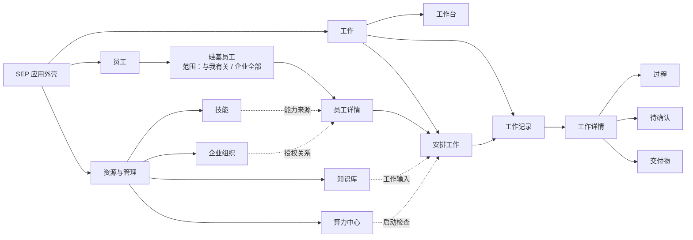
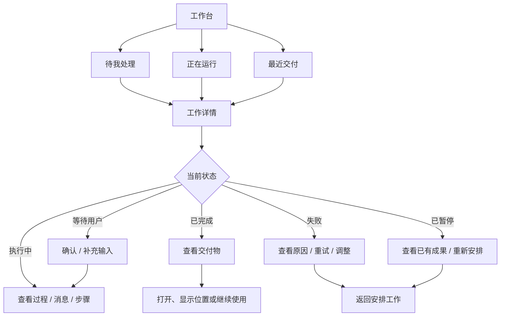
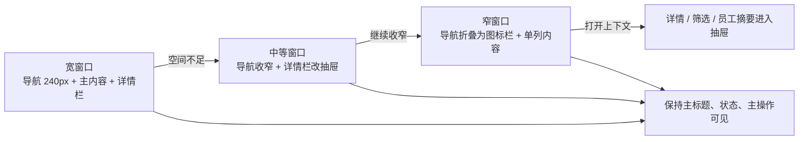
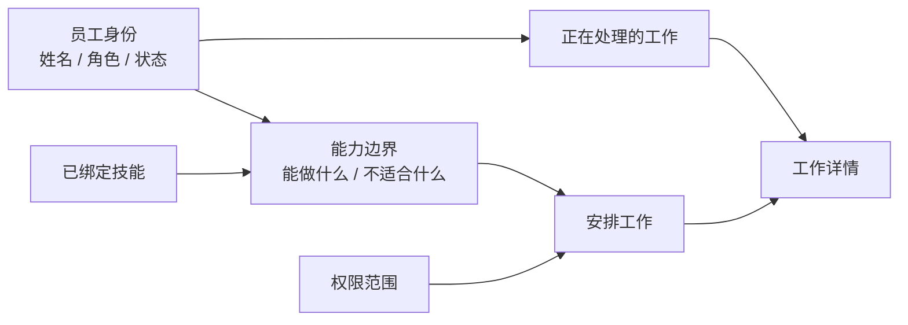

# SEP 客户端整体 UX/UI 重设计方案

> 状态：设计方案与实施基线
>
> 日期：2026-10-23
>
> 适用范围：Electron 桌面客户端 renderer，覆盖应用外壳、导航、所有现有页面和关键辅助状态

## 1. 设计目标

SEP 当前已经具备完整的业务页面和运行能力，但界面仍表现出明显的 demo 感：页面之间像不同阶段的产物，导航职责重复，首页强调展示多于工作决策，员工、工作、成果之间的关系不够连续。

本次重设计的目标不是给现有页面换一套颜色，而是建立一个统一的桌面工作系统：用户能快速回答四个问题：

1. 我有哪些硅基员工？
2. 谁正在做什么，状态是否正常？
3. 哪些事情需要我现在决定？
4. 工作最终交付了什么，如何继续使用？

核心设计命题：**把“硅基员工”从导航名词变成持续可感知的协作关系。**

## 2. 当前产品审计

### 2.1 现有页面与真实功能

| 页面 | 当前职责 | 主要数据/动作 | 主要问题 |
| --- | --- | --- | --- |
| 个人工作台 | 查看已分配员工和当前工作 | 员工状态、工作数量、抽屉查看工作 | 首页仍偏“员工墙”和指标展示，待办与下一步动作不够突出 |
| 硅基员工 | 查找、理解和选择员工 | 默认查看与我有关的员工，也可切换到企业全部、搜索和按状态筛选 | 之前把“我的员工”和“员工目录”写成两个入口，造成概念重复；授权关系应归企业组织管理 |
| 员工详情 | 了解单个员工 | 介绍、擅长、不做、使用范围、技能、安排工作 | 详情与安排工作之间关系弱，员工身份和当前工作没有形成主线 |
| 安排工作 | 开启会话或编排 | 选择员工、自动/手动编排、执行设置、启动工作 | 模式切换多，创建工作和配置运行条件容易被混在一起 |
| 工作记录 | 查找历史和进行中工作 | 状态/类型筛选、搜索、查看结果/过程、终止 | 记录列表信息密度高，但待处理动作、工作生命周期和结果入口竞争 |
| 工作详情 | 跟进一项工作 | 过程、消息、步骤、状态、产物、停止/确认 | 信息丰富，但需要一个稳定的“当前状态 + 下一步”锚点 |
| 员工技能 | 管理技能版本 | 查看、搜索、保存个人版本、选择员工使用版本 | 技能是员工能力的一部分，目前容易成为独立资源库 |
| 知识库 | 企业资料与权限 | 搜索、文档、版本、授权 | 与工作输入、员工能力的关联需要更清楚 |
| 算力中心 | 额度和消费 | 企业额度、个人钱包、消费趋势 | 属于资源治理，不应与日常工作入口争夺同等导航权重 |
| 企业组织 | 查看企业与员工关系 | 组织地图、成员与硅基员工关系 | 与员工目录存在概念重叠，需要明确“管理关系”与“使用员工”的边界 |

### 2.2 造成 demo 感的根因

**信息架构问题**

- 侧栏和顶部的个人/企业切换同时承担导航职责，用户需要猜哪个入口才是权威。
- “员工、工作、技能、知识库、算力”是资源分类，但用户实际任务是“安排工作、跟进工作、处理结果”。
- 首页、工作记录和工作详情之间没有明确的任务优先级链路。

**交互流程问题**

- 安排工作在会话、自动编排、手动编排和运行设置之间切换，创建目标与高级配置没有分层。
- 等待确认、失败、完成和可交付物状态虽然存在，但在入口层没有形成统一的“待我处理”视图。
- 员工详情、安排工作、工作记录之间需要依赖用户主动理解路由关系。

**视觉系统问题**

- 既有员工墙、指标块、卡片网格和详情面板并存，页面密度与容器语言不统一。
- 大面积渐变和背景装饰会让内容像演示稿，而非日常工作工具。
- 页面标题、操作区、筛选区和内容区的垂直节奏不稳定。
- 状态表达需要更稳定的组件级规范，避免每页重新解释颜色、徽标和按钮。

## 3. 目标信息架构

### 3.1 应用级导航

采用单一左侧主导航，顶部只承担窗口拖拽区、当前上下文、命令入口、通知和账号。页面结构采用轻量分区，不把每个区域都画成独立面板。

左侧导航分为三个层级：

1. **工作**
   - 工作台
   - 安排工作
   - 工作记录
2. **员工**
   - 硅基员工
3. **资源与管理**
   - 技能
   - 知识库
   - 企业组织
   - 算力中心

“硅基员工”是一个统一入口：默认范围为“与我有关”，页内可以切换到“企业全部”。两者共享同一套搜索、筛选、列表和详情结构，只改变数据范围和可执行动作。企业全部中未分配给当前用户的员工可以查看介绍，但不能直接安排工作。

“企业组织”只处理成员、部门、员工授权和管理关系，不承担员工发现入口。普通成员只看到有权限的入口，管理员入口放入“资源与管理”分组。

### 3.2 顶部上下文

顶部栏只显示：

- 当前页面标题和一层上下文路径。
- 当前页面的主操作。
- 命令入口（⌘K/Ctrl+K）。
- 通知入口，带待处理数量。
- 账号菜单。

个人/企业不再作为全局并行导航按钮。企业组织作为管理页面进入，工作台中的员工和工作都根据权限显示真实范围。

### 3.3 核心对象关系

```text
硅基员工（与我有关 / 企业全部） → 员工详情 → 安排工作
                         ↓
                 工作记录 → 工作详情
                         ↓
             过程 / 消息 / 待确认 / 交付物

技能、知识库、算力中心作为工作和员工的支撑资源，从相关页面上下文进入。
```

### 3.4 设计示意图

下面的示意图用于说明对象关系和操作优先级，重点是信息流和页面结构，不是最终像素稿。实现时仍以真实数据、权限和窗口行为为准。

#### 图 1：应用级导航与对象关系



这张图表达三个约束：

- 工作台、安排工作、工作记录组成日常主链路。
- 员工详情既是能力理解页，也是进入安排工作的入口。
- 技能、知识库、算力和组织属于支撑资源，通过上下文关联工作，不与日常工作入口争夺同等权重。

#### 图 2：轻量应用外壳

```text
窗口拖拽区                         当前页面 / 上下文             ⌘K  通知  账号

SEP       工作台                         页面标题                         主操作
          安排工作                       页面工具栏：搜索 / 筛选 / 页面内切换
          工作记录

          员工                         主内容区
          硅基员工                      依据页面任务呈现列表、工作台、时间线或详情
          · 与我有关
          · 企业全部                   只保留必要的分隔线和选中状态

          资源与管理                    页面背景保持连续，不为每个区块套外框
          技能
          知识库
          企业组织
          算力中心

          当前账号
```

左侧导航承担“去哪里”，顶部承担“我现在在哪里以及能做什么”，页面内容承担“完成当前任务”。导航、工具栏和内容区通过留白、对齐和少量分隔线建立层级，不使用连续矩形边框制造层级。

#### 图 3：工作主链路与状态分流



列表只承担发现和判断，详情页承担理解状态和完成动作。这样“查看结果”和“查看过程”不会在列表中形成两个互相竞争的入口。

#### 图 4：安排工作的页面骨架

```text
安排工作                                                   保存草稿   开始工作

① 目标                         负责员工
   我想让员工完成什么？         林墨 · 客户研究 · 可用
   必要输入 / 文件 / 知识库

② 步骤                         启动检查
   员工 A  →  员工 B  → 交付物   ✓ 目标已填写
                                  ✓ 员工已选择
③ 运行设置（按需展开）          ✓ 权限检查通过
   工作目录 / 权限 / 高级选项     ! 算力额度不足：前往算力中心

目标 → 步骤 → 运行检查                                   开始工作
```

运行设置默认收起，右侧摘要持续可见，底部操作栏固定主动作。用户可以先把工作交给合适的员工，再在确有需要时展开高级配置。

#### 图 5：窗口收缩策略



响应式策略优先折叠次要上下文，不压缩主要工作内容到不可读的宽度。窗口收窄时，员工身份、当前状态、页面主操作和返回路径始终保留。

#### 图 6：工作详情的状态优先布局

```text
┌──────────────────────────────────────────────────────────────────────────────┐
│ ← 工作记录   整理本季度客户反馈                         [状态] [更多]       │
│            员工：林墨 · 客户研究       最近更新：刚刚                       │
├───────────────────────────────────────────────────────┬──────────────────────┤
│ 过程 / 消息 / 交付物                                   │ 下一步               │
│                                                       │                      │
│ 当前阶段                                               │ 等待你确认            │
│ ┌───────────────────────────────────────────────────┐ │ 需要确认的内容：       │
│ │ ✓ 已收集资料                                       │ │ 是否将这 3 条结论     │
│ │ ✓ 已完成初步归纳                                   │ │ 写入最终报告           │
│ │ ● 正在整理冲突反馈                                 │ │                      │
│ │ ○ 生成最终交付物                                   │ │ [确认] [补充说明]      │
│ └───────────────────────────────────────────────────┘ │                      │
│                                                       │ 相关员工               │
│ 时间线：员工消息、工具调用、用户决定和状态变更          │ 林墨 · 客户研究        │
│                                                       │                      │
│ 交付物                                                 │ [打开工作记录]         │
│ 报告草稿.md   处理中                     [查看]        │                      │
└───────────────────────────────────────────────────────┴──────────────────────┘
```

右侧“下一步”面板是详情页的决策锚点。运行中显示当前进展，等待用户显示需要决定的内容，完成后切换为交付物和继续使用动作。

#### 图 7：员工详情与安排工作的连接



员工详情不是静态档案：用户先通过身份和能力边界判断是否适合，再进入安排工作；已有工作和技能继续提供可追溯的上下文。

## 4. 逐页布局方案

### 4.1 工作台

目标：回答“现在团队发生了什么，我下一步做什么”。

- 第一视觉区是“待我处理”和“正在运行”，不使用大面积欢迎横幅或三块统计卡作为主叙事。
- 中央内容按工作优先级排列：待确认/失败 → 执行中 → 最近交付。
- 员工以紧凑的身份行出现：头像、姓名、职责、状态、当前工作标题、下一动作。
- 右侧提供“与你有关的员工”上下文栏，显示可用员工和最近工作，不把所有员工平铺成同等权重卡片。
- 无待办时显示最近交付和明确的“安排工作”入口；空状态说明下一步，不只显示插画或数字。

### 4.2 安排工作

目标：在最短路径内让用户把目标交给合适的员工。

- 页面顶部先选择工作方式：与员工会话 / 多员工编排。
- 第一层只收集目标、员工和必要输入；模型、工作目录、权限等高级配置放入可展开的“运行设置”。
- 编排页面采用“目标 → 步骤 → 运行检查 → 启动”的线性工作台，自动和手动是步骤编辑方式，不是两个平行产品。
- 右侧固定显示当前员工/步骤摘要和启动前检查结果。
- 启动按钮始终固定在工作台底部操作栏，显示缺少条件时的具体原因。

### 4.3 工作记录

目标：找到一项工作，并知道现在是否需要处理。

- 顶部是页面标题、搜索和主要筛选；状态筛选优先于类型筛选。
- 默认按“需要我处理、进行中、最近完成、已归档”分组，而不是只按时间平铺。
- 每行显示：工作标题、员工身份、当前阶段、状态、下一动作、最近更新时间、交付物数量。
- “查看结果”和“查看过程”合并为进入详情后的上下文页签；列表只保留一个主要动作。
- 终止工作属于详情页的危险操作，列表中不作为普通按钮强调。

### 4.4 工作详情

目标：让用户持续理解一项工作正在发生什么，并能完成下一步。

- 顶部固定工作标题、状态、负责员工和主操作。
- 首屏左侧是当前进展/对话/步骤时间线；右侧是“下一步”面板，显示等待确认、重试、停止或查看结果。
- 中部按页签或分段组织：过程、消息、交付物；避免所有内容同时展开。
- 交付物行显示名称、产出员工或步骤、文件状态和打开/显示位置动作。
- 已完成工作默认展示交付结果，过程作为次级信息；运行中工作默认展示当前过程。

### 4.5 硅基员工

目标：理解员工能力并选择协作对象。

- 页面只有一个“硅基员工”入口。默认视图为“与我有关”，范围切换放在页面工具栏中；“企业全部”是同一页面的只读扩展范围，不是第二个页面。
- “与我有关”回答“我现在可以安排谁”；“企业全部”回答“企业里还有哪些员工，以及我是否有权限使用”。范围切换必须同步改变说明文案和可执行动作，不能只换一个标签。
- 默认采用可扫描列表，卡片只在确实需要比较身份和能力的宽屏场景使用。
- 每行或每项至少包含：头像、姓名、角色、擅长、可用状态、当前工作、最近工作时间、安排工作动作。
- 企业全部中未分配的员工明确标记为“仅可查看”，详情页保留能力介绍和授权提示，不显示可直接启动工作的主按钮。
- 从员工详情进入安排工作时，携带员工身份和当前范围；从工作详情返回时回到原来的员工列表范围和筛选条件。

### 4.6 员工详情

目标：在安排工作前建立信任和预期。

- 顶部是员工身份区：头像、姓名、职责、可用状态、版本和主要操作“安排工作”。
- 主体分为“能做什么”“不适合什么”“正在处理的工作”“可用技能”“权限范围”。
- 将真实能力边界放在主内容，而不是藏在设置或二级弹窗中。
- 员工当前工作以可进入的工作摘要呈现，避免详情页成为静态档案。

### 4.7 技能

目标：理解员工能力来源并管理可用版本。

- 技能以可搜索的资源列表呈现，显示名称、用途、适用员工、版本和更新时间。
- 技能详情展示原文、版本差异和使用范围；编辑和保存属于明确的次级动作。
- 从员工详情可以进入已绑定技能，从技能详情可以查看受影响员工，形成双向关系。

### 4.8 知识库

目标：找到可以用于工作的企业资料，并理解访问范围和准备状态。

- 知识库首页显示资料状态、文档数量、准备状态和最近更新。
- 文档详情显示版本、来源、处理状态和授权成员。
- 从安排工作时通过上下文选择知识库或文档，不要求用户先离开工作台管理资源。

### 4.9 算力中心

目标：理解额度、消费和限制，不干扰日常工作。

- 采用“当前可用额度 → 消费明细 → 限制与说明”的顺序。
- 趋势图只在帮助判断消耗时使用，避免装饰性数据图。
- 工作启动前若额度不足，在运行检查中显示原因并提供进入算力中心的链接。

### 4.10 企业组织

目标：管理成员与硅基员工之间的授权关系。

- 使用组织关系视图或表格视图，但明确这是“管理关系”，不是日常选择员工的目录。
- 成员、员工、授权范围和状态可以从同一详情上下文查看。
- 管理操作需要明确影响范围、确认和成功反馈。

## 5. 统一状态与组件规范

### 5.1 工作状态

| 状态 | 主文案 | 必须显示 | 主要动作 |
| --- | --- | --- | --- |
| 安排中 | 正在准备 | 当前配置或缺少条件 | 继续安排 |
| 运行中 | 正在执行 | 当前员工、阶段、最近进展 | 查看过程 |
| 等待用户 | 等待你确认 | 等待原因和要确认的内容 | 确认/补充 |
| 已完成 | 已完成 | 交付物和完成时间 | 查看结果 |
| 失败 | 执行中断 | 原因和影响范围 | 重试/调整 |
| 已暂停 | 已停止 | 停止原因和已有成果 | 查看结果/重新安排 |

每种状态都使用图标、文字和颜色；禁止只显示彩色圆点。

### 5.2 员工身份

统一使用“头像/生成脸 + 姓名 + 角色 + 状态 + 当前工作”组合。员工卡片不能只展示头像和名字，也不能把不存在的情绪、活动或人格特征当作事实。

### 5.3 操作优先级

- 页面主操作：每个页面最多一个。
- 相关操作：放在同一内容区域，使用次级按钮或菜单。
- 危险操作：详情页中明确说明影响范围，使用确认对话框。
- 取消、返回和关闭使用熟悉图标并提供 tooltip。

## 6. 视觉方向

视觉方向命名为 **“硅基协作台”**：像一间有秩序的数字工作室，员工身份和工作证据是视觉主角，界面本身保持克制。

- 背景以稳定的中性工作台表面为主，减少大面积多色渐变。
- 品牌红只承担选中、主动作和身份强调；状态色单独表达运行、等待、完成和失败。
- 用线性层级、留白和对齐建立专业感，而不是堆叠阴影和卡片。
- 采用更稳定的页面标题、工具栏、列表行和详情栏结构。
- 拟人化通过员工身份、职责、对话和工作记录表达，避免机器人脸、科幻 HUD、发光边缘等装饰。

## 7. 实施阶段

### 阶段 0：基线与证据

- 记录当前页面截图和典型窗口尺寸。
- 建立 `PRODUCT.md`、`DESIGN.md` 和本方案文档。
- 将当前页面按“工作、员工、资源与管理”映射，确认入口权限。

### 阶段 1：应用外壳与导航

- 统一 `ClientAppPage`、`AppSideNav`、`AppTopBar`、命令入口和通知入口。
- 移除重复的顶部个人/企业导航职责。
- 建立页面头部、内容宽度、滚动容器、抽屉和对话框的统一结构。

### 阶段 2：工作主链路

- 重做工作台、安排工作、工作记录和工作详情。
- 先保证“待我处理 → 工作详情 → 结果/下一动作”路径完整。
- 以真实工作状态和交付物验证，不使用静态演示数据。

### 阶段 3：员工主链路

- 重做统一的“硅基员工”入口、范围切换、员工详情和授权提示。
- 建立员工身份、能力边界、当前工作和安排入口的统一组件。

### 阶段 4：资源与管理

- 统一技能、知识库、算力中心和企业组织页面。
- 从工作上下文提供资源入口，减少用户在资源页面和工作页面之间来回寻找。

### 阶段 5：质量收口

- 对所有页面执行 `critique`、`audit`、`polish` 和 `harden`。
- 检查键盘焦点、长文本、空状态、加载、错误、权限不足、窗口缩窄、深色主题和 reduced motion。
- 运行类型检查、lint、renderer 测试和构建。

## 8. 重新评估后的关键取舍

### 8.1 “我的员工”和“员工目录”不是两个产品对象

它们其实是同一个对象集合的两个权限范围：

| 范围 | 用户问题 | 可执行动作 | 页面表达 |
| --- | --- | --- | --- |
| 与我有关 | 我现在可以安排哪些员工？ | 查看、安排工作、查看工作 | 默认范围，显示可用状态和当前工作 |
| 企业全部 | 企业里还有哪些员工？我是否有权限使用？ | 未授权时仅查看 | 同一页面切换范围，显示“仅可查看”原因 |

因此导航只保留“硅基员工”。“员工目录”这个词从主导航和核心流程中移除；在文档、页面副标题和搜索帮助中也优先使用“企业全部”或“员工范围”，避免把目录误解成另一套管理系统。

### 8.2 重新评估后的页面重量

当前示意图的问题不是信息不完整，而是视觉语法过重：连续外框、多个标题栏和等宽区域让客户端像线框版后台系统。重设计应遵循以下顺序：

1. 先用页面背景、对齐、留白和文字层级组织内容。
2. 只有需要独立滚动、独立操作或明确状态隔离的内容才使用面板或抽屉。
3. 列表和详情优先使用行分隔、选中背景和上下文抽屉，不为每个区块添加外框。
4. 顶部窗口栏保持轻量，页面标题和主操作合并在同一行，避免“窗口栏 + 页面标题栏 + 工具栏”三层都拥有强边界。
5. 员工身份可以有头像和状态色，但不通过大头像墙、装饰插画或发光效果制造品牌感。

这意味着最终界面更接近一张连续的工作台：导航是稳定的侧栏，内容是有节奏的工作流，边界只在用户需要判断、编辑或确认时出现。

## 9. 验收清单

- [ ] 用户能在 5 秒内找到“安排工作”和“需要我处理”的工作。
- [ ] 所有页面只有一个明确的主导航体系。
- [ ] 员工、工作、技能、知识库和交付物之间可以双向进入相关上下文。
- [ ] 运行中、等待用户、完成、失败和暂停状态都有文字、图标和下一动作。
- [ ] 长员工名、长目标、长错误和大量记录不溢出、不遮挡。
- [ ] 工作详情在运行中优先显示当前进展，在完成后优先显示交付结果。
- [ ] 个人成员与企业管理员看到的入口符合权限。
- [ ] 典型桌面宽度和较窄窗口下布局稳定。
- [ ] 不引入装饰性渐变、重复卡片墙、虚构进度或无意义动画。
- [ ] `npm run typecheck`、`npm run lint`、`npm run test:renderer`、`npm run build` 通过，或在交付说明中明确失败原因。

## 10. Impeccable 执行提示词

后续实现时可直接将以下内容作为一次 `$impeccable` 请求：

```text
$impeccable

请依据项目根目录的 PRODUCT.md、DESIGN.md 和 docs/plans/2026-10-23-客户端整体UXUI重设计方案.md，对当前 SEP Electron 桌面客户端执行整体 UX/UI 重设计。

这是 Operate 模式的桌面工作客户端，不是营销页。保留真实业务功能、数据、权限、Electron 窗口行为和现有 IPC 边界。先读取现有代码并启动应用检查实际页面，再按方案中的“硅基协作台”方向统一应用外壳、导航和所有页面。

优先完成应用外壳与工作主链路：工作台 → 安排工作 → 工作记录 → 工作详情。随后覆盖员工、技能、知识库、算力中心和企业组织页面。每个页面先明确核心任务、首要信息和主操作，再决定页面结构；不要把所有页面套成同一种卡片网格。

以硅基员工为产品核心：通过姓名、角色、能力边界、工作状态、对话、参与工作和交付物建立拟人化。不要虚构员工活动、进度、能力或成果。状态必须同时使用文字、图标和颜色，并显示下一步动作。

建立单一左侧主导航；顶部只负责当前上下文、页面操作、命令入口、通知和账号。移除重复的个人/企业导航职责。工作台优先展示待我处理、运行中和最近交付；安排工作采用目标 → 步骤 → 运行检查 → 启动；工作详情采用当前状态/下一步 + 过程/消息/交付物的结构。

减少演示感：避免大面积渐变、装饰性指标卡、重复卡片墙、科幻 HUD、无意义动画和虚构数据。采用稳定的页面标题、工具栏、列表行、详情栏和抽屉规范，复用现有技术栈与 Lucide 图标，不新增不必要依赖。

覆盖加载、空、错误、无权限、等待确认、完成、失败、暂停、长文本、长名称、窄窗口、键盘焦点和 reduced motion 状态。实际启动并通过截图检查典型桌面窗口和较窄窗口。

完成后运行 critique、audit、polish、harden，以及与改动相关的 typecheck、lint、renderer tests 和 build。报告实际修改文件、验证结果和剩余风险。
```
