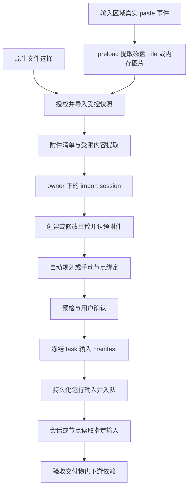

# 安排工作附件与粘贴上传开发文档

日期：2026-10-24。状态：代码链路已实现，跨平台产品验收仍有环境项（更新于 2026-10-24）。本文保留原开发合同，并在第 18 节记录当前代码覆盖、验证证据和剩余工作。

关联：[现状调研与使用逻辑](../research/2026-10-24-安排工作附件输入与编排使用逻辑调研.md)。本文将“复制文件/截图后直接粘贴到输入框”提升为首期需求，替代原方案将粘贴后置的安排。

## 1. 目标与交付范围

用户可以在安排工作的会话、自动编排、手动编排和继续对话中，通过文件按钮或 Cmd+V / Ctrl+V 添加附件。两种入口导入同一套受控快照；发送后会话能读取内容，编排能把附件分给正确节点，重启与重试保留原输入。

首期完整范围包含下表，阶段完成不能代替整体验收。

| 场景 | 预期行为 |
| --- | --- |
| 点击回形针 | 原生窗口选择单个或多个文件，显示导入与解析状态 |
| 复制磁盘文件后粘贴 | 从 Finder/Windows 资源管理器复制实体文件，在目标输入区域直接粘贴导入，支持多选 |
| 复制截图/图片后粘贴 | 将实际图片数据导入为图片附件，无需用户另存临时文件 |
| 粘贴普通文字 | 原有文字编辑、选区替换和撤销语义保持可用 |
| 同次粘贴图文 | 文件项导入一次，确有业务意义的独立文字插入一次；文件管理器附带的文件名/URI 不重复写进目标 |
| 首次会话/继续会话 | 本轮附件随本轮消息持久化并供执行读取 |
| 自动编排 | 规划器依据受限提取内容分配附件，用户可检查节点输入 |
| 手动编排 | 全局候选附件可绑定到一个或多个节点；节点输入处粘贴默认绑定当前节点 |
| 重试、排队、恢复 | 读取已确认版本，不重新读用户原文件或依赖剪贴板仍保留内容 |

“粘贴上传”表示添加到输入区并在本地导入，不表示自动发送消息、自动启动编排或立即上传到模型/媒体服务。用户仍需提供非空文字目标并发送/确认。

拖拽、仅附件发送、扫描件 OCR、压缩包、音视频转写、网络 URL 下载、任意聊天软件虚拟附件，以及 SEP 内“复制附件”的自定义跨窗口协议不列入首期。后两者若已提供真实文件项/图片 bytes，可按通用粘贴处理；不能把复制的文件名或网址当成文件本身。

## 2. 已有能力与开发约束

| 现状 | 开发约束 |
| --- | --- |
| Electron 依赖为 `^33.4.11`，本地声明含 `webUtils.getPathForFile` | 以锁文件实际版本运行 POC；不能使用废弃的 `File.path` |
| `electron/bootstrap/main-window.ts` 为 `contextIsolation: true`、`nodeIntegration: false`、`sandbox: false` | 保持现有安全配置，不为附件开放 Node、原始 IPC 或更多权限 |
| `electron/bootstrap/speech-permissions.ts` 没有开放 `clipboard-read` | 默认使用用户触发的 paste event，不依赖 `navigator.clipboard.read()` 或后台轮询 |
| `electron/controller/routes/media.ts` 有原生图片导入 | 复用“先授权、宿主选择、复制验证”模式，不能复用必须有 taskId 的合同作为首次输入接口 |
| 草稿只在目标提交后创建 | 先用 owner-scoped import session 暂存，不能靠空目标草稿绕过校验 |
| `pi-arrangement-planner.ts` 禁止工具调用 | 宿主先提取并提供规划材料，不要求规划器自己 read 文件 |
| Pi 0.83.0 支持 `PromptOptions.images`，应用只传 text | 扩展应用接口及 SDK 适配，不升级 Pi 版本 |
| 有 Office 预览转换与 utility worker | 复用依赖和隔离模式，新建结构化提取合同，预览 HTML 不作提取正文 |
| guard 支持交付文件精确 read 授权，但 full-local 有放行分支 | 添加附件授权不等于实现操作系统沙箱 |

所有新增接口遵守 `renderer → controller → service → data/runtime → pi/sdk`。路径只在 data 或宿主适配边界构建；service 不导入 SDK。通道统一在 `controller/channels.ts`，事件统一经过 `bootstrap/renderer-bridge.ts`。

## 3. 总体数据流



继续会话跳过草稿规划阶段：import session → task 归属校验与输入收编 → 本轮消息/运行输入持久化 → 入队。任何入口都不能越过导入、归属、完整性与能力检查。

数据来源分三类：用户原始附件、上游已验收交付物、媒体参考资产。三者使用带 `kind` 的引用；媒体工具不能把 `attachmentId` 当 `localAssetId`。

## 4. 剪贴板接入方案

### 4.1 首选真实 paste event

Electron 33 对应 Chromium 的源码包含从系统文件列表生成 DOM `File` 项的链路：Blink `DataObject::CreateFromClipboard` 读取文件；Windows 文件列表路径使用 `CF_HDROP`；macOS 枚举 pasteboard file URL。该证据支持先验证 DOM 事件路线，不能替代产品相同构建与平台的真实 POC。固定版本参考见第 19 节。

采用 preload 内的受限粘贴捕获，避免将 `File`、`FileList`、`ClipboardEvent` 传过 contextBridge/IPC。renderer 只注册输入区域并接收操作状态，不持有宿主文件路径。

1. composer 挂载后注册 `composerId`、当前 import session 和绑定目标；DOM 区域使用固定标记，例如 `data-attachment-composer`。
2. preload 在 capture 阶段监听 `paste`，仅处理注册的、可编辑且启用的目标区域。真实事件使用 `event.isTrusted` 过滤；这不是 main 端授权的替代品。
3. 回调中同步保存文件项、业务文字、composer/session ID、选区令牌及账号 epoch；事件结束后不再读取 `clipboardData` 或当前焦点。
4. 同步确认存在附件且本地编辑回调成功后，在同一事件栈内调用 `preventDefault()`，再启动导入。只有文字时不拦截，交回默认编辑行为；回调失败按第 4.3 节处理。
5. `webUtils.getPathForFile(file)` 非空：路径只进入 preload → main 的内部导入通道；空串且是真实受支持图片：读取有上限的 `ArrayBuffer`，进入图片 bytes 导入通道。
6. main 端完成导入和验证，返回操作 ID、附件视图及逐项错误，preload/renderer 更新当前列表。

禁止公开 `importPaths(string[])`、`readFile(path)` 或通用 `clipboard.readBuffer(format)` 给 renderer。内部路径请求也必须执行 schema、主 frame、owner/session 和文件校验，不能因“来自 preload”就信任。

若隔离世界下的真实事件接入未通过 POC，可改为 renderer 从用户 paste event 读取受限 `File.arrayBuffer()`，只向公开 API 传受限图片/文件 bytes；main 端验证完全相同。它增加 IPC 复制与内存成本，须重新测量预算。该替代路线不能修复操作系统根本没有提供 File/bytes 的虚拟附件。

### 4.2 输入分类与优先级

| 剪贴板实际内容 | 处理 |
| --- | --- |
| 一个或多个磁盘 File | 导入原文件；优先于同次附带的缩略图/图标 |
| 无磁盘路径的真实图片 File | 校验大小、格式和解码尺寸，保存为 PNG/JPEG/WebP 等实际容器；名称由宿主生成 |
| 纯文字、网址、手写路径、`file://...` 文本 | 按文字粘贴，不解析为磁盘读取授权 |
| 有独立正文的混合图文 | 附件导入，同时通过统一编辑回调插入正文一次 |
| 文件列表附带的 URI/名称文本 | 属于传输表示，不当作独立正文；先实测各平台事件形态再固定分类规则 |
| 目录、快捷方式、符号链接、不可读文件 | 逐项拒绝，给出明确原因；首期不递归目录或跟随链接 |
| 应用专有虚拟附件或 promise-file | 无实际可读 File/bytes 时提示先保存本地，不根据文件名或 URL 猜测/下载 |

一个事件同时包含磁盘图片与图标时，只导入原图片。去重先按事件内 backing path/稳定项索引，导入后再按 scope 内 hash 合并物理内容。不能按文件名去重。

禁止简单实现 `clipboard.readBuffer('CF_HDROP')`：Electron 的该 API 走自定义格式访问，Windows 预定义文件列表格式不能据此保证读取。macOS 单次 `public.file-url` 读取也不保证枚举所有文件。若 DOM 路线在目标平台失败，必须先补平台 POC 与明确适配设计，不能静默取消用户要求的文件粘贴。

### 4.3 文字编辑与事件顺序

只有一个逻辑负责混合事件的文字插入，renderer 的 React `onPaste` 先识别已处理状态，避免附件重复导入或文字插入两次。文字需在原粘贴位置同步插入/预留，不等待文件解析结束再写到新的光标位置。

具体约定：注册 composer 时提供同步的本地 `onPasteEdit` 回调。preload 同步分类后，向该回调传递 `{ operationId, composerId, text, selectionStart, selectionEnd, editorVersion }`，仅含本次用户粘贴的有上限纯文本，且不经过 main IPC。回调先校验编辑器版本；校验失败返回未处理且不修改输入，交回默认粘贴行为，不启动附件导入。校验成功时对非空独立正文执行一次选区替换，纯附件事件不修改文字，两者均返回 handled；preload 随后完成同步 `preventDefault()`，React `onPaste` 看到 `defaultPrevented` 后直接返回。状态回调不承担文字插入。注册无效或回调失败时报告可重试原因；回调实现不得先改文字再返回失败。contextBridge 同步回调、受控输入与撤销栈的实际行为纳入 T0/T4 POC，不以设计推断代替验收。

实现时测试选择区替换、撤销、IME、Cmd/Ctrl+V、菜单“粘贴”及输入区域卸载。不要注册全局快捷键拦截 V，也不在页面其他表单抢粘贴。粘贴导入失败保留已插入的独立正文和用户原有输入，失败项可移除或重试。

### 4.4 生命周期与防串单

每个操作携带 `operationId + composerId + sessionId + accountEpoch + target`。target 固定为首次输入、指定 draft、指定 task 续聊或指定手动节点；不得在 await 后重新读取“当前任务”决定归属。

切换任务、企业、账号、员工、节点或关闭输入区时，取消旧绑定。晚到结果不加入新列表；已完成的暂存由引用清理或取消接口回收。移除正在导入项要写取消标记，避免异步完成后重新出现。移除按钮使用稳定 client item ID，成功后映射到 attachmentId。

## 5. 附件领域合同

以下是新增合同建议，名称可以按项目现有风格调整，字段语义应保持。客户端声明只是提示，owner、MIME、大小、hash 均由宿主验证或计算。

```ts
type AttachmentRef = Readonly<{
  attachmentId: string;
  sha256: string;
}>;

type ImportTarget =
  | { kind: 'compose'; composerId: string; clientNodeId?: string }
  | { kind: 'draft'; draftId: string; expectedRevision: number }
  | { kind: 'draft-node'; draftId: string; nodeId: string; expectedRevision: number }
  | { kind: 'conversation'; taskId: string };

type DraftAttachmentCandidate = Readonly<{
  attachment: AttachmentRef;
  mustUse: boolean;
  purposeHint?: string;
}>;

type NodeInputRef =
  | {
      kind: 'attachment';
      attachment: AttachmentRef;
      required: boolean;
      purpose: 'reference' | 'analysis' | 'vision' | 'media-source';
    }
  | {
      kind: 'deliverable';
      nodeId: string;
      deliverableId: string;
      required: boolean;
    };

type AttachmentView = Readonly<{
  attachmentId: string;
  displayName: string;
  mediaType: string;
  byteLength: number;
  sha256: string;
  importSource: 'picker' | 'paste-file' | 'paste-image';
  extractionStatus: 'pending' | 'ready' | 'partial' | 'not-required' | 'unsupported' | 'failed';
  warnings: readonly string[];
}>;
```

内部 manifest 另外保存 `schemaVersion`、实际 `TaskOwnerScope`、blob ID、创建时间、storage owner、提取版本、提取索引 ID 和引用状态。内部路径与 blob ID 不出现在 `AttachmentView`。

草稿候选池保存 `DraftAttachmentCandidate[]`，`mustUse` 是“必须被某节点使用”的持久意图，与节点 `required`（此节点缺少该输入不得执行）分别校验。未建草稿的手动节点使用稳定 `clientNodeId`，创建草稿时显式映射到正式 nodeId 并由宿主验证；节点已删除或 revision 冲突则不绑定，也不在 await 后改绑到当前节点。

建议新增 `InputSnapshot`：记录本次冻结的附件 ref、parserVersion、提取产物 hash、绑定集合、inputDigest。运行只保存 snapshot ID 与受验证引用，不持久化巨型 base64。展示名称、节点目的等模型生成文本必须有长度限制。

宿主生成规范化的摘要输入，按稳定 ID 排序，仅包含明确合同字段后计算 digest；不能拿随意序列化的整个 JS 对象或现有标识型 `planHash` 冒充内容完整性证明。

## 6. IPC 与 preload 合同

扩展 `src/shared/attachment-contracts.ts`，参照已有 shared contract + Zod 模式作为唯一校验来源。公开 API 与内部导入通道分开。

| 建议能力 | 入参要点 | 返回与约束 |
| --- | --- | --- |
| `beginAttachmentImport` | target、客户端操作幂等键 | owner-scoped sessionId、到期时间、版本化限制；不是访问令牌 |
| `selectAttachments` | sessionId、operationId | controller 打开原生多选；取消返回 cancelled，不报失败 |
| `bindAttachmentComposer` | composerId、sessionId、固定 target、同步 onPasteEdit 回调 | preload 本地注册并返回 dispose；target 必须与 session 一致，不接收 path/File/Event |
| `onAttachmentPaste` | 受限状态订阅 callback | 开始、逐项导入结果、结束；不传 Electron event/原始剪贴板内容 |
| 本地 `onPasteEdit` 回调 | operationId、composerId、有限纯文本、选区与 editorVersion | 仅 preload → renderer 同步文字编辑，不经 main；与不含正文的状态订阅区分 |
| 内部 `ATTACHMENT_IMPORT_FILES` | sessionId、operationId、宿主提取的路径列表 | 不作为公开 bridge 方法；主 frame、scope、文件预算全部校验 |
| 内部 `ATTACHMENT_IMPORT_IMAGE` | sessionId、operationId、受限 ArrayBuffer、显示名提示 | 校验原始 byteLength 与真实容器；不接收任意格式 raw clipboard 读取参数 |
| `listAttachments` | sessionId 或已授权 draft/task ID | 返回裁剪后的视图与提取状态 |
| `removeAttachment` | sessionId、attachmentId、expectedRevision | 解除当前绑定，不直接删除仍被引用的原件 |
| `retryAttachmentExtraction` | attachmentId、当前归属 ID、幂等键 | 重建提取任务；不覆盖运行中已冻结产物 |
| `cancelAttachmentImport` | sessionId、operationId | 幂等取消；导入结束竞争由宿主确定最终状态 |
| `previewAttachment` | 已授权 attachmentId | 显式授权、有大小/页数预算的预览，不暴露文件系统读取接口 |
| 新增草稿输入修改能力 | draftId、expectedRevision、附件 refs、节点 inputRefs | 原子更新 revision，失效旧规划/预检结果；现有 settings-only 接口不能承担 |
| `continueTask` 扩展 | taskId、prompt、导入会话/选定 refs、幂等键 | 同一输入确认生成唯一待运行记录并收编附件 |

引用客户端 ID 不代表归属成立；ID/hash 均必须与宿主记录相符。sessionId、operationId 数量与长度限制用 strict schema，拒绝额外字段。按项目实际 envelope 返回 `success/data/error`，错误进入现有 mapper，禁止裸异常泄漏路径。

附件状态事件只传 ID、进度、warning code；在 `bootstrap/renderer-bridge.ts` 统一发送，route 不直接 `webContents.send`。preload 本地 paste 开始回调属于隔离世界内通知，不新建旁路主进程事件发送器。

`trustedMainFrame` 可复用现有 route 选项；其报错文案当前与语音相关，复用时应改为通用或支持场景文案，避免附件错误显示“无法使用语音输入”。

## 7. 存储、原子提交与恢复

### 7.1 数据层布局

通过 `electron/data/scope-path.ts` 扩展布局；下列只是相对 owner/task scope 的建议，不让 service 拼路径。

```text
owner scope/
  attachment-imports/<sessionId>/manifest.json
  attachment-imports/<sessionId>/items/<attachmentId>/source
  attachment-imports/<sessionId>/items/<attachmentId>/extractions/<version>/...
  attachment-claims/<operationId>.json

task scope/
  inputs/<snapshotId>/manifest.json
  inputs/<snapshotId>/items/<attachmentId>/source
  inputs/<snapshotId>/items/<attachmentId>/extractions/<version>/...
  input-commits/<operationId>.json
```

文件名不参与落盘路径；临时文件用随机 ID。导入打开文件后校验 regular file、符号链接、bytes、修改竞争与资源限制，读取过程中计算 hash，最后原子提交。不能只做 `stat` 后相信稍后路径仍指向同一文件。

原件保留在私有存储中；执行可使用独立只读运行副本并复核 hash，不把规范原件开放给模型写入。full-local 下同用户工具仍可能修改数据，hash 用于检测而非承诺硬隔离。

### 7.2 无数据库时的提交协议

文件系统跨多个 JSON 文件没有真正的数据库事务，必须定义可恢复状态，不能只在文档里写“原子认领”。复用 `atomic-file`、`WriteChain`，按 owner 串行变更：

1. 写入 `prepared` journal，包含幂等键、来源 session、目标 ID、附件 refs 与目标 revision。
2. 验证并复制到目标输入临时目录，提交内容与 manifest，禁止此时 enqueue。
3. 写入草稿/计划/会话待运行记录，引用已提交 snapshot；所有权检查在写前再次确认。
4. 将 journal 标记 `committed`，目标输入状态变为可用；最后入队。
5. 重复请求读取 journal 返回原结果；启动恢复扫描 prepared/committed 中间状态，完成提交或回滚无引用临时数据。

草稿认领不立即删除暂存内容；任务收编后，草稿仍引用的内容继续保留或独立复制。禁止移动唯一副本后导致草稿不可再读。cleanup 以引用与活跃租约为依据，不能只按目录年龄删除。

会话续聊应先保存可恢复的 pending turn/run input，再入内存队列；若当前调度器不自动恢复待运行项，应显示“待恢复”并提供恢复入口，不宣称已有自动续跑。恢复只重建输入与 session，不重放已完成工具副作用。

### 7.3 清理与迁移

待认领会话建议闲置 24 小时回收，但活跃导入/提取/已认领引用不受该 TTL 删除；实际数值集中配置。任务删除、草稿删除、取消导入与企业切换调用同一引用释放能力。

旧 schema v1 草稿/计划读取为无附件。包含附件的新草稿/计划合同建议提升到 v2，读兼容层显式迁移到内存 v2，新写入统一 v2；更新 draft/work-plan store 中硬编码的 schema 检查及 controller Zod。会话消息当前没有相同的 schemaVersion 字段，需单独定义其兼容读取合同，不能把不同 store 的版本号机械统一升级。回滚旧客户端不能解释新合同，需保留备份并明确回滚边界，不自动降级丢弃附件字段。

旧消息没有 attachmentRefs 可默认空数组；新格式损坏或 manifest 缺失必须报错，不能也当成“旧消息无附件”。

## 8. 提取与资源预算

| 类型 | 提取结果 | 失败与边界 |
| --- | --- | --- |
| txt/md/json/csv | 编码、行号或记录范围、分片索引 | 非法编码/结构失败；大文件明确截断范围；CSV 使用正确解析，不简单 split 逗号 |
| PNG/JPEG/WebP | 尺寸、真实 MIME、原件 hash；视觉输入或媒体映射 | 超像素、损坏、模型无视觉能力、格式不支持时明确拒绝或要求替换 |
| DOCX | 段落、表格、定位、提取警告 | 复用 Mammoth，禁外部文件访问；嵌图不能假装已理解 |
| XLSX | sheet/row/cell、值、公式、缓存结果、分片 | 不重算公式；无缓存值、隐藏表、日期/数字格式保留说明 |
| PPTX | slide 定位、文本、缺失说明 | 图表与图片需额外能力，不能当作完整视觉解析 |
| PDF | 页码、文本块、覆盖页范围 | backend 新接 PDF.js 提取；加密、扫描、损坏明确区分，OCR 后置 |

文本类 MIME 不能仅靠 magic bytes 判断，结合扩展名、编码、结构解析与 allowlist；二进制文档按容器验证。Office ZIP entry 数、展开 bytes、时间与 worker 退出已有参考，必须对新提取入口重新生效。

建议试运行预算：每次/每会话最多 10 个待提交文件，单文件 20 MiB、总量 100 MiB，内存粘贴图片同样不得超过单文件上限；图片像素采用现有媒体校验或更小值。预检时采用累计有效输入限制，不能分多次 paste 绕过。以上均为待实现的配置值，不是现有能力。

规划上下文建议初始总提取预算 24,000 字符、每附件摘要 2,000 字符、模型输出预算单独限制；执行按需读取完整分片。字符数只作工程预算，不宣称等于 token 数。缺失/截断范围必须随摘要提供。提取 worker timeout、内存/页数/单元格限额在 POC 后定值，超限返回 partial 或明确失败，不能主进程无限解析。

## 9. 会话执行接入

首次会话仍经过 `useEnterpriseWorkspace → run-settings → createDraft → preflight → confirmAndStart`，附件引用随 conversation plan 进入 input snapshot。不能只扩展旧 `CreateTaskInput` 就认定安排工作已支持。

继续会话从 `WorkTalkDrawer → ContinueTaskInput → conversation-service → task-runtime → conversation-executor` 传递本轮 ref。扩展 `ConversationMessage`、task message 投影、run store 与 `QueuedRun`，以 turnId/runId 绑定本轮输入。

runtime 解析可信输入，向 worker 传应用自有 `WorkerInput`，包含 text、受控文件描述符、图片 payload（如适用），而不是把 SDK `ImageContent` 直接暴露给 service 或 renderer。`pi/sdk` 完成应用类型到 `PromptOptions.images` 的转换。

图片只随本轮首个用户 prompt 传入，内部纠正/续跑循环不无条件重复注入。模型 `input` 必须包含 image，网关支持需实测；纯文字模型不能静默忽略图片。视觉模型声明、宿主工具策略和图片工具能力是三项独立检查。

文件型输入注入清单与原件/提取路径，扩展精确 read 授权。若节点没有 read 工具且必须分析文件，可使用受限提取正文注入，但有截断时不得当作完整分析；需要全量处理却无读取能力应阻止启动。

历史附件在 UI 可显示文件条目并预览；新轮次显式引用历史附件时重新检查归属。恢复 Pi session 时使用持久输入记录重建上下文，不依赖剪贴板、React state、File 对象或内存媒体选择集合。

## 10. 自动与手动编排接入

### 10.1 自动规划合同

宿主向 planner 提供真实 attachmentId、名称、结构、覆盖范围、warning、有限摘要和用户用途。planner 返回节点 `inputRefs`；不得返回真实路径，不得发明附件/交付物 ID。保留 `allowedTools: []`。

图片语义采用明确的前处理路径：确需看图分工时，由宿主在用户触发发送/规划后，按当前 provider 数据发送策略调用具备视觉能力的模型生成受限描述，再将该描述供文本 planner 使用。描述记录原图 hash、生成模型、版本、时间和覆盖警告，标为模型生成而非确定性提取；其生成同样受取消、账号 epoch、预算与缓存失效控制。缺少视觉能力/网关支持时阻止依赖看图理解的规划，不从文件名猜内容。仅按用户明确用途把原图送给编辑工具的 media-source 绑定，可以不额外生成视觉描述；规划器仍不能声称已理解图中内容。

更新 planner prompt、返回 schema、normalize/validate、重规划和 renderer 节点转换全链路。材料或绑定变化增加 draft revision，取消/拒绝基于旧 revision 的异步规划结果及预检。模型选择改变时也重跑能力检查。

用户标为 `mustUse` 的全局附件若未被任何节点使用，预检失败；节点 `required` 单独校验此节点输入是否可用。普通候选未使用则提示。节点绑定同一附件不会产生依赖边，只有交付物引用需要直接 `dependsOn`。

### 10.2 手动绑定

顶部材料区导入只加入候选池；节点输入区域导入后，同时加入草稿候选池并绑定当前节点。移除节点绑定不删全局附件；移除全局附件时先显示受影响节点并要求解决引用，不能留下悬空 ID。

目前没有通用 renderer 草稿 patch API，新增受控输入更新用例而非滥用 `updateArrangementExecutionSettings`。node inputRefs 与现有人工材料文本分别保存；结构化工作合同和旧手动执行分支都读取同一解析后的输入上下文。

### 10.3 执行和媒体

执行开始前核验 task snapshot、节点 binding、文件 hash 与 parserVersion。只给当前节点注入绑定附件与获准前驱交付物的读取描述和精确授权；输入附件不自动扩展整个工作目录权限。

引用前驱交付物时继续检查直接依赖、完成/验收状态、待确认项和 hash。失败/待确认节点的临时文件不能给下游当最终输入。通用交付物不得随意套用只支持媒体资产的证明分支。

`purpose: media-source` 图片在宿主建立 `attachmentId + sha256 → task localAssetId` 的幂等映射；工具仅允许当前节点声明的资产。映射持久化，节点结束不清除其他活跃节点仍需的引用。编辑后的验收图通过既有 `inputFrom` 链路进入图生视频；普通附件不能塞进 `mediaRequirements` 当作通用文档输入。

## 11. UI 状态与交互

抽取共享 `AttachmentComposer`/hook，复用在 `ChatArrange`、`GoalComposer`、`ManualArrange`、`WorkTalkDrawer`。使用现有 lucide `Paperclip`、`X`、`RotateCw` 等图标及 tooltip；附件列表为紧凑文件行，不改成独立营销页面。

状态机分别表达导入和提取，不以“上传成功”涵盖所有阶段：

```text
selected -> importing -> imported -> extracting -> ready / partial
                 |           |           |
              failed      cancelled    failed / unsupported
```

每行显示名称、类型/大小、状态和移除/重试；原路径不展示。partial 可展开覆盖范围与 warning。粘贴开始立即出现占位条目，异步完成替换同一个 client item ID，不跳动或重复新增。

导入中禁用发送/规划，文字可编辑；提取中按用途判断，纯媒体图片不必等待文本提取。必需材料失败阻止提交，optional 失败仍须用户显式移除或确认不使用后再继续。失败时不自动清空文字和成功附件。

切换会话/自动/手动模式默认保持各自 composer 隔离，不把未发送附件静默带入另一模式；若需要转移，使用显式复用操作重新校验 target。UI 卸载调用取消/解绑；不以浏览器返回或刷新隐式创建任务。

## 12. 错误、权限与数据发送

新增可映射错误码或子原因：导入会话过期、归属不符、文件不可读、超数量/大小/像素、格式不支持、提取失败/部分、版本冲突、输入损坏、模型能力不足、粘贴源不支持。不要只显示“上传失败”。多个附件允许逐项成功，失败项保留原因。

当前 guard 的 workspace containment 使得把附件外部目录追加到普通 allowedPaths 并不能正确授权；应新增与 `readableDeliveryPaths` 类似的 `readableAttachmentPaths` 精确 read 分支，校验 canonical path、regular file 和 deniedPaths。`write/edit/bash` 不因此取得额外授权。

`full-local + auto-approve` 的既有提前放行仍然有效；不声称节点间硬隔离。私有输入、运行副本与 hash 校验减少误写并检测变化，若需强隔离另立执行环境设计。

日志走 logger/redaction，错误只记录可控 ID/原因，不记录源路径、正文、图片、token。状态 IPC 只传 metadata；预览内容通过单独授权和预算返回。附件内容是不可信数据，不能修改工具策略、审批或系统指令。

选择/粘贴时只本地保存，提取文本/图片在请求模型时会传给当前 provider。媒体参考图继续使用现有 SEP 上传、报价与审批链路，不能以“已粘贴”为由跳过现有审批。

## 13. 文件改动地图

以下新文件为拟建，不代表已经存在；实现前确认命名与现有模块边界，避免重复实现。

| 区域 | 新增/修改文件 | 职责 |
| --- | --- | --- |
| 共享合同 | 新 `src/shared/attachment-contracts.ts`；改 `src/shared/types.ts`、`src/shared/ipc.ts` | refs、视图、输入、状态与 Zod；renderer/domain 转换同步 |
| 剪贴板入口 | 改 `electron/preload.ts`；可抽新 `electron/common/attachment-paste.ts` | 真实目标事件捕获、同步快照、纯分类逻辑、受限桥接；不能从 common 导入 service/runtime |
| IPC | 新 `electron/controller/routes/attachments.ts`；改 `channels.ts`、`routes/index.ts`、`request-context.ts` | strict 验证、dialog、主 frame、错误 envelope |
| 装配 | 改 `electron/bootstrap/build-backend.ts`、`renderer-bridge.ts` | 注入 store/service/runtime，统一状态事件及注销清理 |
| 存储 | 新 `electron/data/attachment-store.ts`、`attachment-files.ts`；改 `scope-path.ts` | session、内容、hash、引用、journal、生命周期和 scope |
| 服务 | 新 `electron/service/attachment-service.ts` | owner 授权、导入/提取用例、预检、收编协调，不拼路径 |
| 提取 | 新 `electron/runtime/attachment-extraction-runtime.ts`、`attachment-extraction-worker.ts`；新 `electron/bootstrap/create-attachment-extraction-runtime.ts` | 受限 worker 和确定性解析；按需复用预览转换器依赖 |
| 领域与计划 | 改 `electron/domain/arrangement-plan.ts`、`arrangement-planner.ts`、`electron/data/arrangement-draft-store.ts`、`work-plan-store.ts` | v2、输入绑定、摘要、恢复校验 |
| 编排用例 | 改 `electron/controller/routes/arrangement.ts`、`electron/service/arrangement-service.ts` | 输入 patch、revision、规划/预检/确认 journal，启动前冻结 |
| 会话入口 | 改 `electron/controller/routes/conversation.ts`、`routes/task.ts`、`electron/service/conversation-service.ts` | 首轮/续聊兼容入口合同，持久化输入确认 |
| 运行与历史 | 改 `electron/runtime/run-types.ts`、`task-runtime.ts`、`conversation-executor.ts`、`arrangement-executor.ts`、`electron/domain/conversation-context.ts`、`electron/data/task-run-store.ts`、`task-messages.ts` | run/turn 绑定、队列、输入解析、恢复与历史投影 |
| 权限/SDK | 改 `pi-extension/guard.ts`、`electron/pi/sdk/pi-agent-runtime.ts`、`pi-task-worker.ts` | 附件精确读取、应用输入到 SDK images 的边界转换 |
| 媒体 | 改 `electron/service/arrangement-media-service.ts`、`media-service.ts` 与相关 data mapping | 任务媒体资产持久映射、节点选择隔离、复用引用 |
| 前端共用 | 新 `src/features/attachments/use-attachment-composer.ts`、纯状态模块；新 `src/components/enterprise/attachments/AttachmentList.tsx` | 列表、取消/过期结果、preview、注册与订阅 |
| 前端接入 | 改 `src/pages/enterprise/ArrangeWorkPage.tsx`、`ChatArrange.tsx`、`GoalComposer.tsx`、`ManualArrange.tsx`、`src/components/enterprise/WorkTalkDrawer.tsx` | picker/paste、节点输入、状态与错误 |
| 前端数据流 | 改 `src/features/enterprise/useEnterpriseWorkspace.ts`、`use-auto-planning.ts`、`run-settings.ts` | refs 经所有转换进入草稿/续聊，防被字段挑选丢弃 |

不顺带重构旧 `WorkspaceComposer` 或升级 SDK。若其旧附件按钮继续对用户开放，应单独明确接入或禁用假成功，不能用它代替实际安排工作入口验收。

## 14. 开发任务与完成证据

按依赖顺序实施，先让平台接入和持久化合同可验证，再扩展 UI/运行。本文不授权自动提交或发布。

| 任务 | 具体步骤 | 完成证据 |
| --- | --- | --- |
| T0 原生粘贴 POC | 新 `poc/attachment-paste/` 独立 Electron fixture；相同 preload 构建/安全配置；运行真实系统复制/粘贴 | macOS/Windows 结果矩阵、实际文件 count/size/hash；不记录用户文件路径/内容 |
| T1 共享合同 | 添加 refs/Zod、错误码；旧草稿/计划读迁移；新增严格输入更新合同 | 合法/伪造/旧版/损坏记录测试；typecheck 通过 |
| T2 存储和 journal | 导入验证、临时写、hash、原子提交、幂等 claim、引用回收 | 导入时源改变、崩溃点、重复确认、跨 owner、取消竞争回归通过 |
| T3 解析 runtime | text/Office/PDF 受限提取、版本化产物、partial/warnings | 小型可审查 fixtures 的来源定位、公式/扫描/加密/超限用例通过 |
| T4 IPC/preload/UI | picker、trusted paste 路径/图片 bytes、共享列表、混合文字、取消/迟到 | route 契约和状态测试；真实输入框粘贴/选区/撤销演示通过 |
| T5 会话 | 首轮草稿和 continue refs、run/message 持久化、read/images、恢复 | 首轮+续聊+重启能读实际内容，图片不重复注入，能力不符有阻断 |
| T6 编排 | planner materials/inputRefs、手动绑定、revision 失效、两种执行分支 | 销售表到报告用例通过，虚构引用和旧规划结果被拒绝 |
| T7 媒体 | 粘贴图片映射 task asset、多节点复用、编辑产物到视频 | 使用受控/模拟 provider 的资产/hash/审批链路测试；真实网关联调另记 |
| T8 整体验收 | 双平台 clipboard、恢复/清理、权限与常规检查 | 第 15–17 节证据齐全，未测项逐项列出 |

每项先写针对真实风险的回归，再实现最小能力并跑相关检查。一次 UI 展示成功不替代后端内容读取或恢复验证。T0 不通过的平台不得宣称支持复制文件粘贴，需完成同范围替代适配后再验收。

## 15. 验收矩阵

| ID | 操作 | 必须观察到的结果 |
| --- | --- | --- |
| P01 | Finder/Explorer 复制一个 PDF/DOCX，再粘贴 | 一个附件、真实 bytes/hash 与原件一致，能提取内容 |
| P02 | 复制多个文件，含中文、空格、同名不同目录 | 数量正确，名称不是身份，附件不丢失/不覆盖 |
| P03 | 复制一个图片文件 | 导入原图一次，不是 Finder 图标或附带缩略图 |
| P04 | 系统截图工具复制图片 | 无磁盘路径仍能导入，尺寸/容器正确 |
| P05 | 粘贴普通文字、网址、本地路径文本 | 正常编辑，不读磁盘、不新增附件 |
| P06 | 混合图文、选区替换、撤销、IME、菜单粘贴 | 文字一次、附件一次、选区与输入状态一致 |
| P07 | 粘贴后立即切任务/员工/企业、关闭窗口 | 结果不串入新 composer；取消/孤儿回收可追踪 |
| P08 | 合成 paste event、伪造 path/ID、超预算 bytes | 合成事件不触发磁盘路径导入，main 对恶意请求独立拒绝 |
| P09 | 目录、链接、不可读、损坏、超限、虚拟附件 | 逐项明确失败；成功项和文字不丢失；有保存本地/重选入口 |
| C01 | 首轮与续聊分别导入附件，移动/改写原件 | 执行读取原快照；本轮历史绑定正确 |
| C02 | 排队后重启、恢复、重试同一轮 | 已确认输入版本一致；不依赖剪贴板、不重放工具副作用 |
| A01 | XLSX+要求 PDF 自动规划并生成报告 | 真实 inputRefs，执行读取完整数据并保留来源，不仅用摘要 |
| A02 | 手动全局导入/节点粘贴/移除/并行复用 | 绑定范围可见，正确节点读取；不凭附件制造 DAG 边 |
| A03 | 绑定未知 ID、跨 scope ID、未验收上游、非直接依赖 | 预检或执行拒绝，错误可操作 |
| A04 | 规划中替换附件/更改绑定/完成提取新版本 | revision 更新，旧结果失效，不能执行旧快照与新绑定混合态 |
| M01 | 商品图编辑→验收→图生视频 | 媒体映射幂等，原图和编辑图区分，审批链路有效 |
| R01 | 在每个 journal 步骤后模拟崩溃、重复确认 | 恢复或清理中间态，不创建重复任务、不出现可运行但缺输入的任务 |
| S01 | 受限策略读取/写入附件及其他节点文件 | 精确 read 允许，未授权 read/write/edit 拒绝；full-local 例外按既有语义记录 |
| S02 | 提取异常、预览、日志、账号退出 | 无路径/正文/秘密意外泄漏，资源任务停止，scope 不串用 |

## 16. 测试文件与命令

沿用 `node:test`/`tsx --test`，不新增测试框架。将测试放入已被现有脚本覆盖的目录；新前端目录测试需显式执行或扩展对应脚本 glob，否则 `test:renderer` 不会自动覆盖新路径。

建议新建 `electron/data/attachment-store.test.ts`、`attachment-files.test.ts`、`electron/service/attachment-service.test.ts`、`electron/controller/attachment-contract.test.ts`、`electron/runtime/attachment-extraction-runtime.test.ts`，以及 `src/features/attachments/attachment-composer.test.ts`。在已有 arrangement service/executor/planner、conversation context/runtime、Pi worker、guard 与 IPC 契约测试中补集成回归。

导入文件测试用临时目录和仓库小 fixtures，不读取开发者个人文件；模型/媒体默认 fake provider。真实剪贴板 fixture 必须使用操作系统复制，不靠 `new File`/手动派发 paste 证明跨平台能力；合成事件仅用于拒绝用例。

针对性检查示例，文件名以实际实现为准：

```bash
npx tsx --test electron/data/attachment-store.test.ts electron/data/attachment-files.test.ts
npx tsx --test electron/controller/attachment-contract.test.ts electron/service/attachment-service.test.ts
npx tsx --test electron/runtime/attachment-extraction-runtime.test.ts src/features/attachments/attachment-composer.test.ts
npm run test:renderer
npm run test:tasks
npm run test:invariants
npm run check:boundaries
npm run typecheck
npm run lint
npm run build
npm run poc:01
npm run poc:02
npm run poc:03
npm run poc:04
```

本功能涉及 `electron/pi/`、runtime、IPC 与队列，完成实现后需四个既有 POC、边界检查、并发回归、typecheck/build。SDK POC 不替代新 clipboard POC。真实 gateway 视觉/媒体测试记录所选模型和 provider，不输出秘密；未运行的环境明确标未测。

## 17. 发布完成条件与风险

实现完成必须满足：文件选择与直接粘贴都能导入内容；会话首轮/续聊与自动/手动编排均能消费指定输入；运行和历史持久化完整；双平台关键粘贴用例、恢复与权限测试有证据。

主要风险是原生剪贴板来源差异、contextIsolation 事件桥接、PDF/Office 提取准确率和资源预算、图片 gateway 能力以及多文件确认时的崩溃一致性。以上均有明确 POC/回归入口，不能用 UI 截图或源码推断标为已通过。

若先交付会话或仅按钮，需按阶段标记，不能宣称用户报告的“会话与编排无法添加附件”已全部解决。依赖维持 Pi 0.83.0，不自动提交、推送或发布。

## 18. 当前实现与验证边界

截至 2026-10-24，工作区已有附件业务实现，当前状态不是“待实施”，也还不能标记完成。已有代码覆盖：

- owner-scoped 导入暂存、文件与图片导入路由、附件提取和引用/哈希校验。
- 安排工作会话、自动/手动编排及继续对话的附件 composer；粘贴 POC 与 renderer 粘贴状态测试已存在。
- 会话首轮/续聊读取文本与图片，并将引用写入消息历史。
- 手动节点 `inputRefs` 执行时解析附件文本/图片，并给工具策略精确授权附件只读路径。
- 草稿附件认领与确认时 task 输入快照冻结。

实现闭环和限制：

- 自动规划器现会接收提取摘要、附件 ref、用途提示和 mustUse 标记；输出只能绑定当前草稿候选中的 ID/hash，mustUse 附件未分配会校验失败。企业/平台多阶段规划会保留已规划节点及其绑定。
- 确认流程使用 owner-scoped confirmation store、预留 task ID 和同版本请求合并，可在进程重启后复用同一 task 继续完成 plan/metadata/draft 写入。附件 claim 与草稿 revision 更新尚未具备跨 JSON 文件事务 journal；失败时可重试，但孤立 claim 的自动回收仍要通过生命周期验收。
- macOS 粘贴 POC 有本地证据文件；Windows Finder/Explorer 对应文件/图片粘贴矩阵尚无真实系统证据。
- 真实模型 gateway 对文本/图片输入的视觉能力和实际用户流程尚未验证。
- 删除草稿、账号切换、导入取消与引用回收的端到端生命周期仍需结合应用运行验收。

已执行检查：

| 检查 | 结果 |
| --- | --- |
| `npm run typecheck` | 通过 |
| `npm run test:renderer` | 通过，340/340 |
| `npm run check:boundaries` | 通过，全部 enforced 规则 |
| `npm run test:tasks` | 初次运行 2120 通过、2 失败、1 跳过；修复后 `arrangement-service.test.ts`（61/61）通过。`media-service.test.ts` 报价审批期间过期用例未按预期拒绝，未重跑全量任务套件 |
| `npm run test:invariants` | 通过，180 通过、1 跳过 |
| `npm run build` | 通过；构建输出有依赖注释位置警告 |
| `npm run lint` | 未通过：全仓 lint 扫描生成的 `.release/commit-checks/build-workspace`、`out` 等产物并报告约 8,500 项问题；附件 hook 另有 1 项依赖数组 warning。需对源文件定向 lint 并修正/确认相关告警 |
| 定向附件/规划测试（最终） | 通过，96/96；覆盖摘要进入规划、节点引用校验、mustUse 强制分配和附件执行绑定 |
| 定向 lint | 附件/规划与服务改动文件无 error；此前 UI 定向扫描有 3 项既存/新 hook warning |
| Windows 原生粘贴 POC | 未运行/无证据 |
| 真实模型图片输入 | 未运行 |

因此，安排工作会话、续聊、自动规划、手动编排、节点执行、输入快照和重试读取已经形成代码闭环并通过定向测试。发布/产品验收仍应补齐 Windows 原生复制粘贴 POC、目标模型图片能力实测、导入取消/账号切换/草稿删除后的引用回收演练，并解决全量后端媒体测试失败和全仓 lint 的产物扫描配置问题。

## 19. 一手资料

仓库依据：`electron/preload.ts`、`electron/bootstrap/main-window.ts`、`electron/bootstrap/speech-permissions.ts`、`electron/controller/router.ts`、`electron/controller/routes/media.ts`、`electron/controller/routes/arrangement.ts`、`electron/domain/arrangement-plan.ts`、`electron/domain/arrangement-planner.ts`、`electron/runtime/pi-arrangement-planner.ts`、`electron/runtime/conversation-executor.ts`、`electron/runtime/arrangement-executor.ts`、`electron/runtime/document-preview-converter.ts`、`pi-extension/guard.ts`。更完整定位见关联调研文档。

Pi 固定本地源码：`node_modules/@earendil-works/pi-coding-agent/dist/core/agent-session.d.ts` 的 `PromptOptions.images`、`node_modules/@earendil-works/pi-ai/dist/types.d.ts` 的模型输入类型、`node_modules/@earendil-works/pi-coding-agent/dist/core/tools/read.js` 的文本/图片分支。以 0.83.0 为准，不用线上 main 版本替代。

以下为固定版本原始资料地址；具体行为以项目实际锁定版本及双平台 POC 为准。

```text
Electron v33.4.11 webUtils：getPathForFile；无磁盘 File 返回空串
https://github.com/electron/electron/blob/v33.4.11/docs/api/web-utils.md

Electron v33.4.11 clipboard：readBuffer 标记 Experimental，无通用 readFiles API
https://github.com/electron/electron/blob/v33.4.11/docs/api/clipboard.md

Electron v33.4.11 DEPS：Chromium 130.0.6723.191
https://github.com/electron/electron/blob/v33.4.11/DEPS

Blink：DataObject::CreateFromClipboard / AddFiles
https://github.com/chromium/chromium/blob/130.0.6723.191/third_party/blink/renderer/core/clipboard/data_object.cc

Windows：ReadFilenames / CF_HDROP / DragQueryFileW
https://github.com/chromium/chromium/blob/130.0.6723.191/ui/base/clipboard/clipboard_win.cc#L570

macOS：ReadAvailableTypes 对 Finder 文件与图标的处理、ReadFilenames
https://github.com/chromium/chromium/blob/130.0.6723.191/ui/base/clipboard/clipboard_mac.mm#L227
https://github.com/chromium/chromium/blob/130.0.6723.191/ui/base/clipboard/clipboard_mac.mm#L381

macOS：FilesFromPasteboard 枚举 pasteboardItems
https://github.com/chromium/chromium/blob/130.0.6723.191/ui/base/clipboard/clipboard_util_mac.mm

Electron readBuffer 的 CustomPlatformType 路径 / Windows 自定义格式注册
https://github.com/electron/electron/blob/v33.4.11/shell/common/api/electron_api_clipboard.cc
https://github.com/chromium/chromium/blob/130.0.6723.191/ui/base/clipboard/clipboard_format_type_win.cc
```
