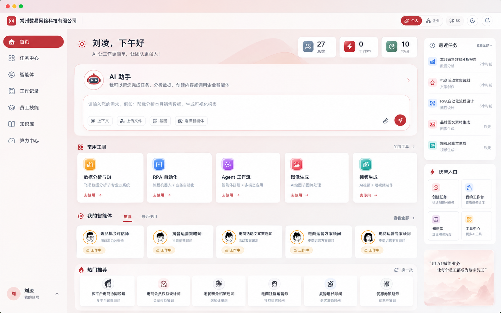

# 首页参考图复刻开发文档

- 日期：2026-10-27
- 范围修订：按用户最新标注，本期移除“常用工具”整块，相关工具入口开发暂缓。
- 状态：前端已实施，已完成针对性验证；原始插画素材与平台热门榜单仍有差异，见第 11 节。
- 调研基线：当前工作区，Git HEAD `bbb604e`；包含用户尚未提交的外壳、导航和样式改动。
- 适用范围：Electron 客户端个人首页内容区；侧栏、顶栏、企业 Logo 和名称统一沿用其他页面。
- 最新修订：用户要求侧栏和企业标识与其他板块一致。本条优先于参考图的外壳尺寸，不再开发首页专用导航或企业顶栏。

## 1. 目标、优先级与边界

本轮按用户提供的图片复刻首页，目标是**在相同窗口尺寸下逐区域对齐本期保留区域的布局、比例、颜色、字体、图标、圆角和留白**，不再提出另一套首页设计。按用户最新要求，“常用工具”整块暂时不做；其余本期模块没有后端时先完成完整的前端展示和交互状态，不能因为接口缺失删除模块或缩成一个“敬请期待”页面。

### 最新范围调整

- 移除“常用工具”标题、五张工具卡、“去使用”操作和“全部工具”入口，本期不开发其组件、弹层、专用素材、接口或测试。
- 五项暂缓能力为：数据分析与 BI、RPA 自动化、Agent 工作流、图像生成、视频生成的首页独立工具入口。既有工作区中的相关能力继续沿用现状。
- “我的员工”紧接 AI 助手面板，“热门推荐”随之上移；删除整块占位，不保留空白带，也不通过放大其他模块填满空出的高度。
- 右侧最近任务、快捷入口和品牌图保持原有结构与位置。快捷入口中的“工具中心”卡片保留外观，仅提示“工具中心暂未开放”，不借此继续开发被暂缓的工具目录。
- 用户最新图片中的红框只标识暂缓范围，外层图片查看器工具栏也不是客户端 UI；两者均不纳入实现。

本次用户截图是首页新的视觉依据，优先于下列既有文档中与它冲突的首页设计：

- `2026-10-26-首页重设计方案.md` 中的“单一工作摘要、不新增输入框、不做三栏”。
- `首页工作台产品与交互打磨方案.md` 中的旧模块优先级与禁止页面滚动要求。
- `DESIGN.md` 中与首页内容区的统计卡、助手面板和浅粉画布冲突的旧约束；共享侧栏和企业标识继续遵守原有规范。

上述取舍只覆盖本次首页视觉；IPC、安全策略、真实状态语义、任务运行与其他页面交互继续遵守现有架构。后续实施时同步更新 `DESIGN.md` 的首页例外说明，不把此次截图样式无差别扩散到工作会话、组织、知识库和算力页面。

### 1.1 本次与后续实施的区分

| 阶段 | 交付 | 完成标准 |
| --- | --- | --- |
| 本次：调研与开发文档 | 参考图归档、代码现状、逐模块规格、能力缺口、实现分期和验收清单 | 文档可直接指导开发；不声称页面已完成 |
| 下一步：前端复刻 | 移除常用工具区后的完整首页、本期入口及前端交互、独立演示数据 | 基准尺寸逐区截图比对；本期缺接口区域也有完整 UI |
| 真实能力接入 | 复用已有任务、员工、通知、附件能力，补齐所需适配 | 真实模式不伪造业务数据，不把演示按钮接到真实执行 |

不新增依赖，不升级 Pi SDK，不修改任务运行框架，不擅自覆盖当前工作区未提交改动。

## 2. 参考图与画布拆解

原图实测为 **1586 × 992 像素**。以下坐标是图片坐标系中的人工读图估计值，通常有 2–4px 误差；用于首轮搭建，最终以叠图校准为准。不能将截图像素未经换算直接当成所有设备上的 CSS 像素。

归档原图保留原始内容供追溯；**本期视觉目标为原图删除常用工具整块后的布局**。中央列后续模块的纵坐标按自然文档流上移，其余保留区域继续对照原图，不再要求与原图中已删除区域逐像素一致。



### 2.1 页面骨架

```text
窗口原生标题栏／拖拽区                                          高约 40
┌────────────────────────────────────────────────────────────────────┐
│ 企业图标 + 企业名称                    个人/企业  ⌘K  主题  通知 │ 高约 52
├──────────────┬───────────────────────────────────────┬──────────────┤
│ 首页         │ 问候语                    三个统计卡  │ 最近任务     │
│ 任务中心     │                                       │ 5 条摘要     │
│ 智能体       │ AI 助手标题与说明                     │              │
│ 工作记录     │ 输入框 + 工具栏 + 附件 + 发送         ├──────────────┤
│ 员工技能     │                                       │ 快捷入口     │
│ 知识库       │ 我的员工  推荐/最近使用        全部 │ 2 × 2        │
│ 算力中心     │ 五张紧凑智能体卡                      ├──────────────┤
│              │                                       │              │
│              │ 热门推荐                       换一批 │ 品牌文案     │
│              │ 六张小推荐卡                          │ 浅粉山景     │
│              │                                       │              │
│ 用户/我的账号│                                       │              │
└──────────────┴───────────────────────────────────────┴──────────────┘
```

结构为“左导航 + 中央内容 + 右摘要栏”。主内容与右摘要栏从顶栏下方开始；问候和统计属于中央列，最近任务从右栏顶端开始，不是位于整个内容区之下。

### 2.2 本期基准尺寸表

我的员工和热门推荐按删除工具区后约上移 218px 估算；下列新纵坐标是排版起点，最终以助手下方约 24–32px 的模块间距和实际文档流校准，不用固定定位硬凑。

| 区域 | 图片中的近似位置 / 尺寸 | 关键约束 |
| --- | --- | --- |
| 原生窗口栏 | `x=0, y=0, w=1586, h=40` | 左上三色按钮由操作系统提供，不用网页画假按钮 |
| 企业与全局操作栏 | `x=0, y=40, w=1586, h=52` | 仅记录原图；实施沿用共享顶栏，企业身份留在共享侧栏 |
| 左导航 | `x=0, y=92, w=212, h=900` | 仅记录原图；实施沿用共享 80/200px 可折叠侧栏 |
| 首页内容起点 | `x≈235, y≈116` | 距侧栏约 23px；中央列右边界约 1321px |
| 问候区 | `x≈246, y≈122` | 太阳图标、姓名问候、说明文字 |
| 统计组 | `x≈943, y≈116, w≈378, h≈67` | 3 张，卡宽约 121–123px，间距约 11px |
| AI 助手面板 | `x≈235, y≈203, w≈1086, h≈227` | 首屏最大交互面板，外圆角约 20px |
| AI 输入框 | `x≈262, y≈301, w≈1036, h≈113` | 面板内部左右约 27px；细粉边与大圆角 |
| 我的员工标题 | `x≈246, y≈458` | 直接接在 AI 助手下方；标签紧随标题，“推荐”有红色下划线 |
| 智能体卡片行 | `x≈242, y≈496, w≈1078, h≈105` | 五列；头像、两行文字、左下状态胶囊 |
| 热门推荐容器 | `x≈237, y≈618, w≈1084, h≈148` | 随智能体区上移；独立浅白面板，内部六列小卡 |
| 右摘要栏 | `x≈1342, y≈120, w≈227` | 与中央列间距约 21px；距窗口右侧约 17px |
| 最近任务面板 | `y≈120, h≈387` | 标题 + 五行，不再给每行套独立厚边框 |
| 快捷入口面板 | `y≈519, h≈255` | 与上方面板间距约 12px；内部四格 |
| 品牌插画面板 | `y≈791, h≈181` | 与上方间距约 17px；文案压在山景上方 |

基准横向关系：`212 + 23 + 1086 + 21 + 227 + 17 = 1586`。此关系只记录原图。按最新要求，实际中央列随共享侧栏 80/200px 自适应，再校准实际边框与内边距，不以统一 `max-width: 1200px` 居中方案替代图片布局。

## 3. 代码现状与差异

### 3.1 真实入口

当前生产入口为：

```text
src/main.tsx
  → App.tsx（登录后）
  → ClientAppPage.tsx
  → useEnterpriseWorkspace(...)
  → PageBody: home/default
  → HomePageRedesign.tsx
  → src/styles/home-v2.css
```

`WorkspaceHomePage.tsx` 是另一套工作区实现，不是当前生产首页。`HomePage.tsx.backup` 不是执行入口。`home-redesign.css` 也不是当前 `HomePageRedesign.tsx` 直接导入的样式文件。后续必须修改正确入口，不能只改备份或旧样式后宣称生效。

### 3.2 现状证据

| 文件 / 符号 | 当前实现 | 对本次的影响 |
| --- | --- | --- |
| `src/pages/ClientAppPage.tsx` / `ClientAppContent` | 侧栏与 `.ent-shell-main` 并列；顶栏在主列内部；个人/企业、命令、主题和通知已存在 | 沿用共享结构；仅为首页传递草稿、显示名与加载状态 |
| `src/components/enterprise/AppSideNav.tsx` / `MAIN` | 六个主入口： 首页、工作、硅基员工、员工技能、知识库、算力中心；企业标识在导航顶部；默认收起 | 沿用共享六项入口、选中逻辑与折叠偏好，不单独拆分 |
| `src/components/enterprise/AppTopBar.tsx` | 左侧仅侧栏切换，右侧为 actions | 沿用共享顶栏，不新增企业身份区域 |
| `src/pages/enterprise/HomePageRedesign.tsx` | 问候、3 个统计、工作中/需关注/空闲员工分组、员工工作抽屉 | 本期需补 AI 助手、智能体标签、热门推荐、完整右栏；常用工具区已暂缓 |
| 同文件 / `groupedDesks` | 工作中先截为 6、空闲先截为 10；顶部统计读取截断后的数组长度 | 全量统计与展示列表必须分开，不能以展示上限计数 |
| 同文件 / 员工卡片 | 直接用 ``，无图时可能为空字符串 | 改为复用 `EmployeeFace` 的头像和回退能力 |
| `src/styles/home-v2.css` | `height: 100%`、外层 `overflow: hidden`，员工区独立滚动；存在 `.section-header` 等通用选择器 | 新首页需要独立命名空间与单一页面滚动，避免旧 CSS 干扰 |
| `src/styles/enterprise.css` | 多代 `.ent-home*`、共享外壳、主题和 macOS 特例共存 | 仅清理确定不再使用的首页规则，不连带删除其他页面样式 |
| `src/pages/WorkspacePreviewPage.tsx` | 浏览器预览默认组织页，个人页只展示“未连接平台” | 必须新增可看到实际首页组件的开发演示模式，不能沿用空页做视觉验收 |
| `src/features/enterprise/home-preview.ts` | `createHomePreview` 已有裁剪列表的纯函数与测试 | 可复用展示上限；不能代替统计、推荐或能力判断 |
| `scripts/test-shell-navigation-ui.mjs` | 已覆盖侧栏宽度、顶栏、拖拽命中、深浅主题、设置和更新面板 | 首页也沿用相同外壳，保留原工作页断言 |

### 3.3 必须保留的约束

- 真实任务继续通过 `useEnterpriseWorkspace` 和现有服务链创建；不在首页直接接入 Pi SDK。
- 页面展示组件不新增对 `window.electronAPI` 的零散调用；平台能力由既有 hook / 容器适配。
- 账号、企业、员工授权、草稿和附件按当前会话作用域隔离；登出和切换作用域清理。
- 通知、主题、命令入口、客户端更新、工具审批和已有账号菜单不能因外观调整失效。
- 当前 Electron 窗口默认 `1200 × 800`，最小 `960 × 640`；参考图更大，必须单独设计收缩行为。

## 4. 视觉规格

### 4.1 配色、排版和装饰

以下为从截图观察和局部像素取样得到的起始值，不是已经通过视觉验收的设计 token。

| 项目 | 起始规格 |
| --- | --- |
| 主品牌色 | 约 `#C0353B`；选中导航和发送按钮带轻微深浅红过渡 |
| 主文字 | 近黑蓝灰，建议从 `#202536` 校准 |
| 次级文字 | 灰蓝，建议从 `#7F8A9F` 校准；正文保持可读性 |
| 页面底色 | 低对比浅粉到浅灰渐变；左上较暖，右下较冷 |
| 面板 | 白色至微粉白；细边、轻阴影；不能换成大面积纯灰或深色面板 |
| 圆角 | 主助手约 20px，输入框约 24px，右侧面板约 14px，员工卡约 10–12px |
| 标题 | 问候约 26px/600，AI 助手约 23px/600，模块标题约 16px/600 |
| 正文 | 导航约 16px，智能体标题约 14–15px，辅助约 12–14px，紧凑推荐约 12px |
| 字体 | 优先现有中文系统字体栈；按相同系统与字体环境验收，不引入网络字体依赖 |
| 图标 | 复用 `lucide-react` 的线性图标；保留统计与快捷入口的彩色底座，按原图校准 |
| 装饰 | 问候区背后浅粉曲线、机器人头像、黑白员工头像、右下粉色山景均属于复刻范围 |

截图中的图标底座和头像是明确的视觉素材，不用 emoji、随机头像或统一圆点替代。仓库目前只定位到通用 `src/assets/logo.png`，没有找到参考图中的完整机器人与山景素材包。本期仅准备保留区域所需素材，五种常用工具底座不在本期清单。能用本地 SVG/CSS 准确表达的图形自行绘制，其余需要单独素材。截图归档仅作验收参考，不把整张截图作为页面背景，也不从它裁出可点击区域伪装实现。

若缺少原始素材、字体或图标源，只能先完成结构与近似素材，再将差异逐项登记；不能提前承诺已经达到逐像素一致。

### 4.2 外壳与侧导航（按最新反馈修订）

- 首页与其他板块使用同一 `AppSideNav`、`AppTopBar`、企业 Logo、企业名称、账号菜单及状态来源。
- 沿用六项导航与 80/200px 折叠宽度，读取并保留用户已保存的折叠偏好；不做首页专用导航。
- 企业标识留在共享侧栏，回退显示、管理员入口与其他页面一致。
- 个人 / 企业、命令、主题、通知、更新及设置沿用共享交互。
- 原生窗栏、拖拽与 Windows 控件避让继续使用现有 44px 契约。
- 首页只增加 `ent-scroll-home` 内容滚动规则，不修改全局外壳位置或品牌样式。

### 4.3 问候与统计

- 左侧太阳图标、`{显示名}，{时段问候}`，下一行为“AI 让工作更简单，让团队更强大！”。开发演示固定下午问候以便截图稳定；真实模式使用当前本地时段。
- 右侧为“总数 / 工作中 / 空闲”三张紧凑卡，图标底座分别为灰蓝 / 红 / 青绿。
- 截图数据 `27 / 0 / 10` 只用于视觉演示，不能写进真实业务统计。
- 真实“总数”采用当前用户可见且授权的智能体数量；“工作中”按活跃工作涉及的员工去重，“空闲”按已确认可用、未活跃的员工统计。不可用、需授权、未知状态不冒充空闲；因此三者不保证相加相等。
- 先从全量数据算统计，再分别裁剪卡片列表。加载中显示等尺寸骨架或 `—`，读取失败保留错误与重试入口，不伪装成 0。

### 4.4 AI 助手

面板保留当前首页机器人头像、标题、说明、粉色描边、圆角和红色发送按钮的视觉样式。

2026-10-28 按用户最新要求精简输入工具栏，底部从左到右为：

1. 唯一的回形针附件入口（支持现有文件选择和粘贴导入）。
2. `选择员工`。
3. 靠右的语音输入按钮。
4. 最右红色圆形发送按钮。

交互要求：

- 移除“上下文”“截图”按钮、对应弹层和上下文字段；不向发送内容拼接隐藏上下文。
- 文本、已选员工与附件属于同一个首页草稿；菜单开关和页面切换不清空输入。
- 中文输入法组合中不能误发送；Enter 发送、Shift+Enter 换行，与正式会话约定对齐。
- 空文本、附件处理中、录音或识别中、重复提交、员工不可用、接口失败均按真实状态处理；失败保留草稿。
- 选择员工面板可搜索当前授权员工；选中后显示可移除标签。
- 单个附件入口复用现有附件导入 session；保留移除、重试、粘贴和退出清理。
- 语音复用 `useSpeechInput` / `SpeechInputActions`，支持点击麦克风或输入框内长按空格录音、停止、取消和光标处转写；转写后由用户手动发送。
- 取消、失焦、切换员工或离开首页时终止录音，避免异步转写落入其他输入框；演示模式不调用麦克风。
- 成功提交后进入现有工作会话。

### 4.5 常用工具（本期暂缓）

按用户最新要求，该区域整体移出本期范围：不展示标题、五张卡片、“去使用”按钮或“全部工具”入口，不创建对应组件、目录弹层和独立工具页面，也不预留原区域高度。

后续如恢复开发，再单独确认入口、页面与真实能力接入。本期验收以“AI 助手 → 我的员工 → 热门推荐”的中央列顺序为准。

### 4.6 我的员工与热门推荐

- “我的员工”与当前业务模型 `SiliconEmployee` 对应，改变展示用语即可，不重命名底层 subscription 和运行对象。
- “推荐 / 最近使用”为两个真实可切换标签；默认推荐，红字和短下划线；切换不改变页面网格。
- 基准五列，每卡有圆头像、名称、职责说明、状态胶囊；长名称单行截断并可查看全文。
- 推荐列表当前可由授权目录按稳定规则展示，不能伪装为平台个性化推荐。最近使用从真实工作参与关系与时间生成，不用数组当前顺序冒充。
- 截图的卡片状态为浅橙“工作中”；演示可还原。真实模式必须按员工状态显示“工作中 / 空闲 / 不可用 / 需授权”等，不能全量硬编码“工作中”。
- “查看全部”进入已有员工列表；点击真实员工可看详情或预选开始对话，目标由入口文案说明。
- “热门推荐”独立面板有火焰图标和右上“换一批”，内部六张居中小卡，每张含头像、名称、短职责。
- 缺少平台热门榜单时，演示使用固定卡片；真实模式展示前端配置的能力推荐并说明来源，不能宣称热度排名来自平台。
- 换一批仅轮换已有推荐集合；不足一批不凭空生成重复员工，不在刷新时闪空整个面板。

### 4.7 右侧栏

| 模块 | 结构与文案 | 交互 |
| --- | --- | --- |
| 最近任务 | 时钟图标、“最近任务”、“查看全部”；五行彩色图标、标题、类别、相对时间 | 按真实 `updatedAt` 倒序展示最近 5 条，点击进入 work；查看全部进入 records |
| 快捷入口 | 闪电图标、“快捷入口”；2×2 网格 | 创建任务、我的工作台、知识库复用既有入口；工具中心保留卡片并提示暂未开放 |
| 品牌图 | 浅粉山峦背景，两行文案 | 默认装饰内容，不擅自增加外部链接或广告跳转 |

演示最近任务按图依次为“本月销售数据分析报告”“电商活动文案策划”“RPA 自动化流程设计”“品牌图文素材生成”“短视频脚本生成”，时间为 2/3/5 小时前、昨天、昨天。真实任务无可靠业务类别时显示已有权威会话/编排分类，不能根据关键词猜出“数据分析/图像生成”等类别。

快捷入口承接：创建任务进入现有创建模式；我的工作台打开当前用户工作列表；知识库进入现有知识库；工具中心点击后仅提示“工具中心暂未开放”，不打开工具目录、不跳转到其他页面。右下文案按原图为“用 AI 赋能业务 / 让每个员工都成为数字员工”。

## 5. 现有能力与接口缺口

以下结论来自当前代码，不代表已经完成首页接线。**“已有运行能力”不等于“截图中的独立产品模块已经存在”。** 本阶段不需要为首页创造一个全新的聚合后端接口。

### 5.1 能力矩阵

| 图中能力 | 已核实的代码入口 | 判断与下一步 |
| --- | --- | --- |
| 用户、企业身份 | `use-client-profile.ts`、`profile-display.ts`、`ClientAppPage.tsx` | 已有真实数据与头像 / Logo 回退；问候、侧栏和顶栏使用一致的显示名 |
| 个人 / 企业切换 | `ClientAppPage.tsx` 中的 `workspace.navigate` | 已有；分别进入 `home` 与 `organization`，是视图切换，不是更换登录账号或企业授权 |
| 命令、主题、通知、更新 | `CommandPalette.tsx`、`NotificationCenter.tsx`、`UpdateNotice.tsx` | 已有；复用现有交互，更新入口保留在全局操作中，不因图中未显示就删除 |
| 员工目录与状态 | `use-workspace-employees.ts` / `getSubscriptions`、`getEmployeeStatus`；`useEnterpriseWorkspace.ts` | 已有查询、loading/error/retry；首页需获得这些状态并与任务活跃信息组合 |
| 通用 AI 助手 | `general-assistant.ts` / `GENERAL_ASSISTANT_ID`、`generalAssistant`；`useEnterpriseWorkspace.ts` / `startConversation` | 已有真实启动路径；公共模型来自可用员工模型的交集，交集为空时不能发送 |
| 指定智能体会话 | `startConversation(employeeId, text, options)`；`arrange/ChatArrange.tsx` | 已有；复用员工搜索、授权检查、运行前检查和成功后的 work 跳转 |
| 创建及执行编排 | `useEnterpriseWorkspace.ts` / `arrangeWork`，现有 arrange 页面 | 已有；创建任务继续使用 `arrange` 的 `auto/manual/pick`；常用工具区的 Agent 工作流入口本期暂缓 |
| 文件选择、图片粘贴、移除、附件状态 | `attachments/AttachmentComposer.tsx`、`use-attachment-composer.ts`、`src/shared/attachment-contracts.ts` | 已有；首页单个附件入口复用导入会话，不重写附件存储与权限链 |
| 首页截图入口 | 用户 2026-10-28 明确要求移除 | 不在当前首页工具栏提供截图按钮；粘贴导入图片仍由现有附件链路支持 |
| 首页上下文选择器 | 用户 2026-10-28 明确要求移除 | 不在首页提供独立上下文选择器，也不向提交正文拼接隐藏背景信息 |
| 最近任务 | `workspace.works`、`work-record-filters.ts`、`vocabulary.ts`、`WorkIndicators.tsx` | 数据、分类、时间与跳转已有；当前 workspace 没有独立的任务列表 loading/error/retry，需要补齐状态投影 |
| 推荐 / 最近使用 | `SiliconEmployee`、`WorkItem.participants`、`lastWorkedAt` | 最近使用可本地计算；未定位到首页个性化推荐接口，推荐先用稳定的前端配置 / 已授权目录 |
| 热门推荐与换一批 | 当前首页没有相应模块 / 榜单链路 | 前端先实现展示和换批；需要平台热度与个性化时再定义正式接口 |
| 独立 BI / RPA / 工具目录 | `AppRoute` 无这些独立页面 | 本期暂缓，不新增页面、弹层、配置界面或接口；仅保留右侧工具中心卡片的未开放提示 |
| 图片 / 视频 | 当前工作区已有媒体偏好、生成与产出相关能力 | 既有能力维持现状；本期不新增首页独立生成工具入口或工具页 |

补充边界：`ConversationOptions.skillIds` 当前只有界面层记录，代码注释明确表示尚无技能下发通道。不能因参数存在就声称首页选择的技能已经影响执行。`templates` 中有本地占位模板、`savedFlows` 为本机持久化数据，均不能作为平台“热门”或服务端模板已上线的证据。

### 5.2 首页发送的真实路径

```text
首页草稿：正文 + 已选智能体 + 附件导入会话
  → 未选员工时使用 GENERAL_ASSISTANT_ID；已选员工时使用真实 subscriptionId
  → workspace.startConversation(id, text, options)
  → createArrangementDraft
  → 必要时 updateArrangementInputs（附件）
  → preflightArrangementDraft
  → confirmAndStartArrangement
  → workspace.navigate({ name: 'work', workId })
```

不能绕过模型授权、预检、幂等启动或工具审批。通用助手只支持其已有能力，不额外承诺“自动调用所有企业智能体”。正文可保留图中的介绍文案，具体可执行范围以当前权限与员工能力为准。

`ChatArrange` 现有内部管理文本、员工选择与附件，直接整块嵌入会带来额外布局和状态。建议复用其快捷键、选择逻辑与附件 hook，为首页建立匹配截图的组合组件；必要的复用提取以已有行为测试保护，不扩大为通用表单框架。

### 5.3 首页新增入口的路由映射

| 可见入口 | 目标 | 注意 |
| --- | --- | --- |
| 侧栏：首页 | `{ name: 'home' }` | 首页独立选中 |
| 共享侧栏：工作 | `{ name: 'records' }` | arrange / records / work 共用选中态 |
| 共享侧栏：硅基员工 | `{ name: 'employees' }` | 沿用授权与可见范围 |
| 员工技能 / 知识库 / 算力中心 | `skills` / `knowledge` / `compute-center` | 继续使用现有页面 |
| AI 面板右上箭头 / 创建任务 | `{ name: 'arrange', mode: 'pick' }` | 有未发送草稿时经首页草稿所有者保存，不静默丢失 |
| 我的工作台 / 最近任务查看全部 | `{ name: 'records', bucket: 'all' }` | “我的”指当前登录作用域，无跨成员任务查询 |
| 具体最近任务 | `{ name: 'work', workId }` | 使用真实 ID；演示数据不进真实工作会话 |
| 智能体查看全部 | `{ name: 'employees', scope: 'mine' }` | 不跳到未授权企业目录 |
| 快捷入口：工具中心 | 本地提示“工具中心暂未开放” | 本期不开发工具目录、工具弹层或新路由；中央“全部工具”入口不展示 |

不新增 `AppRoute` 联合类型；共享导航的 arrange / records / work 继续归“工作”，首页创建任务按钮直接进入 arrange。

2026-10-28 按用户要求，`useEnterpriseWorkspace` 初始路由调整为 `home`，用户登录后默认进入主页；企业组织页继续通过企业切换入口访问。

### 5.4 必须补齐的状态，而非新业务后端

1. 员工列表与状态的 `loading / error / retry` 从 `ClientAppPage` 传给首页容器，避免只在顶层通知条展示、统计却先出现 0。
2. `getAllTasks()` 当前在 `useEnterpriseWorkspace` 内初始化读取，失败没有完整对外表达。为最近任务增加明确的查询状态与重试；实时推送更新继续沿用已有合并逻辑，不能被迟到的初次查询覆盖。
3. 首页数据投影显式区分 `live` 与 `visual-fixture`，演示统计不进入 `EnterpriseOverview` 或任何持久化任务表。
4. 首页未发送草稿由账号 / 企业作用域的所有者持有；页面切换保存，退出释放附件会话。不能把含敏感正文和文件路径无条件写入通用 localStorage。

## 6. 前端结构与文件计划

以下结构已用于实施；小型展示区仍在主组件内联。组件按独立交互边界拆分，小型标题和统计可以内联，避免为每个装饰图标创建文件。

```text
ClientAppPage                       共享外壳、草稿所有者、真实能力适配
├── AppTopBar                        共享全局操作
├── AppSideNav                       共享导航、企业标识与账号
└── HomePageRedesign                 首页布局与容器，不直接调用 IPC
    ├── GreetingAndStats             问候与全量统计
    ├── HomeAssistantCard            草稿、选择员工、文件、语音与发送
    ├── HomeEmployeeSections         我的员工 + 热门推荐
    └── HomeSidebar                  最近任务 + 快捷入口 + 品牌图
```

| 文件 | 动作 | 变更目的 |
| --- | --- | --- |
| `src/pages/enterprise/HomePageRedesign.tsx` | 修改 | 保留当前生产入口与导出名，替换为参考图结构 |
| `src/components/enterprise/home/` | 按需新增上述有交互的组件 | 职责清晰，不引入第二套运行状态 |
| `src/features/enterprise/home-view-model.ts` | 新增纯数据投影 | 统计、上限、排序、最近使用、可用能力；不发起 IPC |
| `src/features/enterprise/home-draft.ts` | 新增 | 有作用域的草稿和附件生命周期；与现有 session 所有者整合 |
| `src/features/enterprise/useEnterpriseWorkspace.ts` | 小范围修改 | 暴露最近任务查询状态 / 重试；复用已有创建路径 |
| `src/pages/ClientAppPage.tsx` | 修改 | 共享外壳不变，传递草稿、状态和显示名 |
| `src/components/enterprise/AppTopBar.tsx` | 复用 | 与其他板块使用相同顶栏 |
| `src/components/enterprise/AppSideNav.tsx` | 复用 | 与其他板块使用相同导航及企业标识 |
| `src/styles/home-v2.css` | 替换当前首页规则 | 新规则放在 `.sep-home` / `.ent-scroll-home` 命名空间 |
| `src/styles/enterprise.css`、`icon-navigation.css` | 最小修改 | 外壳适配、旧首页冲突规则收敛，不追加一层无边界覆盖 |
| `src/assets/home/` | 新增必要素材 | 机器人、山景、装饰曲线和保留区域图标；不制作常用工具底座，文件可离线加载 |
| `WorkspacePreviewPage.tsx`、`main.tsx` | 修改开发预览分支 | 访问明确的首页演示入口，共用真实首页展示组件 |
| `src/preview/home-fixtures.ts` | 按需新增 | 仅开发 / 测试加载的固定演示数据 |
| 首页测试、`scripts/test-shell-navigation-ui.mjs`、`DESIGN.md` | 对应调整 | 覆盖新行为，保留现行工作页验收约束 |

首页保持共享顶栏和侧栏位置，不再增加外壳变体，也不挂载第二套通知轮询和账号状态。路由切换不重建 `useEnterpriseWorkspace`、媒体作用域和会话所有者。

### 6.1 演示模式与真实模式

- 开发演示入口建议 `?preview=home`，仅 `import.meta.env.DEV` 时允许；现有 `?preview=workspace` 保持原用途。
- 演示使用同一套首页展示组件，固定用户名、企业名、时间、图中的统计、五张员工卡、六张推荐卡和五条任务；来源明确标记为视觉 fixture。
- 演示数据在开发分支动态加载；不向全局注入完整假 `electronAPI` 来冒充在线客户端，不把演示模块无条件混入生产页面。
- 演示模式按钮通过本地回调演示弹层、标签、轮换和输入反馈；任何发送均提示“演示模式，不会创建真实任务”，不能触发付费模型、系统截图或文件写入。
- 真实模式不因接口出错回退到演示员工与假历史；有数据用数据，无数据展示同等完整的空状态结构。
- 本期不提供常用工具区或工具目录的演示数据；工具中心卡片在演示与真实模式均只展示未开放提示。假员工、假工作和假热度仅属于演示数据。

## 7. 窗口收缩与滚动策略

1586 × 992 是逐图复刻基准；其余窗口保持相同内容顺序和视觉语言，不要求缩放整张画布。断点按实际可用内容宽度校准，以下为实施起点。

| 窗口 | 布局策略 | 验收重点 |
| --- | --- | --- |
| 1586 × 992 | 展开导航约 212px、中央约 1086px、右栏约 227px；员工 5 列、推荐 6 列 | 本期保留模块首屏完整呈现；我的员工与热门推荐按第 2.2 节上移 |
| 1440 × 900 | 保留三列；中央卡片随网格收缩；字号不全局缩小 | 智能体名称和最近任务无横向溢出 |
| 1280 × 800 / 默认 1200 × 800 | 内容空间不足时右栏移至中央模块之后；员工 3+2、热门 3+3 | 本期模块均可到达；不把右栏隐藏为缺失功能 |
| 最小 960 × 640 | 左导航约 180–200px，主体单列模块；员工 2 列，右栏顺序排在底部 | 输入区可用，文本不压到 9px，菜单 / 发送按钮无重叠 |
| 200% 文本放大 / 长姓名 / 连续长英文 | 允许自然增高、适当换行或可访问省略 | 所有操作可聚焦，无整体横向滚动 |

滚动规则：固定原生窗栏、全局顶栏和左导航；首页内容区承担唯一的页面纵向滚动。模块内不再嵌套最近任务滚动条、员工横向轮播与独立员工墙滚动。小窗口允许页面变长，不用固定高度加 `overflow: hidden` 隐藏热门推荐。

深色模式继续可用，做单独 token 校准；图片一致性的主验收以浅色模式为准。`prefers-reduced-motion` 下关闭非必要动画；默认不添加参考图没有的循环呼吸、持续旋转和错峰入场。

## 8. 实施顺序与交付物

| 阶段 | 工作 | 可审查产物与出口条件 |
| --- | --- | --- |
| 1. 外壳与布局 | 共享外壳、中央 / 右栏网格 | 同尺寸静态骨架截图；其余页面现有布局无回归 |
| 2. 全量视觉 | AI 助手、5 智能体、6 热门、右栏三块、本期装饰素材 | 固定 fixture 的完整首页；确认工具区不展示且无占位；初次叠图差异清单 |
| 3. 前端交互 | 输入草稿、语音、员工选择、附件入口、换批、导航、工具中心未开放提示 | 本期入口可操作；缺后端入口有完整面板与状态说明，不扩展工具目录 |
| 4. 真实能力 | 通用助手与指定员工会话、已有附件、最近工作、真实状态、通知与主题 | 创建成功进入 work；失败保留输入；演示与真实数据隔离 |
| 5. 校准与验收 | 素材、像素对齐、最小窗口、深色、可访问与其他页面回归 | 基准叠图、差异记录、通过的测试记录与未解决项 |

阶段 1–2 不以接口未开放阻塞完整页面；阶段 4 也不为追求演示效果伪造运行成功。每个阶段产出真实可截图的页面，避免长时间只调整内部模型而没有前端结果。

## 9. 验收与验证计划

### 9.1 视觉验收方法

1. 以归档原图和本次明确的范围调整为视觉对照：删除常用工具整块，并按第 2.2 节将中央后续模块上移；固定平台、字体、缩放、fixture、时钟和加载完成状态。
2. 浏览器展示层使用 `1586 × 992`、100% 缩放、固定 device scale factor；另取 Electron 实窗截图，记录系统缩放、原生标题栏与内容边界。原生截图先统一坐标和比例再比较，不把物理像素误差当作 CSS 偏移。
3. 输出原图、本期调整后的比对基准、实际图、50% 叠图与差异图；调整基准需明确记录删除工具区及约 218px 上移。重点检查顶栏 / 侧栏、助手、两行卡片与右侧栏边界，不将已暂缓区域计为缺失实现，也不任意屏蔽保留区域的差异。
4. 基准结构坐标在校准后以 ≤2 CSS px 的几何偏差为目标；卡片数、顺序、标题、各入口和区域归属必须完全正确。头像、装饰和字体差异单独登记，不能用整体相似度掩盖缺模块。
5. 首轮近似素材不等于完成“百分百复刻”；所有已登记的素材差异与结构差异收敛后再交付视觉验收。
6. 自动截图 / 差异图建议放 `output/playwright/home-reference/`，只提交项目约定需要保留的基准，避免批量纳入临时产物。

### 9.2 功能和数据检查清单

- [ ] 1586 × 992 下复用共享顶栏、侧导航、企业标识，并展示中央内容和右侧栏；中央顺序为问候与统计、AI 助手、我的员工、热门推荐。
- [ ] 常用工具标题、五张工具卡、“去使用”和“全部工具”入口均不展示，无原区域高度占位；没有新增相关工具目录或接口。
- [ ] 五张我的员工、六张热门推荐、五条最近任务均完整呈现，保留模块的标题和“查看全部”等入口齐全。
- [ ] 全量 27 位以上员工、超过 6 位工作中或 10 位空闲时，统计不受展示上限影响；不把未知 / 失败查询计成 0。
- [ ] 真实员工状态与最近工作有依据；通用助手不计入平台员工总数；推荐 fixture 不进入真实目录。
- [ ] AI 助手文字、选择员工、语音、附件都可操作；IME、换行、重复发送和附件处理中状态正确。
- [ ] 通用助手无公共模型、员工失去授权、预检失败、发送失败均有反馈，正文与可恢复附件不会丢失。
- [ ] 首页与工作区切换、账号 / 企业作用域切换、登出时草稿与附件生命周期正确，无跨账号残留。
- [ ] 单个附件入口复用导入 session；移除、失败重试、粘贴、成功交接与退出清理均正确。
- [ ] 最近任务按更新时间排序；权威类型加载失败保持未知；点击进入正确 work，删除后不再显示旧项。
- [ ] 推荐 / 最近使用标签和换一批有实际状态；右侧工具中心卡片仅提示暂未开放，不打开工具目录或触发业务执行。
- [ ] 个人 / 企业、主题、命令、通知、更新、设置、退出和工具审批仍可用。
- [ ] 所有尺寸无整页横向滚动、遮挡或裁切操作；图标按钮有可访问名称、菜单支持 Esc 与焦点返回。
- [ ] macOS 原生窗口按钮和 Windows 右上窗口按钮不压住企业名称与工具栏；拖拽区不吞按钮点击。
- [ ] 生产运行不加载视觉 fixture，浏览器演示不执行真实任务。

### 9.3 后续实施应运行的检查

```bash
# 首页和共享外壳实现后
npm run typecheck
npm run lint
npm run test:renderer
npm run build
node scripts/test-shell-navigation-ui.mjs

# 针对既有数据 / 附件 / 状态口径的快速回归
npx tsx --test src/features/enterprise/home-preview.test.ts \
  src/features/enterprise/work-record-filters.test.ts \
  src/features/enterprise/conversation-sessions.test.ts \
  src/features/enterprise/use-attachment-composer.test.ts \
  src/components/enterprise/AppSideNav.test.tsx
```

新增首页数据投影和交互测试应加入现有 renderer 测试发现范围。另增加首页截图脚本，与外壳脚本共用已有 `playwright-core` / Vite 能力；不要为截图再装一套依赖。

若只改 renderer，不要求运行全部 Pi POC。若后续实现原生截图涉及 IPC、preload 或层结构，运行 `npm run check:boundaries` 和对应 controller / service 测试；若触及 `electron/main.ts`、Pi 或启动加载边界，按 AGENTS.md 追加四个 POC、typecheck 和 build。运行并发变化才追加相应 invariants。

**实施验证记录见第 11 节。** 上述清单保留为完整验收目标，未实测的真实平台或原生窗口行为不标记通过。

## 10. 尚待实现阶段收敛的事项

| 事项 | 当前状态 | 处理策略 |
| --- | --- | --- |
| 机器人、黑白头像、粉色山景原始素材 | 只有用户截图，没有找到独立源文件 | 单独准备本期素材并逐项比对；这是精确视觉验收项，常用工具底座不在本期范围 |
| 字体与屏幕像素比例 | 截图未附字体 / DPR 元数据 | 在目标机器固定字体和缩放，以叠图校准；不承诺跨系统字体渲染完全相同 |
| 原生窗口栏 40 / 44px 差异 | 已核实参考图与现行契约不同 | 与页面几何分开记录；需改契约时同步跨平台回归 |
| 首页截图、统一上下文、热门榜单 | 未发现可直接接线的完整首页能力 | 先实现本期前端与明确能力提示；真实后端按契约单独补齐 |
| 常用工具与独立工具目录 | 用户明确暂缓 | 本期不实现，不作为阻塞项或验收项；后续恢复需重新确认范围 |
| 首页任务读取状态 | 当前 workspace 未完整暴露 | 最小范围补状态与重试，保持现有推送和首屏查询合并语义 |
| 既有未提交改动 | 外壳、导航、样式和相关测试已有用户改动 | 在其基础上做可审查的小改动，不恢复旧版本覆盖 |

最终交付必须同时提供完整页面、同尺寸对比截图和剩余差异清单。前端已实现，验证结果和剩余视觉差异见第 11 节。

## 附录：核心调研证据位置

下列行号对应本次调研工作区，用于快速复核；后续实现会使行号移动，优先按符号查找。

| 结论 | 文件与位置 |
| --- | --- |
| 首页生产入口与路由分发 | `src/pages/ClientAppPage.tsx` 的 `HomePageRedesign as HomePage` 导入与 `PageBody` |
| 当前员工分组、统计展示上限 | `src/pages/enterprise/HomePageRedesign.tsx:20–45` |
| 会话参数与技能下发限制 | `src/features/enterprise/useEnterpriseWorkspace.ts:90–103` |
| 首页可复用 workspace 接口 | 同文件 `:173–230` 的 `EnterpriseWorkspace` |
| 登录默认进入主页 | 同文件的 `useState<AppRoute>({ name: 'home' })` |
| overview 的员工数与任务数来源 | 同文件 `:396–412` |
| 初次任务查询与推送合并 | 同文件 `:506–525` |
| 通用 / 指定员工创建会话 | 同文件 `:619–658` 的 `startConversation` |
| 通用助手公共模型交集 | `src/features/enterprise/general-assistant.ts:4–14` |
| 路由枚举与 arrange 模式 | `src/features/enterprise/types.ts:274–300` |
| 附件展示与选择 | `src/components/enterprise/attachments/AttachmentComposer.tsx:23–56` |
| 文本、剪贴板图片导入 | `electron/preload.ts:22–76`；不是原生桌面截图 |
| 附件 IPC 能力 | `src/shared/ipc.ts:335–341` |
| 原生窗口栏高度与 Windows 控件避让 | `electron/common/window-layout.ts:1–43` |
| 默认与最小窗口尺寸 | `electron/bootstrap/main-window.ts:24–42` |


## 11. 实施记录（2026-10-27）

### 已完成

- 按最新反馈复用其他页面的侧栏、顶栏、企业 Logo 和公司名；撤销首页专用外壳及七项导航。
- 首页内容按问候与统计、AI 助手、我的员工、热门推荐排列；常用工具整块移除，无高度占位。
- 右侧最近任务、四个快捷入口与山景保留；小窗口自然换行到内容下方。
- 真实统计使用全量授权员工；最近使用只包含真实参与过任务或具有有效时间戳的员工。
- 草稿在登录作用域内持有；跨页保留正文、员工与附件，退出作用域清理。
- 发送复用既有 startConversation、预检与任务启动；单一附件入口支持移除和版本校验的粘贴。
- 开发专用 `?preview=home` 复用真实展示组件；演示发送与导入不调用真实 IPC。

### 验证记录

- `npm run typecheck`：2026-10-28 通过。
- `npm run test:renderer`：2026-10-28 通过（444 项）。
- `npm run build`：2026-10-28 通过；生成配置的 buildTime 副作用已恢复。
- `node scripts/test-shell-navigation-ui.mjs`：通过 macOS / Windows 四组共享外壳场景。
- `node scripts/test-home-ui.mjs`：2026-10-28 验证四种尺寸、浅深色、侧栏折叠、移除的工具项、员工选择、演示发送、工具中心提示与无横向溢出。
- `node scripts/test-home-composer-ui.mjs`：2026-10-28 验证单一附件入口、跨页保留、员工选择、粘贴版本、IME、换行、失败保留、重复锁、成功清空与作用域清理。
- `npm run test:speech:client`：新增首页端到端语音用例通过，验证光标处转写、录音时拦截发送、取消保留草稿及导航时清理；完整语音客户端套件本次 16 项中 8 项通过、8 项失败，失败涉及其他入口的录音错误提示、IME / 设置等，未据此宣称全套通过。
- 本次相关文件 ESLint：通过。全仓 `npm run lint` 仍被 `.release/commit-checks/build-workspace` 构建副本和既有脚本错误阻断，不能宣称全仓 lint 通过。
- 截图：`output/playwright/home-reference/home-{1586,1440,1200,960}.png` 及对应 dark 文件。

### 剩余差异与验证边界

- 机器人和山景为本地 SVG 近似素材，未取得原图素材包；头像由平台提供，演示为现有 Dicebear。尚不能声称原始插画逐像素一致。
- 推荐使用授权目录，未接平台热度榜单；真实界面标注推荐来源。
- 2026-10-28 已移除上下文、截图和重复上传按钮；单个附件入口继续支持粘贴导入，新增共用语音输入。
- 自动交互通过受控 IPC 验证，未发起真实付费任务，也未完成所有目标平台的 Electron 原生实窗像素验收。
