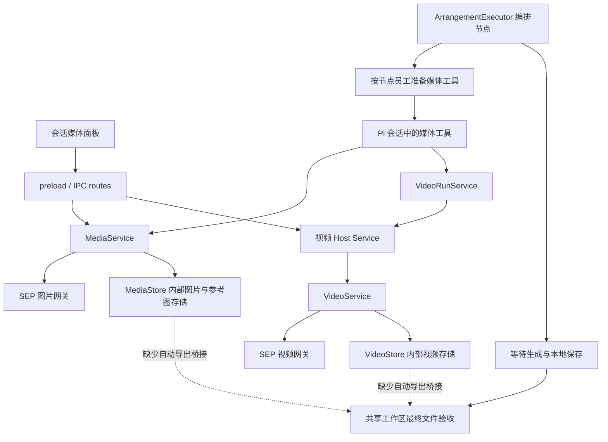

# 生图、生视频使用逻辑与编排接入调研

- 调研日期：2026-10-21。
- 文档状态：参考，记录调研时的实现，不替代架构基线或接口契约。
- 调研对象：当前 `sep-client` 工作区，包含已有但尚未提交的视频授权、技能复用相关修改。
- 调研方式：静态调用链分析及针对性自动化测试；未调用真实付费生成接口，未验证线上员工实际授权配置，未核验已安装客户端版本。
- 变更范围：本次只新增调研文档并更新索引，不修改业务实现。

## 1. 结论

生图、生视频已经接入编排的节点执行器。每个节点可以按自己的员工订阅获得媒体工具，执行器也会等待媒体结果保存后再继续节点完成流程。

但当前实现尚不具备完整的媒体编排交付闭环：

1. 默认“只读”不能生成；“工作区编辑”的默认工具清单也没有媒体生成工具，现有界面需要选择“完整本地权限”。
2. 生成结果保存到内部媒体库，没有自动写入编排规定的共享工作区交付路径。
3. 生图产物属于 `output`，图生视频只接受 `reference`，两者没有自动转换。
4. 编排详情页没有挂载媒体面板，缺少现成的参考图导入、预览、播放和导出入口。
5. 编排启动预检没有验证目标媒体操作、模型规格和相关工具权限；文件验收也尚未针对图片和视频适配。

因此，当前准确的能力描述是：**编排可按条件调用生成工具并等待结果，但不能据此承诺“生图 → 图生视频 → 下游加工 → 文件验收”的全自动流程已经可用。**

## 2. 总体调用关系



生产装配位于 [build-backend.ts](../../electron/bootstrap/build-backend.ts#L197)：图片使用 `MediaService` 与 `SepRealMediaGateway`；视频使用 `VideoRunService`、`MockVideoHostService`、`VideoService` 与对应网关。`MockVideoHostService` 虽然名称带 Mock，但生产装配也使用这个类，实际模式由配置和网关决定，不能仅凭类名判断是假调用。

## 3. 当前生图逻辑

### 3.1 使用入口与工具

界面入口是 [MediaArtifactsPanel.tsx](../../src/components/workspace/MediaArtifactsPanel.tsx)，经 preload 调用 [media IPC 路由](../../electron/controller/routes/media.ts#L11)。支持任务能力读取、参考图导入与选择、生成、预览、导出、恢复跟踪、重试保存、取消及显式重做。

Agent 可使用的工具定义在 [pi-coding-agent-adapter.ts](../../electron/pi/sdk/pi-coding-agent-adapter.ts#L230)：

| 工具 | 用途 |
| --- | --- |
| `media_get_capabilities` | 查询图片能力、模型配置和面板选中的参考图 |
| `media_generate_image` | 生图或编辑图片 |
| `media_get_job` | 查询任务状态与本地资产 |
| `media_cancel_job` | 停止本地跟踪，或按授权请求取消上游任务 |

模型可只传 `creativeBrief`，主进程按员工授权配置选择 profile，并补齐比例、尺寸、质量和数量等默认值。编辑操作要求参考图；工具输入最多接受 16 个参考图 ID，具体操作和数量仍受 profile 能力限制。模型不能通过任意文件路径直接上传素材。

### 3.2 执行顺序

1. 核对任务所属用户、企业、员工订阅及图片能力。
2. 检查工具策略，以及操作、比例、尺寸、质量、数量和参考图是否符合 profile。
3. 对需要上传的参考图取得传输审批，并校验上传后的哈希与有效期。
4. 请求报价，核对请求绑定、有效期、平台授权、预算授权、金额及币种。
5. 取得生成审批，持久化请求身份及冻结参数，再提交生成。
6. 跟踪原请求，下载结果并校验完整性，保存到内部媒体库。

图片只有在 `full-local + auto-approve` 同时成立时，才跳过人工上传/生成确认；报价和预算检查仍执行。涉及参考图的真实网关请求可能分为“上传前确认”和“报价后生成确认”两次审批。

证据：[MediaService.prepareRun](../../electron/service/media-service.ts#L182)、[生成权限和参数检查](../../electron/service/media-service.ts#L266)、[上传与报价审批](../../electron/service/media-service.ts#L313)。

### 3.3 产物与恢复

结果保存为任务级媒体资产。Agent 获取的资产视图包含 ID、来源、格式、大小、宽高和保存状态，不包含本地文件路径或供应商下载地址。现有导出由主进程提供，界面通过原生保存对话框选择目标位置；Pi 图片工具没有导出或读取资产字节的入口。

下载失败可以恢复原结果；提交响应丢失时按原请求身份查询，不能把恢复等同于重新生成。显式“重做”才会发起新生成，并重新走授权和报价流程。

证据：[资产视图](../../electron/service/media-service.ts#L101)、[导出 IPC](../../electron/controller/routes/media.ts#L29)、[恢复与重做](../../electron/service/media-service.ts#L494)。

## 4. 当前生视频逻辑

### 4.1 使用入口与工具

视频面板为 [VideoArtifactsPanel.tsx](../../src/components/workspace/VideoArtifactsPanel.tsx)，由媒体面板统一挂载；IPC 位于 [routes/video.ts](../../electron/controller/routes/video.ts)。

Agent 工具定义位于 [pi-coding-agent-adapter.ts](../../electron/pi/sdk/pi-coding-agent-adapter.ts#L136)：

| 工具 | 用途与约束 |
| --- | --- |
| `video_get_job` | 传 jobId 查询单个任务；传 `{}` 查询当前视频 profiles、规格、任务和参考图 |
| `video_generate` | 文生视频，不接受参考图 |
| `video_from_image` | 图生视频，必须提供一个当前任务中已保存的参考图 ID |

生成工具接受创作描述，主进程选择授权 profile 和后端默认规格。用户明确提出时长、比例、分辨率、帧率、音频或格式时，才按支持的规格传参；不应要求用户自行配置 profileId。

### 4.2 启用、授权与提交

视频运行服务会核对员工订阅、`runtime.video`、`executionAvailable`、执行模式和工具策略。真实与 Mock 模式不能混用。当前配置在没有显式关闭且未启用 Mock 时默认启用真实视频通道；这只代表通道已装配，不代表任意员工都已获得视频授权。

实际流程为：校验 operation 与 profile → 检查策略 → 如需参考图则审批并上传 → 请求报价并冻结参数 → 取得生成审批 → 复核授权及配置 → 提交原请求 → 跟踪、下载与保存。

媒体模型来自员工 `runtime.media` / `runtime.video` 中的 profile，不等于编排节点用于运行 Agent 的对话 `modelId`。当前 `authorizeRuntime()` 只获取在线媒体能力，完整技能准备保留在节点运行准入阶段；不能把每次媒体授权理解为重新下载整套技能。

证据：[video-run-service.ts](../../electron/service/video-run-service.ts#L30)、[视频模式配置](../../electron/common/config.ts#L3)、[视频生成流程](../../electron/service/mock-video-host-service.ts#L380)、[轻量媒体授权](../../electron/service/employee-authorizer.ts#L288)。

### 4.3 等待、恢复与停止

`VideoRunService.waitForRun()` 要求关联任务生成成功或部分成功、结果为 `SAVED`，且计费不再处于待完成状态。生成成功但下载失败、文件丢失或计费仍在对账时，不能直接确认视频已交付。

提交状态不确定时，通过原 receipt 或 clientRequestId 查询恢复，禁止自动再次提交付费任务。视频 Pi 工具目前没有取消工具；停止编排会停止本地运行和跟踪，不能据此宣称上游任务已取消或费用已退回。

证据：[等待条件](../../electron/service/video-run-service.ts#L129)、[VideoService](../../electron/service/video-service.ts)、[VideoTracker](../../electron/service/video-tracker.ts)。

## 5. 编排已经实现的接入

### 5.1 按节点注入与归属

[ArrangementExecutor](../../electron/runtime/arrangement-executor.ts#L351) 会按节点的 `subscriptionId` 和 `modelId` 授权员工，再调用图片与视频的 `prepareRun()`，传入当前任务 ID、节点运行 ID、员工配置、工具策略及审批入口，然后将媒体工具注入 worker。

这意味着媒体执行使用节点员工的权限，不应统一套用整项编排首位员工的媒体配置。视频运行服务还有“节点员工与任务主订阅不同”的针对性测试。

### 5.2 完成和下游调度

对于自动编排或配置了交付清单的节点，响应结束后先等待媒体任务，再解析最终提交 JSON、验收工作区文件。执行器在 worker 运行结束后也会等待媒体任务。

下游节点依赖前置节点完成；结构化交付模式下，接收的是已确认最终文件的路径，并会重新核对文件是否仍然有效。媒体任务完成本身不会自动生成这份最终文件交付记录。

证据：[媒体注入](../../electron/runtime/arrangement-executor.ts#L373)、[等待和交付校验](../../electron/runtime/arrangement-executor.ts#L404)、[前置成果校验](../../electron/runtime/arrangement-executor.ts#L314)。

## 6. 完整使用的限制与断点

### 6.1 默认权限没有开放生成工具

前端默认权限为 `read-only`。后端 `PERMISSION_TOOLS` 对 `workspace-edit` 只提供文件读取和编辑工具，没有 `media_generate_image`、`video_generate` 或 `video_from_image`。工具注册和服务实际执行均检查权限，因此仅切换到“工作区编辑”仍不能生成。

按现有界面档位，选择 `full-local` 才能通过这一层工具过滤；之后仍需员工媒体能力和审批。内部显式工具白名单可以表达更细的权限，但现有请求设置没有提供独立媒体授权配置。图片能力/状态查询可在只读情况下保留；视频 host 的准备阶段还会过滤工具，不能仅根据 SDK 对查询工具的特殊处理判断只读下必然能查询视频。

证据：[默认设置](../../src/features/enterprise/run-settings.ts#L16)、[权限清单](../../electron/domain/arrangement-plan.ts#L209)、[工具注册过滤](../../electron/pi/sdk/pi-coding-agent-adapter.ts#L66)、[视频 host 工具过滤](../../electron/service/video-run-service.ts#L35)。

### 6.2 内部媒体资产没有自动成为工作区交付文件

编排交付要求共享工作区内的相对路径及真实文件，媒体生成工具只返回内部资产信息。当前未发现受支持的编排工具或桥接服务，将媒体结果自动导出到节点规定的交付路径。

例如，计划要求交付 `outputs/产品海报.png`，工具即使生成并保存了图片资产，也不会因此自动创建该工作区文件。除非有其他明确导出操作，否则节点验收仍可能失败。此结论针对正常工具契约，不把完整本地权限下猜测内部目录当作正式产品能力。

证据：[媒体资产视图](../../electron/service/media-service.ts#L101)、[现有图片导出入口](../../electron/controller/routes/media.ts#L29)、[视频导出适配](../../electron/data/video-scope-adapter.ts#L46)、[最终文件验收](../../electron/data/arrangement-delivery-files.ts#L113)。

### 6.3 生图产物不能直接传给图生视频

图片生成通过 `saveOutput()` 保存为 `source=output`。视频参考读取及列表明确只接受 `source=reference`，且要求 `SAVED`。因此即使两个节点属于同一任务，直接把生成图片 ID 传给 `video_from_image`，也不能通过现有参考图读取校验。

当前没有发现 `output → reference` 的自动转换入口。现有原生导出、重新导入是用户操作路径，不能视为编排已经自动打通。

证据：[图片结果保存](../../electron/service/media-service.ts#L404)、[视频参考读取与过滤](../../electron/data/video-scope-adapter.ts#L27)。

### 6.4 编排详情页没有媒体面板

企业工作详情通过 `isConversation` 判断是否挂载 `MediaArtifactsPanel`。编排任务只显示最终文件清单等工作报表，无法在该页面直接使用已有媒体面板的参考图导入、任务状态、图片预览、视频播放、导出和恢复操作。

这会同时影响结果可见性和失败后的人工处理，不能只靠后端工具已经注入来判断用户可正常使用。

证据：[WorkDetailPage.tsx](../../src/pages/enterprise/WorkDetailPage.tsx#L210)、[最终成果映射](../../src/features/enterprise/work-mapping.ts#L237)。

### 6.5 规划与预检缺少媒体执行校验

规划器根据员工职责、能力摘要和可用对话模型拆分工作；规划阶段本身禁止执行工具。当前员工规划目录没有携带完整媒体 runtime/profile。

启动预检检查订阅可用性、节点对话模型和交付清单，没有针对媒体任务验证 executionAvailable、operation、规格以及生成工具是否会被权限策略过滤。因此“规划成功、允许启动”不能证明该节点实际能生成目标媒体。

证据：[规划提示词](../../electron/domain/arrangement-planner.ts#L126)、[员工规划目录](../../electron/service/arrangement-service.ts#L371)、[启动预检](../../electron/service/arrangement-service.ts#L442)。

### 6.6 文件验收尚未针对媒体适配

最终交付读取统一限制为 64 MiB。较大的视频即使已在视频库保存成功，复制到工作区后也可能因超限无法验收。

验收器对文本、Office 和 PDF 有内容检查，对 PNG、JPEG、WebP、MP4、WebM 没有专门格式检查分支。这些格式不会仅因不在分支中就被拒绝，但当前只能获得普通文件存在、非空、大小限制及哈希等基础保证，不能证明文件可解码、可播放或规格符合要求。

证据：[大小限制与文件读取](../../electron/data/arrangement-delivery-files.ts#L11)、[格式检查](../../electron/data/arrangement-delivery-files.ts#L66)。

## 7. 按场景判断可用性

| 场景 | 当前判断 | 前提或限制 |
| --- | --- | --- |
| 会话面板手动生成、预览、导出 | 已有实现 | 员工能力、网关、任务权限及审批有效；本次未做线上验收 |
| 编排节点调用生图 | 已接入，有条件可调用 | 现有界面需完整本地权限；生成成功不等于工作区文件交付成功 |
| 编排节点调用文生视频 | 已接入，有条件可调用 | 视频模式、员工 runtime、profile、权限和审批有效 |
| 编排节点用已导入参考图生视频 | 工具链支持 | 需要任务级已保存 reference；编排页面缺少直接导入入口 |
| 生图节点产物直接交给图生视频节点 | 未打通 | output 不满足 reference 读取规则 |
| 媒体自动保存到编排计划指定路径 | 未发现实现 | 缺少媒体库到共享工作区的受控导出桥接 |
| 媒体文件通过验收后供下游使用 | 通用文件机制支持 | 需要先生成真实工作区文件；存在 64 MiB 和媒体格式验收限制 |
| 停止编排即取消上游视频并退款 | 不支持这一承诺 | 现有停止以本地运行、跟踪控制为主 |

## 8. 建议补齐顺序

以下是基于断点提出的建议，尚未实施，也不代表已批准的接口变更。

1. **先建立媒体资产到交付文件的受控桥接。** 按任务、节点和资产身份验证来源，在共享工作区规定位置保存结果，返回可验收文件记录；保留路径、覆盖、归属及完整性校验。
2. **支持生图产物作为视频参考输入。** 明确允许的资产来源及转换语义，验证格式、保存状态、归属和大小，避免依赖手动导出再导入。
3. **补充编排媒体展示与处理入口。** 复用现有面板能力，保留节点和员工归属，让用户可处理参考图、下载失败和原请求恢复。
4. **拆分媒体生成权限。** 使允许媒体生成不必同时开放 bash 等完整本地能力；保留报价与审批，并在运行设置和预检中明确展示。
5. **补齐媒体预检和验收。** 启动前验证所需操作与规格；交付按媒体类型设置大小限制，检查可解码性及必要的时长、尺寸、格式等条件。
6. **增加跨模块端到端验证。** 覆盖“生图 → 图生视频 → 保存工作区 → 验收 → 下游消费”，以及中断恢复不重复生成、不同节点员工授权隔离等场景。

应复用现有生成服务、网关、资产存储和原请求恢复机制，无需另建一套编排专用付费生成链路。

## 9. 验证记录与边界

本次调研实际运行以下两组检查，均退出成功：

```bash
npx tsx --test electron/runtime/arrangement-executor.test.ts electron/service/video-run-service.test.ts electron/pi/sdk/pi-media-tools.test.ts electron/pi/sdk/pi-video-tools.test.ts

npx tsx --test electron/service/media-service.test.ts electron/data/arrangement-delivery-files.test.ts electron/data/video-scope-adapter.test.ts electron/bootstrap/video-authorization-wiring.test.ts electron/common/config.test.ts
```

| 检查组 | 结果 | 主要覆盖 |
| --- | --- | --- |
| 编排执行、视频运行、Pi 媒体工具 | 69 项通过，0 失败 | 节点工具注入、等待、停止、审批、工具过滤、视频运行与原请求恢复 |
| 图片服务、交付文件、视频参考、装配与配置 | 124 项通过，0 失败 | 图片报价和授权、保存及恢复、文件验收、参考图归属、授权装配及模式配置 |
| 合计 | 193 项通过，0 失败 | 仅表示这些检查在当前工作区通过 |

需要特别保留的验证边界：

- 编排媒体测试使用替身端口验证注入和等待，不等同于真实媒体生成、导出及最终交付的完整端到端验收。
- 部分 Pi 测试使用实际 SDK 配合隔离模型 fixture，但没有请求外部真实生成服务。
- 未读取线上具体员工的实时 manifest，不能确认某个订阅当前具备哪些 profile、预算或规格。
- 未执行真实付费生图、生视频，未确认上游实时可用性、耗时或计费结果。
- 未核验当前已安装客户端与工作区源码是否一致。
- 本次未修改业务实现，因此未重跑全量构建、lint、typecheck 或启动 POC；上述测试也不能替代这些检查。
